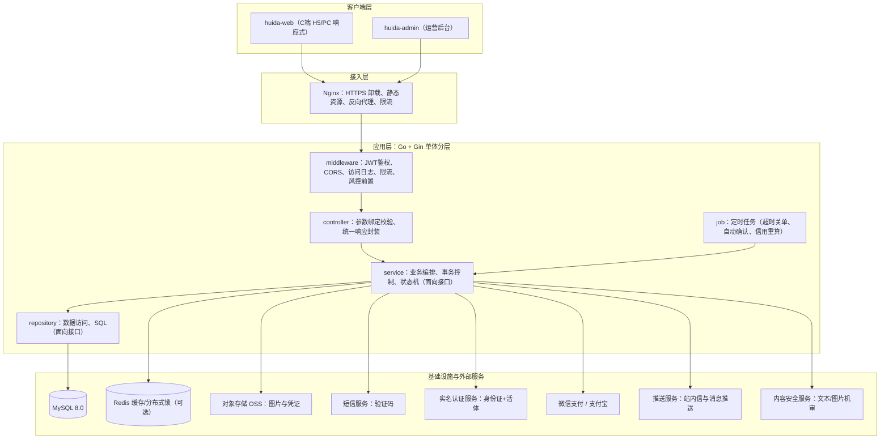
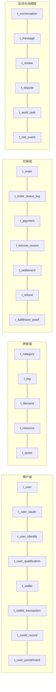
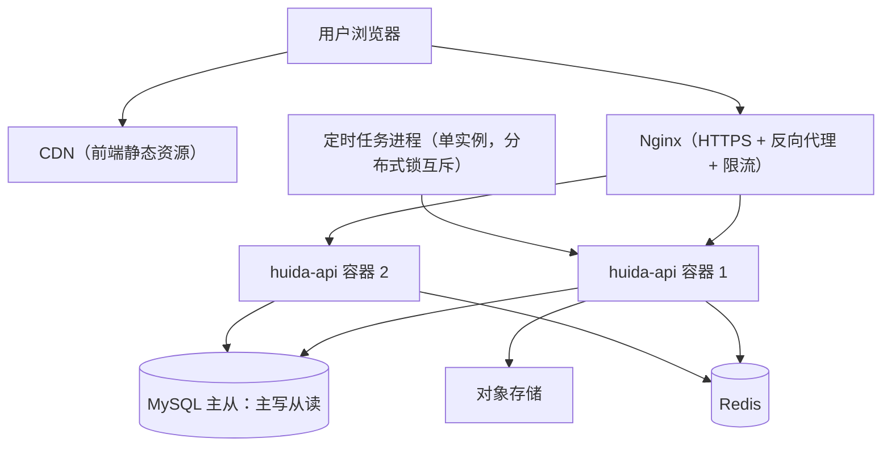
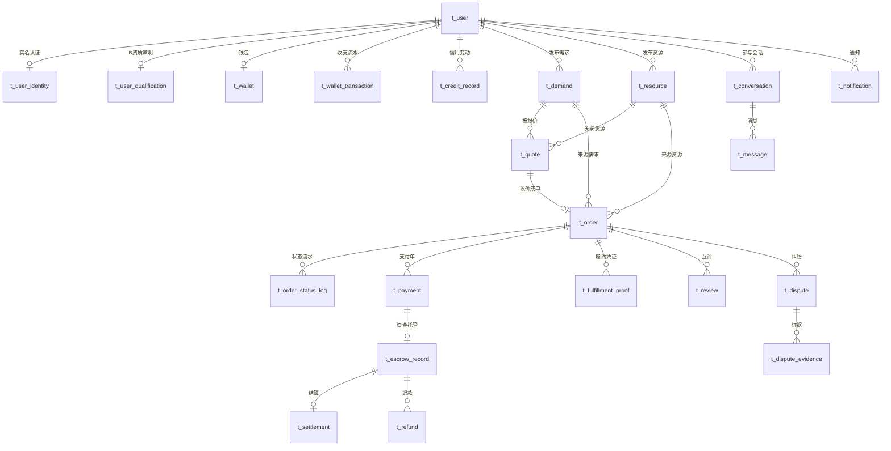
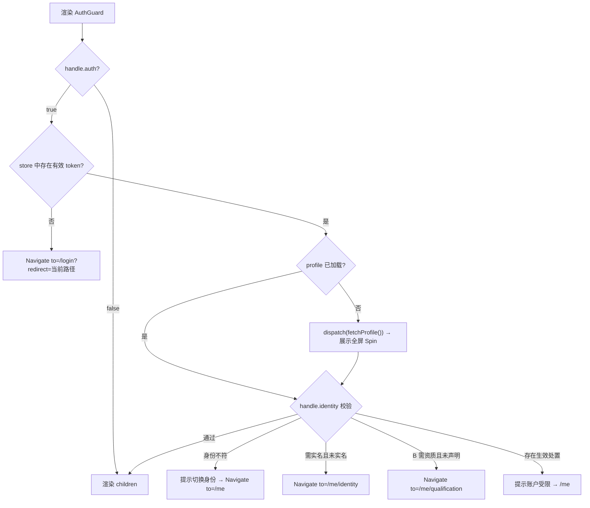

# 惠搭 HuiDa 消费优惠资源撮合平台 开发文档（DEV101）

## 1. 文档说明

### 1.1 文档目的

本文档依据 `sdp/PRD201.md`（MVP 精简版需求文档）与 `tpl/dev_rules.md`（开发规范模板）编写，目标是把 MVP 的全部 P0 需求转化为**可直接落地的技术实现方案**，为前后端开发、测试、运维提供统一的实现依据。

具体目的：

1. 明确系统整体架构、技术栈选型与工程目录结构，统一团队技术认知。
2. 给出完整的数据库设计（表结构、字段、索引、关系），作为建库建表的直接依据。
3. 给出完整的 API 接口设计（规范、清单、关键接口报文），作为前后端联调契约。
4. 给出前端页面设计（应用划分、路由、页面清单、状态管理），作为前端开发依据。
5. 明确代码、API、数据库、安全、测试与协作规范，保证代码质量与一致性。
6. 拆解开发里程碑与任务，明确交付顺序与依赖关系。

### 1.2 文档范围

**范围内（对应 PRD201.md 全部 P0 需求）：**

| 模块编号 | 模块名称 | 关联需求 |
|---|---|---|
| M1 | 用户与账户 | FR-USER-01/02/03/05/07 |
| M2 | 需求发布与管理（A） | FR-DEM-01/02/03/05 |
| M3 | 优惠资源发布与管理（B） | FR-RES-01/02/03/05/06 |
| M4 | 撮合与匹配 | FR-MATCH-01/02/03/05/06 |
| M5 | 沟通与协商 | FR-CHAT-01/02 |
| M6 | 交易与支付（担保托管） | FR-TRADE-01~06 |
| M7 | 服务履约 | FR-FULFILL-01/02 |
| M8 | 信用与评价 | FR-CREDIT-01/02/03 |
| M9 | 纠纷与售后 | FR-DISPUTE-01/02/03/04 |
| M10 | 合规与风控 | FR-RISK-01/02/04 |
| M11 | 消息通知 | FR-NOTIFY-01/02 |
| M12 | 平台运营后台 | FR-ADMIN-01/02/03/04 |

**范围外（本文档不涉及）：**

1. PRD101.md 中已裁剪的 P1/P2 可选项（如智能推荐算法、多城市运营策略、营销活动等）。
2. iOS/Android 原生客户端（MVP 仅提供 Web + H5 响应式前端）。
3. 第三方支付、实名认证、短信通道的商务对接流程（本文档只定义技术接入方式与接口抽象）。
4. 大数据数仓、BI 报表体系（MVP 仅提供后台基础统计看板）。

### 1.3 参考文档

| 文档 | 路径 | 说明 |
|---|---|---|
| 需求文档（MVP 精简版） | `sdp/PRD201.md` | 本文档的需求来源，所有设计均须可追溯至 FR 编号 |
| 需求文档（完整版） | `sdp/PRD101.md` | 含 P1/P2 全量需求，用于架构预留参考 |
| Idea 简要说明 | `sdp/IDEA201.md` | 产品定位与业务背景 |
| 原始 Idea | `sdp/IDEA101.md` | 产品创意来源 |
| 需求规范 | `tpl/prd_rules.md` | PRD 编写规范 |
| 开发规范 | `tpl/dev_rules.md` | 本文档的结构与技术栈约束来源 |

**术语约定：**

| 术语 | 含义 |
|---|---|
| A / 需求方 | 有消费需求、缺少优惠资源的用户（buyer） |
| B / 资源方 | 拥有优惠资源、提供代下单/代购等合规服务的用户（seller） |
| 担保交易 | A 支付的款项先由平台托管冻结，确认履约后再结算给 B |
| 托管资金 | 处于冻结状态、尚未结算的交易资金 |
| 履约凭证 | B 完成服务后提交的证明材料（订单截图、券码、配送信息等） |
| 信用分 | 基于实名、履约率、评价、纠纷与违规记录计算的用户信用评分 |
| MVP | 最小可行产品，本文档全部范围 |

---

## 2. 系统架构设计

### 2.1 整体架构

系统采用「前后端分离 + 单体分层服务」架构。MVP 阶段后端为一个 Go 单体应用（内部按业务模块划分包），前端为两个独立 React 应用（C 端与运营后台），数据统一存储于 MySQL。单体分层便于快速交付与后续按模块拆分微服务。



**分层职责与依赖规则：**

| 层级 | 职责 | 允许依赖 | 禁止事项 |
|---|---|---|---|
| middleware | 鉴权、跨域、日志、限流、恢复 panic、注入上下文用户 | utils、config | 编写业务逻辑 |
| controller | HTTP 参数绑定与校验、调用 service、封装统一响应 | service 接口、model | 直接访问 repo、编写 SQL、处理事务 |
| service | 业务规则、流程编排、状态机流转、事务边界、领域事件 | repo 接口、model、外部服务客户端 | 出现 `*http.Request`、直接拼 SQL |
| repository | 数据持久化、SQL 语句、结果集映射 | model、database/sql | 编写业务判断、跨表事务编排 |
| model | 实体 struct、请求/响应 DTO、枚举常量、错误定义 | 无 | 包含业务逻辑 |
| job | 定时任务调度，仅调用 service | service 接口 | 直接访问 repo |

**核心业务闭环在架构上的落点：**

```mermaid
flowchart LR
    P["发布（demand/resource）"] --> A["审核（audit_task）"]
    A --> M["撮合（match/search）"]
    M --> Q["议价（quote/conversation）"]
    Q --> O["订单（order 状态机）"]
    O --> PAY["托管支付（payment/escrow）"]
    PAY --> F["履约（fulfillment_proof）"]
    F --> C["确认结算（settlement/wallet）"]
    C --> R["评价与信用（review/credit_record）"]
    F -. 异议 .-> D["纠纷（dispute/refund）"]
    D -. 裁决 .-> C
```



**工程目录结构（后端，遵循 `tpl/dev_rules.md`）：**

```
backend
├── main.go                     # 程序入口：加载配置、初始化DB、注册路由、启动服务
├── go.mod
├── config
│   ├── config.go               # 配置结构体与加载逻辑（读取 config.yaml + 环境变量覆盖）
│   └── config.yaml             # 配置文件（数据库、JWT、OSS、支付、短信等）
├── routes
│   ├── router.go               # 路由总入口：挂载 v1、admin/v1、公共中间件
│   ├── v1
│   │   ├── auth_routes.go      # 认证与登录
│   │   ├── user_routes.go      # 用户、实名、资质、钱包
│   │   ├── demand_routes.go    # 需求
│   │   ├── resource_routes.go  # 资源
│   │   ├── quote_routes.go     # 报价议价
│   │   ├── match_routes.go     # 搜索与匹配
│   │   ├── chat_routes.go      # 会话与消息
│   │   ├── order_routes.go     # 订单与履约
│   │   ├── payment_routes.go   # 支付与回调
│   │   ├── dispute_routes.go   # 纠纷与退款
│   │   ├── review_routes.go    # 评价与信用
│   │   └── notify_routes.go    # 通知与协议
│   └── admin
│       └── v1
│           ├── admin_auth_routes.go
│           ├── audit_routes.go     # 内容审核台
│           ├── order_routes.go     # 订单与资金
│           ├── dispute_routes.go   # 纠纷工作台
│           ├── user_routes.go      # 用户与信用
│           ├── risk_routes.go      # 风控
│           └── system_routes.go    # 管理员、角色、权限、配置、日志
├── controller
│   ├── auth_controller.go
│   ├── user_controller.go
│   ├── wallet_controller.go
│   ├── demand_controller.go
│   ├── resource_controller.go
│   ├── quote_controller.go
│   ├── match_controller.go
│   ├── chat_controller.go
│   ├── order_controller.go
│   ├── payment_controller.go
│   ├── dispute_controller.go
│   ├── review_controller.go
│   ├── notify_controller.go
│   └── admin
│       ├── audit_controller.go
│       ├── order_controller.go
│       ├── dispute_controller.go
│       ├── user_controller.go
│       ├── risk_controller.go
│       └── system_controller.go
├── service
│   ├── InterfaceService.go     # 全部 service 接口定义
│   ├── AuthService.go
│   ├── UserService.go
│   ├── WalletService.go
│   ├── DemandService.go
│   ├── ResourceService.go
│   ├── QuoteService.go
│   ├── MatchService.go
│   ├── ChatService.go
│   ├── OrderService.go         # 订单状态机
│   ├── PaymentService.go       # 担保支付与托管
│   ├── SettleService.go        # 结算与退款
│   ├── FulfillService.go       # 履约凭证
│   ├── ReviewService.go
│   ├── CreditService.go
│   ├── DisputeService.go
│   ├── RiskService.go          # 风控规则引擎
│   ├── AuditService.go         # 内容审核
│   ├── NotifyService.go
│   ├── AgreementService.go
│   └── AdminService.go
├── repository
│   ├── InterfaceRepository.go  # 全部 repository 接口定义
│   ├── UserRepository.go
│   ├── UserOauthRepository.go
│   ├── IdentityRepository.go
│   ├── WalletRepository.go
│   ├── CategoryRepository.go
│   ├── TagRepository.go
│   ├── DemandRepository.go
│   ├── ResourceRepository.go
│   ├── QuoteRepository.go
│   ├── ConversationRepository.go
│   ├── MessageRepository.go
│   ├── OrderRepository.go
│   ├── PaymentRepository.go
│   ├── EscrowRepository.go
│   ├── SettleRepository.go
│   ├── RefundRepository.go
│   ├── ProofRepository.go
│   ├── ReviewRepository.go
│   ├── CreditRepository.go
│   ├── DisputeRepository.go
│   ├── RiskRepository.go
│   ├── AuditRepository.go
│   ├── ReportRepository.go
│   ├── NotifyRepository.go
│   ├── AgreementRepository.go
│   ├── PunishmentRepository.go
│   ├── AdminRepository.go
│   ├── ConfigRepository.go
│   └── MatchRepository.go
├── model
│   ├── UserModel.go            # User、UserOauth、UserIdentity、CreateUserRequest...
│   ├── WalletModel.go          # Wallet、WalletTransaction、WithdrawRequest...
│   ├── DemandModel.go          # Demand、CreateDemandRequest、DemandListResponse...
│   ├── ResourceModel.go        # Resource、CreateResourceRequest...
│   ├── QuoteModel.go           # Quote、CreateQuoteRequest...
│   ├── ChatModel.go            # Conversation、Message、SendMessageRequest...
│   ├── OrderModel.go           # Order、OrderStatusLog、CreateOrderRequest...
│   ├── PaymentModel.go         # Payment、EscrowRecord、Settlement、Refund...
│   ├── FulfillModel.go         # FulfillmentProof、SubmitProofRequest...
│   ├── ReviewModel.go          # Review、CreditRecord...
│   ├── DisputeModel.go         # Dispute、DisputeEvidence、VerdictRequest...
│   ├── RiskModel.go            # RiskEvent、RiskRule、AuditTask、Report...
│   ├── NotifyModel.go          # Notification、NotificationListRequest...
│   ├── AdminModel.go           # AdminUser、AdminRole、AdminPermission、OperationLog...
│   ├── CommonModel.go          # Response、PageRequest、PageResult、IDRequest...
│   ├── ErrCodeModel.go         # 业务错误码常量与错误映射
│   └── EnumModel.go            # 全部枚举常量（订单状态、支付渠道、审核状态等）
├── middleware
│   ├── JwtMiddleware.go        # JWT 鉴权，解析用户并注入 context
│   ├── AdminAuthMiddleware.go  # 后台鉴权 + RBAC 权限校验
│   ├── CorsMiddleware.go       # 跨域
│   ├── LoggerMiddleware.go     # 访问日志（trace_id、耗时、状态码）
│   ├── RecoveryMiddleware.go   # panic 恢复
│   ├── RateLimitMiddleware.go  # 接口限流
│   ├── IdentityMiddleware.go   # 身份（A/B）与实名状态校验
│   └── RiskMiddleware.go       # 高风险请求前置拦截
├── pkg
│   ├── database                # MySQL 连接池初始化、事务辅助 WithTx
│   ├── logger                  # 日志封装（分级、滚动、trace_id）
│   ├── jwt                     # Token 生成与解析
│   ├── crypto                  # 敏感信息加解密（身份证、手机号脱敏）
│   ├── validator               # 参数校验扩展（手机号、金额、枚举）
│   ├── oss                     # 对象存储上传客户端
│   ├── sms                     # 短信通道客户端（接口化，便于替换）
│   ├── kyc                     # 实名认证通道客户端（接口化）
│   ├── payment                 # 微信支付/支付宝客户端（接口化）
│   ├── contentsafe             # 内容安全机审客户端（接口化）
│   ├── push                    # 推送通道客户端（接口化）
│   └── idgen                   # 业务编号生成（订单号、报价号等）
├── job
│   ├── scheduler.go            # 任务注册与调度（cron）
│   ├── order_timeout_job.go    # 待支付超时关单
│   ├── auto_confirm_job.go     # 待确认超时自动确认并结算
│   ├── quote_expire_job.go     # 报价过期
│   ├── credit_recalc_job.go    # 信用分周期重算
│   └── risk_scan_job.go        # 风控离线扫描
├── logs                        # 运行日志目录（gitignore）
└── test
    ├── service                 # service 单元测试
    ├── repository              # repo 集成测试（依赖测试库）
    └── api                     # 接口级测试
```

**工程目录结构（前端，两个应用）：**

```
frontend
├── huida-web                       # C 端（H5 + PC 响应式）
│   ├── index.html
│   ├── package.json
│   ├── vite.config.ts
│   ├── tsconfig.json
│   ├── .env.development / .env.production
│   └── src
│       ├── main.tsx                # 入口：Provider 包裹（Redux、Router、AntdApp、ConfigProvider）
│       ├── App.tsx                 # 根组件：路由出口 + 全局布局
│       ├── router
│       │   ├── index.tsx           # createBrowserRouter 路由表
│       │   └── AuthGuard.tsx       # 鉴权/身份/实名守卫组件
│       ├── api                     # 接口定义（按模块拆分，如 order.ts、demand.ts）
│       ├── store                   # Redux Toolkit
│       │   ├── index.ts            # configureStore + 根 reducer + 类型导出
│       │   └── slices              # userSlice、orderSlice、chatSlice...
│       ├── hooks                   # 自定义 Hook（useAuth、usePolling、usePagination...）
│       ├── components              # 通用组件（PascalCase 目录 + index.tsx）
│       ├── layouts                 # TabBarLayout（移动端）、UserCenterLayout、BlankLayout
│       ├── pages                   # 页面组件（按模块分目录）
│       ├── assets                  # 静态资源
│       ├── styles                  # 全局样式、主题 token、响应式断点
│       ├── types                   # 全局 TS 类型（接口 DTO 定义）
│       ├── constants               # 枚举与映射（订单状态、错误码）
│       └── utils                   # request.ts、format.ts、validate.ts、storage.ts
└── huida-admin                     # 运营后台
    └── src
        ├── main.tsx / App.tsx / router / api / store / hooks / components / layouts / pages / utils
```

### 2.2 技术栈选择

#### 2.2.1 前端技术栈

前端采用 **React 18 + Ant Design 5 + Redux Toolkit** 技术栈（依据 `tpl/dev_rules.md` 第 10 行的 “React” 并经技术负责人确认）。

| 分类 | 选型 | 版本 | 用途说明 |
|---|---|---|---|
| 核心框架 | react / react-dom | ^18.3 | 视图层框架，统一使用函数组件 + Hooks，禁止新增 class 组件 |
| UI 组件库 | antd | ^5.x | 表单、表格、弹窗、上传、步骤条等；C 端与后台共用，通过 `ConfigProvider` 定制主题 token |
| 图标 | @ant-design/icons | ^5.x | 按需引入图标 |
| 路由 | react-router-dom | ^6.x | `createBrowserRouter` 数据路由、`React.lazy` 懒加载、`AuthGuard` 守卫 |
| 状态管理 | @reduxjs/toolkit + react-redux | ^2.x / ^9.x | `createSlice` + `createAsyncThunk` 管理用户身份、钱包、通知未读数、订单等跨页面状态 |
| 服务端状态 | @tanstack/react-query（可选） | ^5.x | 列表/详情的缓存、重试与轮询；MVP 若团队不熟悉则由 RTK Query 或 slice 内 thunk 承担 |
| HTTP | axios | ^1.x | 统一封装拦截器：Token 注入、错误提示、幂等键、trace_id |
| 构建工具 | vite + @vitejs/plugin-react | ^5.x / ^4.x | 开发热更新与生产构建 |
| 语言 | TypeScript | ^5.4 | 全量启用 `strict`，接口 DTO 与枚举集中定义在 `types/`、`constants/` |
| CSS 方案 | antd 5 CSS-in-JS token + CSS Modules（`.module.less`） | - | 主题变量统一；禁止全局样式污染 |
| 移动端适配 | postcss-px-to-viewport + antd `Grid` 响应式栅格 | - | H5 与 PC 共用一套代码 |
| 表单 | antd `Form` + `dayjs` | - | 复杂表单统一使用受控 `Form` 实例，校验规则与后端 validator 对齐 |
| 工具库 | dayjs、lodash-es | - | 时间处理、通用工具函数 |
| 图表（后台） | @ant-design/charts 或 echarts | - | 后台运营看板 |
| 代码质量 | ESLint（eslint-plugin-react、react-hooks）+ Prettier + husky + lint-staged | - | 提交前自动检查 |
| 测试 | Vitest + React Testing Library + Playwright（E2E） | - | 组件测试与主链路 E2E |

> **说明**：`tpl/dev_rules.md` 第 10 行同时出现 “React” 与 Vue 生态依赖清单（`ant-design-vue`、`vue`、`vuex`、`vue-router`），经确认**以 React 为准**，依赖对应替换为 `react`、`react-dom`、`antd`、`react-router-dom`、`@reduxjs/toolkit`、`react-redux`、`axios`。第 8 章 Q1 已标记为已确认。

#### 2.2.2 后端技术栈

| 分类 | 选型 | 版本 | 用途说明 |
|---|---|---|---|
| 语言 | Go | 1.22+ | 后端开发语言 |
| Web 框架 | github.com/gin-gonic/gin | v1.9+ | 路由、中间件、参数绑定 |
| 数据库驱动 | github.com/go-sql-driver/mysql | v1.8+ | MySQL 驱动，配合标准库 `database/sql` |
| ORM | 不使用 ORM | - | 直接使用 `database/sql` 手写 SQL，SQL 统一收敛在 repository 层 |
| 鉴权 | github.com/golang-jwt/jwt/v5 | v5.x | JWT 生成与校验 |
| 配置 | github.com/spf13/viper | v1.18+ | 读取 `config.yaml`，支持环境变量覆盖 |
| 日志 | go.uber.org/zap + lumberjack | v1.27+ | 结构化日志、按天与大小滚动，输出至 `logs/` |
| 参数校验 | github.com/go-playground/validator/v10 | v10.x | struct tag 校验，注册中文错误提示与自定义规则 |
| 定时任务 | github.com/robfig/cron/v3 | v3.x | 超时关单、自动确认等任务 |
| 缓存（可选） | github.com/redis/go-redis/v9 | v9.x | 验证码、限流计数、分布式锁、热点数据缓存 |
| 唯一 ID | 雪花算法（sonyflake/bwmarrin） | - | 业务编号（订单号、报价号）生成，避免自增 ID 外泄 |
| 单元测试 | testing + testify + sqlmock | - | service 单测与 repo 测试 |
| 接口文档 | swaggo/swag（注解生成 Swagger） | v1.16+ | 自动生成 OpenAPI 文档 |

**分层调用链（`tpl/dev_rules.md` 约定）：controller → interface → service → interface → repo**

即：controller 依赖 `service.InterfaceService.go` 中定义的接口；service 实现依赖 `repository.InterfaceRepository.go` 中定义的接口；repo 为实现层。接口与实现分离，便于单测 Mock 与后续替换实现。

**接口定义示例：**

```go
// service/InterfaceService.go
package service

// OrderService 订单业务接口，controller 层仅依赖该接口
type OrderService interface {
    // CreateOrder 创建订单（需求驱动或资源驱动），返回订单号
    CreateOrder(ctx context.Context, req *model.CreateOrderRequest) (*model.CreateOrderResponse, error)
    // CancelOrder 取消订单（仅待支付状态可取消）
    CancelOrder(ctx context.Context, orderID int64, op *model.Operator) error
    // ConfirmOrder A 确认完成，触发结算
    ConfirmOrder(ctx context.Context, orderID int64, op *model.Operator) error
}
```

```go
// repository/InterfaceRepository.go
package repository

// OrderRepository 订单数据访问接口
type OrderRepository interface {
    Insert(ctx context.Context, order *model.Order) (int64, error)
    GetByID(ctx context.Context, id int64) (*model.Order, error)
    GetByOrderNo(ctx context.Context, orderNo string) (*model.Order, error)
    // UpdateStatusCAS 基于原状态的 CAS 更新，保证状态机并发安全
    UpdateStatusCAS(ctx context.Context, id int64, fromStatus, toStatus int) (int64, error)
    ListByCondition(ctx context.Context, q *model.OrderQuery) ([]*model.Order, int64, error)
}
```

**统一响应格式（`tpl/dev_rules.md` 约定）：**

```json
{
  "code": 200,
  "message": "成功",
  "result": {}
}
```

```go
// model/CommonModel.go
// Response 全接口统一响应结构，result 可为对象、数组或空字符串
type Response struct {
    Code    int         `json:"code"`
    Message string      `json:"message"`
    Result  interface{} `json:"result"`
}
```

**事务与一致性约定：**

1. 事务边界只允许出现在 service 层，通过 `database.WithTx(ctx, fn)` 统一开启、提交与回滚。
2. 涉及「订单状态 + 资金 + 流水」的操作必须在同一事务内完成；跨外部系统（支付回调）通过幂等 + 本地消息表补偿。
3. 并发状态流转使用 `UpdateStatusCAS`（`WHERE id = ? AND status = ?`）保证只有一个请求成功。
4. 钱包余额变更必须使用乐观锁（`WHERE user_id = ? AND version = ?`）并写入流水表，禁止直接 `UPDATE ... SET balance = 值`。

#### 2.2.3 数据库

**仅使用关系型数据库 MySQL**（`tpl/dev_rules.md` 约定）。

| 项 | 约定 |
|---|---|
| 版本 | MySQL 8.0.32+ |
| 存储引擎 | InnoDB（全部表） |
| 字符集 / 排序规则 | utf8mb4 / utf8mb4_general_ci |
| 数据库名 | `huida`（生产）、`huida_test`（测试） |
| 时区 | 服务端与应用统一 `+08:00`，时间字段使用 `DATETIME` |
| 金额 | 一律使用 `INT`/`BIGINT` 存储**分**，禁止使用 FLOAT/DOUBLE |
| 主键 | `id BIGINT UNSIGNED AUTO_INCREMENT`；对外暴露业务编号（如 `order_no`） |
| 软删除 | 需要保留追溯的表使用 `deleted_at DATETIME NULL`，查询默认过滤 `deleted_at IS NULL` |
| 通用字段 | `created_at`、`updated_at` 必备；`deleted_at`、`version` 按需 |
| 缓存 | Redis 仅作缓存与分布式锁，**不作为数据源**，缓存丢失不影响数据正确性 |

**数据库分层（逻辑分组，物理上同库）：**



#### 2.2.4 部署与运维

**环境划分：**

| 环境 | 用途 | 域名（示例） | 数据库 |
|---|---|---|---|
| dev | 本地开发联调 | localhost | 本地 MySQL 8.0 |
| test | 测试验证 | test.huida.internal | `huida_test` |
| prod | 生产 | api.huida.com / www.huida.com / admin.huida.com | `huida` |

**部署拓扑（MVP）：**



**容器化与编排：**

1. 后端镜像基于 `golang:1.22-alpine` 构建、`alpine:3.19` 运行，多阶段构建减小体积。
2. 前端构建产物由 Nginx 镜像托管，`huida-web` 与 `huida-admin` 分别部署在不同 server 或不同路径。
3. MVP 使用 `docker-compose` 编排（api × 2、nginx、mysql、redis、job）；后续可平滑迁移至 Kubernetes。
4. 配置通过环境变量注入（`HUIDA_ENV`、`MYSQL_DSN`、`JWT_SECRET`、支付与短信密钥），**禁止把生产密钥写入代码仓库**。

**CI/CD 流程：**

```
提交 MR → 代码评审 → 流水线（go vet + golangci-lint + go test + 前端 lint + 构建）
       → 构建镜像并推送仓库 → 部署 test 环境 → 冒烟测试 → 人工确认 → 部署 prod（滚动发布）
```

**运维与可观测性：**

| 项 | 方案 |
|---|---|
| 日志 | zap 结构化 JSON 日志，按天与 100MB 滚动，保留 30 天；每请求注入 `trace_id` |
| 健康检查 | `GET /health`（存活）、`GET /ready`（含 DB/Redis 连通性） |
| 监控告警 | Prometheus + Grafana（QPS、P99 延迟、错误率、DB 连接池）；关键业务指标：待支付订单积压、托管资金总额、结算失败数、纠纷数 |
| 资金对账 | 每日定时对账任务：`t_payment` ↔ 第三方账单、`t_escrow_record` ↔ `t_wallet_transaction`，差异告警 |
| 数据备份 | MySQL 每日全量备份 + binlog 增量，保留 30 天；每季度做一次恢复演练 |
| 安全 | 全站 HTTPS、敏感字段加密存储、后台 IP 白名单、接口限流、SQL 全部参数化 |

---

## 3. 数据库设计

### 3.1 数据库概述

**设计原则：**

1. **单一职责**：一张表只描述一个业务实体，敏感信息（身份证号）独立成表并加密存储。
2. **状态可追溯**：订单、纠纷、审核、资金等关键实体除主状态字段外，均有对应的流水/日志表。
3. **金额分为单位**：所有金额字段类型为 `INT`/`BIGINT`，单位为**分**，字段注释统一标注「单位：分」。
4. **枚举显式化**：所有状态/类型字段使用 `TINYINT` + 注释枚举，枚举常量在 `model/EnumModel.go` 中集中定义，禁止魔法数字散落。
5. **反范式适度**：为列表查询性能，允许冗余少量字段（如订单中的商品标题、用户中的信用分），冗余字段须注明来源与同步时机。
6. **索引最小充分**：只为高频查询条件建索引，联合索引遵循最左前缀；禁止在低区分度字段上单独建索引。
7. **不使用外键约束**：关联关系在应用层保证（便于分库与数据迁移），但必须建立对应索引。

**表清单总览（共 43 张）：**

| 域 | 表名 | 说明 | 关联需求 |
|---|---|---|---|
| 用户域 | t_user | 用户主表 | FR-USER-01/02 |
| 用户域 | t_user_oauth | 第三方登录绑定 | FR-USER-01 |
| 用户域 | t_user_identity | 实名认证信息 | FR-USER-03 |
| 用户域 | t_user_qualification | B 资质与合规声明 | FR-USER-05 |
| 用户域 | t_wallet | 钱包账户 | FR-USER-07 |
| 用户域 | t_wallet_transaction | 钱包收支流水 | FR-USER-07 |
| 用户域 | t_credit_record | 信用分变动记录 | FR-CREDIT-02 |
| 用户域 | t_user_punishment | 用户处置记录 | FR-DISPUTE-04 |
| 用户域 | t_sms_code | 短信验证码 | FR-USER-01 |
| 供给域 | t_category | 消费场景分类 | FR-DEM-02、FR-MATCH-02 |
| 供给域 | t_tag | 标签字典 | FR-DEM-02 |
| 供给域 | t_tag_relation | 标签关联关系 | FR-DEM-02 |
| 供给域 | t_demand | 消费需求 | FR-DEM-01/02/03 |
| 供给域 | t_resource | 优惠资源（含合规声明） | FR-RES-01、FR-RES-02、FR-RES-03 |
| 供给域 | t_quote | 报价与议价 | FR-RES-06 |
| 供给域 | t_match_result | 规则匹配结果 | FR-MATCH-03/05 |
| 交易域 | t_order | 订单主表 | FR-TRADE-01/04/05 |
| 交易域 | t_order_status_log | 订单状态流水 | FR-TRADE-05 |
| 交易域 | t_payment | 支付单 | FR-TRADE-02/03 |
| 交易域 | t_escrow_record | 资金托管记录 | FR-TRADE-02 |
| 交易域 | t_settlement | 结算记录 | FR-TRADE-06 |
| 交易域 | t_refund | 退款记录 | FR-DISPUTE-03 |
| 交易域 | t_fulfillment_proof | 履约凭证 | FR-FULFILL-01/02 |
| 互动治理域 | t_conversation | 会话 | FR-CHAT-01 |
| 互动治理域 | t_message | 聊天消息 | FR-CHAT-01/02 |
| 互动治理域 | t_review | 交易评价 | FR-CREDIT-01/03 |
| 互动治理域 | t_dispute | 纠纷申诉 | FR-DISPUTE-01/02 |
| 互动治理域 | t_dispute_evidence | 纠纷证据 | FR-DISPUTE-01 |
| 互动治理域 | t_dispute_log | 纠纷处理流水 | FR-DISPUTE-02 |
| 互动治理域 | t_audit_task | 内容审核任务 | FR-RISK-01、FR-ADMIN-01 |
| 互动治理域 | t_report | 举报 | FR-ADMIN-01 |
| 互动治理域 | t_risk_rule | 风控规则 | FR-RISK-02 |
| 互动治理域 | t_risk_event | 风控事件 | FR-RISK-02 |
| 通知域 | t_notification | 站内通知 | FR-NOTIFY-01/02 |
| 合规域 | t_agreement | 协议版本 | FR-RISK-04 |
| 合规域 | t_user_agreement | 用户协议签署记录 | FR-RISK-04 |
| 后台域 | t_admin_user | 后台管理员账号 | FR-ADMIN-01~04 |
| 后台域 | t_admin_role | 后台角色（OP/CS/RISK/SUPER） | FR-ADMIN-01~04 |
| 后台域 | t_admin_permission | 后台权限（菜单/操作） | FR-ADMIN-01~04 |
| 后台域 | t_admin_user_role | 管理员-角色关联 | FR-ADMIN-01~04 |
| 后台域 | t_admin_role_permission | 角色-权限关联 | FR-ADMIN-01~04 |
| 后台域 | t_operation_log | 后台操作日志（审计） | FR-ADMIN-01~04 |
| 后台域 | t_config | 系统业务配置 | 全局 |

**核心实体关系图：**



### 3.2 数据表设计

#### 3.2.1 用户域

**（1）t_user 用户主表**

```sql
CREATE TABLE `t_user` (
  `id`               BIGINT UNSIGNED NOT NULL AUTO_INCREMENT COMMENT '用户ID',
  `mobile`           VARCHAR(20)     NOT NULL COMMENT '手机号，登录账号',
  `nickname`         VARCHAR(64)     NOT NULL DEFAULT '' COMMENT '昵称',
  `avatar_url`       VARCHAR(512)    NOT NULL DEFAULT '' COMMENT '头像URL',
  `gender`           TINYINT         NOT NULL DEFAULT 0 COMMENT '性别：0未知 1男 2女',
  `city_code`        VARCHAR(16)     NOT NULL DEFAULT '' COMMENT '常驻城市编码',
  `city_name`        VARCHAR(64)     NOT NULL DEFAULT '' COMMENT '常驻城市名称',
  `realname_status`  TINYINT         NOT NULL DEFAULT 0 COMMENT '实名状态：0未认证 1审核中 2已认证 3认证失败',
  `current_identity` TINYINT         NOT NULL DEFAULT 0 COMMENT '当前身份：0未选择 1需求方A 2资源方B',
  `enable_a`         TINYINT         NOT NULL DEFAULT 1 COMMENT '是否开通A身份：0否 1是',
  `enable_b`         TINYINT         NOT NULL DEFAULT 0 COMMENT '是否开通B身份（需资质声明）：0否 1是',
  `credit_score`     INT             NOT NULL DEFAULT 100 COMMENT '信用分（冗余，来源 t_credit_record 累计）',
  `credit_level`     TINYINT         NOT NULL DEFAULT 1 COMMENT '信用等级：1-5（冗余，按分数区间计算）',
  `total_deal_count` INT             NOT NULL DEFAULT 0 COMMENT '累计成交单数（冗余，订单完成时+1）',
  `good_rate`        DECIMAL(5,2)    NOT NULL DEFAULT 100.00 COMMENT '好评率%（冗余，评价写入时重算）',
  `status`           TINYINT         NOT NULL DEFAULT 1 COMMENT '账户状态：0封禁 1正常 2限权',
  `register_channel` VARCHAR(32)     NOT NULL DEFAULT 'sms' COMMENT '注册渠道：sms/wechat/alipay',
  `last_login_at`    DATETIME        NULL DEFAULT NULL COMMENT '最近登录时间',
  `created_at`       DATETIME        NOT NULL DEFAULT CURRENT_TIMESTAMP COMMENT '创建时间',
  `updated_at`       DATETIME        NOT NULL DEFAULT CURRENT_TIMESTAMP ON UPDATE CURRENT_TIMESTAMP COMMENT '更新时间',
  `deleted_at`       DATETIME        NULL DEFAULT NULL COMMENT '软删除时间',
  PRIMARY KEY (`id`),
  UNIQUE KEY `uk_mobile` (`mobile`),
  KEY `idx_identity_credit` (`current_identity`, `credit_score`),
  KEY `idx_city_status` (`city_code`, `status`),
  KEY `idx_created_at` (`created_at`)
) ENGINE=InnoDB DEFAULT CHARSET=utf8mb4 COLLATE=utf8mb4_general_ci COMMENT='用户主表';
```

| 关键字段 | 业务规则 |
|---|---|
| `mobile` | 唯一，注册即创建；同一手机号不允许重复注册（FR-USER-01） |
| `realname_status` | 为 2 之前禁止发布需求/资源与下单（FR-USER-03） |
| `enable_b` | 须先完成实名 + 签署合规使用承诺（`t_user_qualification`）后置 1（FR-USER-05） |
| `current_identity` | 前端身份切换写入，仅影响展示与权限校验，不影响数据归属（FR-USER-02） |
| `credit_score` | 由 `CreditService` 在信用事件发生时更新，初始 100，范围 0-200 |

**（2）t_user_oauth 第三方登录绑定表**

```sql
CREATE TABLE `t_user_oauth` (
  `id`           BIGINT UNSIGNED NOT NULL AUTO_INCREMENT COMMENT '主键',
  `user_id`      BIGINT UNSIGNED NOT NULL COMMENT '用户ID',
  `provider`     VARCHAR(32)     NOT NULL COMMENT '第三方平台：wechat/alipay/apple',
  `open_id`      VARCHAR(128)    NOT NULL COMMENT '第三方 openid',
  `union_id`     VARCHAR(128)    NOT NULL DEFAULT '' COMMENT '第三方 unionid',
  `nickname`     VARCHAR(64)     NOT NULL DEFAULT '' COMMENT '第三方昵称',
  `avatar_url`   VARCHAR(512)    NOT NULL DEFAULT '' COMMENT '第三方头像',
  `access_token` VARCHAR(512)    NOT NULL DEFAULT '' COMMENT '访问令牌（加密存储）',
  `expire_at`    DATETIME        NULL DEFAULT NULL COMMENT '令牌过期时间',
  `created_at`   DATETIME        NOT NULL DEFAULT CURRENT_TIMESTAMP COMMENT '创建时间',
  `updated_at`   DATETIME        NOT NULL DEFAULT CURRENT_TIMESTAMP ON UPDATE CURRENT_TIMESTAMP COMMENT '更新时间',
  PRIMARY KEY (`id`),
  UNIQUE KEY `uk_provider_openid` (`provider`, `open_id`),
  KEY `idx_user_id` (`user_id`)
) ENGINE=InnoDB DEFAULT CHARSET=utf8mb4 COLLATE=utf8mb4_general_ci COMMENT='第三方登录绑定表';
```

**（3）t_user_identity 实名认证信息表**

```sql
CREATE TABLE `t_user_identity` (
  `id`               BIGINT UNSIGNED NOT NULL AUTO_INCREMENT COMMENT '主键',
  `user_id`          BIGINT UNSIGNED NOT NULL COMMENT '用户ID',
  `real_name`        VARCHAR(64)     NOT NULL COMMENT '真实姓名（明文，脱敏展示）',
  `id_card_no`       VARCHAR(256)    NOT NULL COMMENT '身份证号（AES-256 加密存储）',
  `id_card_no_mask`  VARCHAR(32)     NOT NULL DEFAULT '' COMMENT '身份证号掩码，如 110***********1234',
  `id_card_front_url` VARCHAR(512)   NOT NULL DEFAULT '' COMMENT '身份证人像面URL',
  `id_card_back_url` VARCHAR(512)    NOT NULL DEFAULT '' COMMENT '身份证国徽面URL',
  `face_verify_no`   VARCHAR(128)    NOT NULL DEFAULT '' COMMENT '活体检测流水号',
  `verify_channel`   VARCHAR(32)     NOT NULL DEFAULT '' COMMENT '认证通道：aliyun/tencent',
  `verify_status`    TINYINT         NOT NULL DEFAULT 0 COMMENT '认证状态：0待提交 1审核中 2通过 3失败',
  `verify_msg`       VARCHAR(256)    NOT NULL DEFAULT '' COMMENT '认证失败原因',
  `verified_at`      DATETIME        NULL DEFAULT NULL COMMENT '认证通过时间',
  `auditor_id`       BIGINT UNSIGNED NOT NULL DEFAULT 0 COMMENT '人工复核后台账号ID，0为纯机审',
  `created_at`       DATETIME        NOT NULL DEFAULT CURRENT_TIMESTAMP COMMENT '创建时间',
  `updated_at`       DATETIME        NOT NULL DEFAULT CURRENT_TIMESTAMP ON UPDATE CURRENT_TIMESTAMP COMMENT '更新时间',
  PRIMARY KEY (`id`),
  UNIQUE KEY `uk_user_id` (`user_id`),
  KEY `idx_verify_status` (`verify_status`),
  KEY `idx_id_card_mask` (`id_card_no_mask`)
) ENGINE=InnoDB DEFAULT CHARSET=utf8mb4 COLLATE=utf8mb4_general_ci COMMENT='用户实名认证信息表';
```

> **安全要求**：`id_card_no` 使用 `pkg/crypto` 中 AES-256-GCM 加密，密钥来自环境变量；接口返回一律使用 `id_card_no_mask`；身份证号原文仅后台风控角色在审计场景下可解密查看，且记录 `t_operation_log`。

**（4）t_user_qualification 资源方资质与合规声明表**

```sql
CREATE TABLE `t_user_qualification` (
  `id`                BIGINT UNSIGNED NOT NULL AUTO_INCREMENT COMMENT '主键',
  `user_id`           BIGINT UNSIGNED NOT NULL COMMENT '用户ID（B）',
  `agreement_code`    VARCHAR(64)     NOT NULL COMMENT '协议编码：compliance_promise',
  `agreement_version` VARCHAR(16)     NOT NULL COMMENT '签署时协议版本',
  `resource_types`    VARCHAR(256)    NOT NULL DEFAULT '' COMMENT '声明的资源类型，逗号分隔：coupon,member,group,promo',
  `platform_names`    VARCHAR(512)    NOT NULL DEFAULT '' COMMENT '适用平台名称，逗号分隔',
  `promise_text`      VARCHAR(512)    NOT NULL DEFAULT '' COMMENT '承诺补充说明',
  `sign_ip`           VARCHAR(64)     NOT NULL DEFAULT '' COMMENT '签署IP',
  `sign_ua`           VARCHAR(512)    NOT NULL DEFAULT '' COMMENT '签署UA',
  `audit_status`      TINYINT         NOT NULL DEFAULT 1 COMMENT '审核状态：0待审 1通过 2驳回',
  `signed_at`         DATETIME        NOT NULL DEFAULT CURRENT_TIMESTAMP COMMENT '签署时间',
  `created_at`        DATETIME        NOT NULL DEFAULT CURRENT_TIMESTAMP COMMENT '创建时间',
  `updated_at`        DATETIME        NOT NULL DEFAULT CURRENT_TIMESTAMP ON UPDATE CURRENT_TIMESTAMP COMMENT '更新时间',
  PRIMARY KEY (`id`),
  UNIQUE KEY `uk_user_id` (`user_id`),
  KEY `idx_audit_status` (`audit_status`)
) ENGINE=InnoDB DEFAULT CHARSET=utf8mb4 COLLATE=utf8mb4_general_ci COMMENT='资源方资质与合规声明表（FR-USER-05）';
```

**（5）t_wallet 钱包账户表**

```sql
CREATE TABLE `t_wallet` (
  `id`             BIGINT UNSIGNED NOT NULL AUTO_INCREMENT COMMENT '主键',
  `user_id`        BIGINT UNSIGNED NOT NULL COMMENT '用户ID',
  `balance`        BIGINT          NOT NULL DEFAULT 0 COMMENT '可用余额，单位：分',
  `frozen`         BIGINT          NOT NULL DEFAULT 0 COMMENT '冻结金额（托管中/提现中），单位：分',
  `total_income`   BIGINT          NOT NULL DEFAULT 0 COMMENT '累计收入，单位：分',
  `total_expense`  BIGINT          NOT NULL DEFAULT 0 COMMENT '累计支出，单位：分',
  `pay_password`   VARCHAR(128)    NOT NULL DEFAULT '' COMMENT '支付密码哈希（提现校验，bcrypt）',
  `status`         TINYINT         NOT NULL DEFAULT 1 COMMENT '钱包状态：0冻结 1正常',
  `version`        INT             NOT NULL DEFAULT 0 COMMENT '乐观锁版本号',
  `created_at`     DATETIME        NOT NULL DEFAULT CURRENT_TIMESTAMP COMMENT '创建时间',
  `updated_at`     DATETIME        NOT NULL DEFAULT CURRENT_TIMESTAMP ON UPDATE CURRENT_TIMESTAMP COMMENT '更新时间',
  PRIMARY KEY (`id`),
  UNIQUE KEY `uk_user_id` (`user_id`)
) ENGINE=InnoDB DEFAULT CHARSET=utf8mb4 COLLATE=utf8mb4_general_ci COMMENT='用户钱包账户表（FR-USER-07）';
```

| 字段 | 规则 |
|---|---|
| `balance` | 可提现金额 = `balance`；不可为负，扣减前须校验 |
| `frozen` | A 支付成功后由托管流程记账（平台托管账户视角），B 侧提现中金额亦计入 |
| `version` | 每次变更 +1，`UPDATE ... WHERE user_id=? AND version=?`，失败即重试或报错 |

**（6）t_wallet_transaction 钱包流水表**

```sql
CREATE TABLE `t_wallet_transaction` (
  `id`              BIGINT UNSIGNED NOT NULL AUTO_INCREMENT COMMENT '主键',
  `txn_no`          VARCHAR(40)     NOT NULL COMMENT '流水号（唯一）',
  `user_id`         BIGINT UNSIGNED NOT NULL COMMENT '用户ID',
  `direction`       TINYINT         NOT NULL COMMENT '方向：1收入 2支出',
  `txn_type`        TINYINT         NOT NULL COMMENT '类型：1充值 2支付托管 3托管退回 4交易结算收入 5退款收入 6提现 7平台扣费 8后台调账',
  `amount`          BIGINT          NOT NULL COMMENT '发生金额，单位：分（正数）',
  `balance_before`  BIGINT          NOT NULL COMMENT '变动前可用余额，单位：分',
  `balance_after`   BIGINT          NOT NULL COMMENT '变动后可用余额，单位：分',
  `frozen_before`   BIGINT          NOT NULL COMMENT '变动前冻结金额，单位：分',
  `frozen_after`    BIGINT          NOT NULL COMMENT '变动后冻结金额，单位：分',
  `biz_type`        VARCHAR(32)     NOT NULL DEFAULT '' COMMENT '业务类型：order/refund/settle/withdraw/adjust',
  `biz_id`          BIGINT UNSIGNED NOT NULL DEFAULT 0 COMMENT '业务主键ID',
  `biz_no`          VARCHAR(40)     NOT NULL DEFAULT '' COMMENT '业务编号（订单号/退款号）',
  `remark`          VARCHAR(256)    NOT NULL DEFAULT '' COMMENT '备注',
  `operator_type`   TINYINT         NOT NULL DEFAULT 1 COMMENT '操作方：1用户 2系统 3后台',
  `operator_id`     BIGINT UNSIGNED NOT NULL DEFAULT 0 COMMENT '操作人ID',
  `created_at`      DATETIME        NOT NULL DEFAULT CURRENT_TIMESTAMP COMMENT '创建时间',
  PRIMARY KEY (`id`),
  UNIQUE KEY `uk_txn_no` (`txn_no`),
  KEY `idx_user_created` (`user_id`, `created_at`),
  KEY `idx_biz` (`biz_type`, `biz_id`)
) ENGINE=InnoDB DEFAULT CHARSET=utf8mb4 COLLATE=utf8mb4_general_ci COMMENT='钱包收支流水表（FR-USER-07）';
```

> **强约束**：任何余额/冻结金额变更必须同时写入一条流水，且 `balance_after - balance_before` 与 `direction`、`amount` 三者自洽。流水表只允许 INSERT，禁止 UPDATE/DELETE。

**（7）t_credit_record 信用分变动记录表**

```sql
CREATE TABLE `t_credit_record` (
  `id`            BIGINT UNSIGNED NOT NULL AUTO_INCREMENT COMMENT '主键',
  `user_id`       BIGINT UNSIGNED NOT NULL COMMENT '用户ID',
  `change_type`   TINYINT         NOT NULL COMMENT '变动类型：1实名认证 2订单完成 3收到好评 4收到差评 5纠纷败诉 6违规扣分 7履约超时 8后台调分',
  `change_score`  INT             NOT NULL COMMENT '变动分值（可正可负）',
  `score_before`  INT             NOT NULL COMMENT '变动前信用分',
  `score_after`   INT             NOT NULL COMMENT '变动后信用分',
  `biz_type`      VARCHAR(32)     NOT NULL DEFAULT '' COMMENT '业务类型：order/review/dispute/risk',
  `biz_id`        BIGINT UNSIGNED NOT NULL DEFAULT 0 COMMENT '业务ID',
  `remark`        VARCHAR(256)    NOT NULL DEFAULT '' COMMENT '说明',
  `operator_id`   BIGINT UNSIGNED NOT NULL DEFAULT 0 COMMENT '后台操作人ID，0为系统',
  `created_at`    DATETIME        NOT NULL DEFAULT CURRENT_TIMESTAMP COMMENT '创建时间',
  PRIMARY KEY (`id`),
  KEY `idx_user_created` (`user_id`, `created_at`),
  KEY `idx_biz` (`biz_type`, `biz_id`)
) ENGINE=InnoDB DEFAULT CHARSET=utf8mb4 COLLATE=utf8mb4_general_ci COMMENT='信用分变动记录表（FR-CREDIT-02）';
```

**信用分计算规则（MVP）：**

| 事件 | 分值变动 | 触发时机 |
|---|---|---|
| 初始分 | 100 | 注册时 |
| 完成实名认证 | +10 | 认证通过（仅一次） |
| 订单完成（作为 B 履约） | +2 | 订单结算完成 |
| 收到 5 星评价 | +1 | 评价提交 |
| 收到 4 星评价 | 0 | 评价提交 |
| 收到 1-2 星评价 | -3 | 评价提交 |
| 履约超时（超过约定时效未提交凭证） | -5 | 定时任务判定 |
| 纠纷裁决败诉 | -10 | 客服裁决 |
| 风控判定违规（套现/刷单/诱导脱离平台） | -20 | 风控处置 |
| 后台人工调分 | ±N | 后台操作，须填理由 |

**信用等级映射：** `1: 0-59`、`2: 60-79`、`3: 80-99`、`4: 100-119`、`5: 120-200`；上限 200，下限 0。等级 ≤2 时降低撮合排序权重，=1 时禁止发布资源（由 `RiskService` 校验）。

**（8）t_user_punishment 用户处置记录表**

```sql
CREATE TABLE `t_user_punishment` (
  `id`           BIGINT UNSIGNED NOT NULL AUTO_INCREMENT COMMENT '主键',
  `user_id`      BIGINT UNSIGNED NOT NULL COMMENT '用户ID',
  `punish_type`  TINYINT         NOT NULL COMMENT '处置类型：1警告 2限权 3封禁 4黑名单',
  `reason`       VARCHAR(512)    NOT NULL COMMENT '处置原因',
  `source_type`  TINYINT         NOT NULL COMMENT '来源：1风控事件 2纠纷裁决 3内容审核 4后台人工',
  `source_id`    BIGINT UNSIGNED NOT NULL DEFAULT 0 COMMENT '来源业务ID',
  `limit_scope`  VARCHAR(128)    NOT NULL DEFAULT '' COMMENT '限权范围，逗号分隔：publish,order,chat,withdraw',
  `start_at`     DATETIME        NOT NULL COMMENT '生效时间',
  `end_at`       DATETIME        NULL DEFAULT NULL COMMENT '失效时间，NULL为永久',
  `status`       TINYINT         NOT NULL DEFAULT 1 COMMENT '状态：1生效中 2已解除 3已过期',
  `operator_id`  BIGINT UNSIGNED NOT NULL COMMENT '操作后台账号ID',
  `remark`       VARCHAR(256)    NOT NULL DEFAULT '' COMMENT '备注',
  `created_at`   DATETIME        NOT NULL DEFAULT CURRENT_TIMESTAMP COMMENT '创建时间',
  `updated_at`   DATETIME        NOT NULL DEFAULT CURRENT_TIMESTAMP ON UPDATE CURRENT_TIMESTAMP COMMENT '更新时间',
  PRIMARY KEY (`id`),
  KEY `idx_user_status` (`user_id`, `status`),
  KEY `idx_source` (`source_type`, `source_id`)
) ENGINE=InnoDB DEFAULT CHARSET=utf8mb4 COLLATE=utf8mb4_general_ci COMMENT='用户违规处置记录表（FR-DISPUTE-04）';
```

**（9）t_sms_code 短信验证码表**

```sql
CREATE TABLE `t_sms_code` (
  `id`           BIGINT UNSIGNED NOT NULL AUTO_INCREMENT COMMENT '主键',
  `mobile`       VARCHAR(20)     NOT NULL COMMENT '手机号',
  `code`         VARCHAR(8)      NOT NULL COMMENT '验证码（哈希存储）',
  `scene`        TINYINT         NOT NULL COMMENT '场景：1注册登录 2绑定手机 3提现 4修改资料',
  `expire_at`    DATETIME        NOT NULL COMMENT '过期时间（默认5分钟）',
  `used`         TINYINT         NOT NULL DEFAULT 0 COMMENT '是否已使用：0否 1是',
  `try_count`    INT             NOT NULL DEFAULT 0 COMMENT '校验尝试次数，超5次作废',
  `request_ip`   VARCHAR(64)     NOT NULL DEFAULT '' COMMENT '请求IP',
  `created_at`   DATETIME        NOT NULL DEFAULT CURRENT_TIMESTAMP COMMENT '创建时间',
  PRIMARY KEY (`id`),
  KEY `idx_mobile_scene` (`mobile`, `scene`, `created_at`)
) ENGINE=InnoDB DEFAULT CHARSET=utf8mb4 COLLATE=utf8mb4_general_ci COMMENT='短信验证码表（FR-USER-01）';
```

> 发送频控：同一手机号同一场景 60 秒内仅可发送 1 次，单日上限 10 次；同一 IP 单日上限 50 次。计数使用 Redis，超限时降级读表统计。

#### 3.2.2 供给域（需求 / 资源 / 报价 / 匹配）

**（10）t_category 消费场景分类表**

```sql
CREATE TABLE `t_category` (
  `id`         BIGINT UNSIGNED NOT NULL AUTO_INCREMENT COMMENT '分类ID',
  `parent_id`  BIGINT UNSIGNED NOT NULL DEFAULT 0 COMMENT '父分类ID，0为一级',
  `code`       VARCHAR(32)     NOT NULL COMMENT '分类编码：takeout/group/member/other',
  `name`       VARCHAR(64)     NOT NULL COMMENT '分类名称：外卖/团购/会员/其他',
  `level`      TINYINT         NOT NULL DEFAULT 1 COMMENT '层级：1一级 2二级',
  `icon_url`   VARCHAR(512)    NOT NULL DEFAULT '' COMMENT '图标URL',
  `sort`       INT             NOT NULL DEFAULT 0 COMMENT '排序值，越小越前',
  `status`     TINYINT         NOT NULL DEFAULT 1 COMMENT '状态：0禁用 1启用',
  `created_at` DATETIME        NOT NULL DEFAULT CURRENT_TIMESTAMP COMMENT '创建时间',
  `updated_at` DATETIME        NOT NULL DEFAULT CURRENT_TIMESTAMP ON UPDATE CURRENT_TIMESTAMP COMMENT '更新时间',
  PRIMARY KEY (`id`),
  UNIQUE KEY `uk_code` (`code`),
  KEY `idx_parent_sort` (`parent_id`, `sort`)
) ENGINE=InnoDB DEFAULT CHARSET=utf8mb4 COLLATE=utf8mb4_general_ci COMMENT='消费场景分类表（FR-MATCH-02）';
```

**（11）t_tag 标签字典表**

```sql
CREATE TABLE `t_tag` (
  `id`         BIGINT UNSIGNED NOT NULL AUTO_INCREMENT COMMENT '标签ID',
  `name`       VARCHAR(32)     NOT NULL COMMENT '标签名称',
  `biz_type`   TINYINT         NOT NULL COMMENT '适用对象：1需求 2资源 3评价',
  `group_code` VARCHAR(32)     NOT NULL DEFAULT '' COMMENT '标签分组：scene/platform/feature/review_good/review_bad',
  `sort`       INT             NOT NULL DEFAULT 0 COMMENT '排序值',
  `status`     TINYINT         NOT NULL DEFAULT 1 COMMENT '状态：0禁用 1启用',
  `created_at` DATETIME        NOT NULL DEFAULT CURRENT_TIMESTAMP COMMENT '创建时间',
  PRIMARY KEY (`id`),
  UNIQUE KEY `uk_name_biz` (`name`, `biz_type`),
  KEY `idx_group_status` (`group_code`, `status`, `sort`)
) ENGINE=InnoDB DEFAULT CHARSET=utf8mb4 COLLATE=utf8mb4_general_ci COMMENT='标签字典表（FR-DEM-02）';
```

**（12）t_tag_relation 标签关联表**

```sql
CREATE TABLE `t_tag_relation` (
  `id`         BIGINT UNSIGNED NOT NULL AUTO_INCREMENT COMMENT '主键',
  `biz_type`   TINYINT         NOT NULL COMMENT '业务类型：1需求 2资源 3评价',
  `biz_id`     BIGINT UNSIGNED NOT NULL COMMENT '业务ID',
  `tag_id`     BIGINT UNSIGNED NOT NULL COMMENT '标签ID',
  `created_at` DATETIME        NOT NULL DEFAULT CURRENT_TIMESTAMP COMMENT '创建时间',
  PRIMARY KEY (`id`),
  UNIQUE KEY `uk_biz_tag` (`biz_type`, `biz_id`, `tag_id`),
  KEY `idx_tag_biz` (`tag_id`, `biz_type`)
) ENGINE=InnoDB DEFAULT CHARSET=utf8mb4 COLLATE=utf8mb4_general_ci COMMENT='业务对象与标签关联表';
```

**（13）t_demand 消费需求表（A 发布）**

```sql
CREATE TABLE `t_demand` (
  `id`              BIGINT UNSIGNED NOT NULL AUTO_INCREMENT COMMENT '需求ID',
  `demand_no`       VARCHAR(40)     NOT NULL COMMENT '需求编号（对外展示）',
  `user_id`         BIGINT UNSIGNED NOT NULL COMMENT '发布者用户ID（A）',
  `category_id`     BIGINT UNSIGNED NOT NULL COMMENT '消费场景分类ID',
  `scene_code`      VARCHAR(32)     NOT NULL COMMENT '场景编码（冗余 t_category.code）',
  `title`           VARCHAR(128)    NOT NULL COMMENT '需求标题',
  `description`     VARCHAR(1000)   NOT NULL DEFAULT '' COMMENT '需求详细描述',
  `platform_name`   VARCHAR(64)     NOT NULL DEFAULT '' COMMENT '目标平台名称（美团/饿了么/京东等）',
  `store_name`      VARCHAR(128)    NOT NULL DEFAULT '' COMMENT '目标门店名称',
  `goods_name`      VARCHAR(128)    NOT NULL DEFAULT '' COMMENT '目标商品/套餐名称',
  `city_code`       VARCHAR(16)     NOT NULL DEFAULT '' COMMENT '城市编码',
  `city_name`       VARCHAR(64)     NOT NULL DEFAULT '' COMMENT '城市名称',
  `expect_discount` VARCHAR(128)    NOT NULL DEFAULT '' COMMENT '期望优惠描述',
  `budget_amount`   BIGINT          NOT NULL DEFAULT 0 COMMENT '预算上限，单位：分',
  `expect_deadline` DATETIME        NULL DEFAULT NULL COMMENT '期望完成时效',
  `remark`          VARCHAR(512)    NOT NULL DEFAULT '' COMMENT '备注',
  `image_urls`      VARCHAR(2048)   NOT NULL DEFAULT '' COMMENT '需求配图URL，逗号分隔，最多9张',
  `status`          TINYINT         NOT NULL DEFAULT 1 COMMENT '状态：0草稿 1待审核 2已发布 3已下架 4已成交 5已关闭',
  `audit_status`    TINYINT         NOT NULL DEFAULT 0 COMMENT '审核状态：0待审核 1通过 2驳回',
  `audit_remark`    VARCHAR(256)    NOT NULL DEFAULT '' COMMENT '审核意见',
  `quote_count`     INT             NOT NULL DEFAULT 0 COMMENT '报价数（冗余，报价写入时+1）',
  `view_count`      INT             NOT NULL DEFAULT 0 COMMENT '浏览数',
  `risk_flag`       TINYINT         NOT NULL DEFAULT 0 COMMENT '风控标记：0正常 1待复核 2已拦截',
  `published_at`    DATETIME        NULL DEFAULT NULL COMMENT '发布时间',
  `expire_at`       DATETIME        NULL DEFAULT NULL COMMENT '过期时间（默认发布后30天）',
  `closed_at`       DATETIME        NULL DEFAULT NULL COMMENT '关闭时间',
  `created_at`      DATETIME        NOT NULL DEFAULT CURRENT_TIMESTAMP COMMENT '创建时间',
  `updated_at`      DATETIME        NOT NULL DEFAULT CURRENT_TIMESTAMP ON UPDATE CURRENT_TIMESTAMP COMMENT '更新时间',
  `deleted_at`      DATETIME        NULL DEFAULT NULL COMMENT '软删除时间',
  PRIMARY KEY (`id`),
  UNIQUE KEY `uk_demand_no` (`demand_no`),
  KEY `idx_user_status` (`user_id`, `status`),
  KEY `idx_scene_status_pub` (`scene_code`, `status`, `published_at`),
  KEY `idx_city_status` (`city_code`, `status`),
  KEY `idx_platform` (`platform_name`, `status`),
  FULLTEXT KEY `ft_title_desc` (`title`, `description`)
) ENGINE=InnoDB DEFAULT CHARSET=utf8mb4 COLLATE=utf8mb4_general_ci COMMENT='消费需求表（FR-DEM-01/02/03）';
```

**（14）t_resource 优惠资源表（B 发布）**

```sql
CREATE TABLE `t_resource` (
  `id`               BIGINT UNSIGNED NOT NULL AUTO_INCREMENT COMMENT '资源ID',
  `resource_no`      VARCHAR(40)     NOT NULL COMMENT '资源编号（对外展示）',
  `user_id`          BIGINT UNSIGNED NOT NULL COMMENT '发布者用户ID（B）',
  `category_id`      BIGINT UNSIGNED NOT NULL COMMENT '消费场景分类ID',
  `scene_code`       VARCHAR(32)     NOT NULL COMMENT '场景编码（冗余）',
  `resource_type`    TINYINT         NOT NULL COMMENT '资源类型：1优惠券 2会员权益 3团购资格 4促销资格',
  `service_type`     TINYINT         NOT NULL COMMENT '服务方式：1代下单 2代购 3其他',
  `title`            VARCHAR(128)    NOT NULL COMMENT '资源标题',
  `description`      VARCHAR(1000)   NOT NULL DEFAULT '' COMMENT '资源与服务说明',
  `platform_name`    VARCHAR(64)     NOT NULL COMMENT '适用平台名称',
  `store_name`       VARCHAR(128)    NOT NULL DEFAULT '' COMMENT '适用门店，空表示不限',
  `city_code`        VARCHAR(16)     NOT NULL DEFAULT '' COMMENT '城市编码',
  `city_name`        VARCHAR(64)     NOT NULL DEFAULT '' COMMENT '城市名称',
  `origin_price`     BIGINT          NOT NULL DEFAULT 0 COMMENT '原价，单位：分',
  `price`            BIGINT          NOT NULL COMMENT '优惠后商品/服务价格，单位：分',
  `service_fee`      BIGINT          NOT NULL DEFAULT 0 COMMENT 'B 服务费，单位：分',
  `total_price`      BIGINT          NOT NULL COMMENT '合计=price+service_fee，单位：分（冗余，便于排序）',
  `service_time_desc` VARCHAR(256)   NOT NULL DEFAULT '' COMMENT '可服务时间描述',
  `service_start`    TINYINT         NOT NULL DEFAULT 0 COMMENT '可服务起始小时（0-23）',
  `service_end`      TINYINT         NOT NULL DEFAULT 23 COMMENT '可服务结束小时（0-23）',
  `valid_from`       DATETIME        NULL DEFAULT NULL COMMENT '资源有效期开始',
  `valid_to`         DATETIME        NULL DEFAULT NULL COMMENT '资源有效期结束',
  `stock`            INT             NOT NULL DEFAULT 1 COMMENT '可服务份数',
  `sold_count`       INT             NOT NULL DEFAULT 0 COMMENT '已成交份数',
  `image_urls`       VARCHAR(2048)   NOT NULL DEFAULT '' COMMENT '资源图片URL，逗号分隔，最多9张',
  `source_declare`   VARCHAR(512)    NOT NULL DEFAULT '' COMMENT '资源来源合规声明',
  `compliance_flag`  TINYINT         NOT NULL DEFAULT 1 COMMENT '合规声明：0未声明 1已声明',
  `status`           TINYINT         NOT NULL DEFAULT 1 COMMENT '状态：0草稿 1待审核 2已上架 3已下架 4已售罄 5已关闭',
  `audit_status`     TINYINT         NOT NULL DEFAULT 0 COMMENT '审核状态：0待审核 1通过 2驳回',
  `audit_remark`     VARCHAR(256)    NOT NULL DEFAULT '' COMMENT '审核意见',
  `view_count`       INT             NOT NULL DEFAULT 0 COMMENT '浏览数',
  `order_count`      INT             NOT NULL DEFAULT 0 COMMENT '成交单数',
  `risk_flag`        TINYINT         NOT NULL DEFAULT 0 COMMENT '风控标记：0正常 1待复核 2已拦截',
  `published_at`     DATETIME        NULL DEFAULT NULL COMMENT '上架时间',
  `created_at`       DATETIME        NOT NULL DEFAULT CURRENT_TIMESTAMP COMMENT '创建时间',
  `updated_at`       DATETIME        NOT NULL DEFAULT CURRENT_TIMESTAMP ON UPDATE CURRENT_TIMESTAMP COMMENT '更新时间',
  `deleted_at`       DATETIME        NULL DEFAULT NULL COMMENT '软删除时间',
  PRIMARY KEY (`id`),
  UNIQUE KEY `uk_resource_no` (`resource_no`),
  KEY `idx_user_status` (`user_id`, `status`),
  KEY `idx_scene_status_pub` (`scene_code`, `status`, `published_at`),
  KEY `idx_platform_store` (`platform_name`, `store_name`),
  KEY `idx_city_price` (`city_code`, `status`, `total_price`),
  KEY `idx_valid_to` (`valid_to`),
  FULLTEXT KEY `ft_title_desc` (`title`, `description`)
) ENGINE=InnoDB DEFAULT CHARSET=utf8mb4 COLLATE=utf8mb4_general_ci COMMENT='优惠资源表（FR-RES-01/02/03）';
```

**合规声明与违规拦截（FR-RES-02）实现要点：**

1. `compliance_flag` 必须为 1（即已勾选「资源来源合规、使用符合原平台规则」）才允许提交，前端与后端双重校验。
2. `source_declare` 为必填项（≥ 10 字），说明资源获取途径，作为后台审核与纠纷裁决依据。
3. 提交时依次执行：敏感词/套现倒卖关键词库匹配（`RISK_CASH_OUT_KW`）→ 内容安全机审（`t_audit_task`）→ 命中则 `audit_status=2`、`status=5`、`risk_flag=2`，写入 `t_risk_event` 并返回业务错误码 `2001`，不对外曝光。
4. 编辑资源后 `audit_status` 重置为 0、`status` 回到 1（待审核），审核通过前保持原版本对外展示或直接下架，由 `t_config.audit_edit_strategy` 控制（默认下架重审）。

**（15）t_quote 报价与议价表**

```sql
CREATE TABLE `t_quote` (
  `id`             BIGINT UNSIGNED NOT NULL AUTO_INCREMENT COMMENT '报价ID',
  `quote_no`       VARCHAR(40)     NOT NULL COMMENT '报价编号',
  `demand_id`      BIGINT UNSIGNED NOT NULL DEFAULT 0 COMMENT '需求ID（需求驱动时必填）',
  `resource_id`    BIGINT UNSIGNED NOT NULL DEFAULT 0 COMMENT '资源ID（资源驱动议价时填写）',
  `from_user_id`   BIGINT UNSIGNED NOT NULL COMMENT '报价方（B）',
  `to_user_id`     BIGINT UNSIGNED NOT NULL COMMENT '接收方（A）',
  `conversation_id` BIGINT UNSIGNED NOT NULL DEFAULT 0 COMMENT '关联会话ID，便于留痕',
  `round`          INT             NOT NULL DEFAULT 1 COMMENT '议价轮次，从1开始',
  `parent_id`      BIGINT UNSIGNED NOT NULL DEFAULT 0 COMMENT '上一轮报价ID',
  `cost_amount`    BIGINT          NOT NULL DEFAULT 0 COMMENT '商品/服务实付成本，单位：分',
  `service_fee`    BIGINT          NOT NULL DEFAULT 0 COMMENT '服务费，单位：分',
  `total_amount`   BIGINT          NOT NULL COMMENT '报价总额=cost_amount+service_fee，单位：分',
  `service_desc`   VARCHAR(512)    NOT NULL DEFAULT '' COMMENT '服务方式与履约说明',
  `expect_finish_hours` INT        NOT NULL DEFAULT 24 COMMENT '承诺完成时长（小时）',
  `message`        VARCHAR(512)    NOT NULL DEFAULT '' COMMENT '报价留言',
  `status`         TINYINT         NOT NULL DEFAULT 0 COMMENT '状态：0待响应 1已接受 2已拒绝 3已过期 4已撤销 5已失效（需求关闭）',
  `expire_at`      DATETIME        NULL DEFAULT NULL COMMENT '报价有效期',
  `order_id`       BIGINT UNSIGNED NOT NULL DEFAULT 0 COMMENT '接受后生成的订单ID',
  `responded_at`   DATETIME        NULL DEFAULT NULL COMMENT '响应时间',
  `created_at`     DATETIME        NOT NULL DEFAULT CURRENT_TIMESTAMP COMMENT '创建时间',
  `updated_at`     DATETIME        NOT NULL DEFAULT CURRENT_TIMESTAMP ON UPDATE CURRENT_TIMESTAMP COMMENT '更新时间',
  PRIMARY KEY (`id`),
  UNIQUE KEY `uk_quote_no` (`quote_no`),
  KEY `idx_demand_status` (`demand_id`, `status`),
  KEY `idx_from_user` (`from_user_id`, `created_at`),
  KEY `idx_to_user_status` (`to_user_id`, `status`),
  KEY `idx_resource` (`resource_id`)
) ENGINE=InnoDB DEFAULT CHARSET=utf8mb4 COLLATE=utf8mb4_general_ci COMMENT='报价与议价表（FR-RES-05/06）';
```

**（16）t_match_result 规则匹配结果表**

```sql
CREATE TABLE `t_match_result` (
  `id`            BIGINT UNSIGNED NOT NULL AUTO_INCREMENT COMMENT '主键',
  `demand_id`     BIGINT UNSIGNED NOT NULL COMMENT '需求ID',
  `resource_id`   BIGINT UNSIGNED NOT NULL COMMENT '资源ID',
  `match_score`   INT             NOT NULL DEFAULT 0 COMMENT '匹配得分 0-100',
  `match_dims`    VARCHAR(512)    NOT NULL DEFAULT '' COMMENT '命中维度及得分，JSON字符串',
  `notified_a`    TINYINT         NOT NULL DEFAULT 0 COMMENT '是否已通知A：0否 1是',
  `notified_b`    TINYINT         NOT NULL DEFAULT 0 COMMENT '是否已通知B：0否 1是',
  `status`        TINYINT         NOT NULL DEFAULT 1 COMMENT '状态：1有效 0已失效',
  `created_at`    DATETIME        NOT NULL DEFAULT CURRENT_TIMESTAMP COMMENT '创建时间',
  PRIMARY KEY (`id`),
  UNIQUE KEY `uk_demand_resource` (`demand_id`, `resource_id`),
  KEY `idx_resource_score` (`resource_id`, `match_score`),
  KEY `idx_demand_score` (`demand_id`, `match_score`)
) ENGINE=InnoDB DEFAULT CHARSET=utf8mb4 COLLATE=utf8mb4_general_ci COMMENT='供需规则匹配结果表（FR-MATCH-03/05）';
```

**规则匹配算法（MVP，纯规则打分，不使用机器学习）：**

| 维度 | 权重 | 命中规则 | 得分 |
|---|---|---|---|
| 场景（scene_code） | 30 | 必须完全一致，否则不参与匹配 | 30 / 直接淘汰 |
| 平台（platform_name） | 25 | 完全一致 25；资源平台为空 15 | 25 / 15 |
| 门店（store_name） | 15 | 完全一致 15；需求门店为空 8 | 15 / 8 |
| 城市（city_code） | 10 | 一致 10；资源不限城市 5 | 10 / 5 |
| 价格 | 15 | 资源 `total_price` ≤ 需求 `budget_amount` 得 15；超出 0-20% 得 8；超出 >20% 淘汰 | 15 / 8 |
| 时效 | 5 | 资源 `valid_to` 晚于需求 `expect_deadline` 得 5 | 5 / 0 |

得分 ≥ 60 判定为匹配成功，写入 `t_match_result` 并触发双向通知（FR-MATCH-05）。匹配触发时机：需求发布/编辑通过后、资源发布/编辑通过后，均以「新发布方」为主体检索对方候选集（各取前 200 条）计算得分。排序权重：`match_score DESC, 发布者 credit_score DESC, published_at DESC`。

---

#### 3.2.3 交易域

**（17）t_order 订单主表**

```sql
CREATE TABLE `t_order` (
  `id`                BIGINT UNSIGNED NOT NULL AUTO_INCREMENT COMMENT '订单ID',
  `order_no`          VARCHAR(40)     NOT NULL COMMENT '订单编号（对外展示，唯一）',
  `order_type`        TINYINT         NOT NULL COMMENT '订单来源：1需求驱动（A发需求B应答） 2资源驱动（B发资源A下单）',
  `demand_id`         BIGINT UNSIGNED NOT NULL DEFAULT 0 COMMENT '来源需求ID',
  `resource_id`       BIGINT UNSIGNED NOT NULL DEFAULT 0 COMMENT '来源资源ID',
  `quote_id`          BIGINT UNSIGNED NOT NULL DEFAULT 0 COMMENT '成交报价ID',
  `conversation_id`   BIGINT UNSIGNED NOT NULL DEFAULT 0 COMMENT '关联会话ID（协商留痕）',
  `buyer_id`          BIGINT UNSIGNED NOT NULL COMMENT '买家（A）用户ID',
  `seller_id`         BIGINT UNSIGNED NOT NULL COMMENT '卖家（B）用户ID',
  `title`             VARCHAR(128)    NOT NULL COMMENT '订单标题（冗余需求/资源标题）',
  `item_desc`         VARCHAR(1000)   NOT NULL DEFAULT '' COMMENT '商品/服务描述快照',
  `platform_name`     VARCHAR(64)     NOT NULL DEFAULT '' COMMENT '平台名称快照',
  `store_name`        VARCHAR(128)    NOT NULL DEFAULT '' COMMENT '门店名称快照',
  `cost_amount`       BIGINT          NOT NULL DEFAULT 0 COMMENT '商品/服务实付成本，单位：分',
  `service_fee`       BIGINT          NOT NULL DEFAULT 0 COMMENT 'B 服务费，单位：分',
  `total_amount`      BIGINT          NOT NULL COMMENT '订单总额=cost_amount+service_fee，单位：分',
  `pay_amount`        BIGINT          NOT NULL DEFAULT 0 COMMENT '实际支付金额，单位：分',
  `settle_amount`     BIGINT          NOT NULL DEFAULT 0 COMMENT '实际结算给B的金额，单位：分',
  `refund_amount`     BIGINT          NOT NULL DEFAULT 0 COMMENT '累计退款金额，单位：分',
  `status`            TINYINT         NOT NULL DEFAULT 10 COMMENT '订单状态：10待支付 20待履约 30履约中 40待确认 50已完成 60纠纷中 70已退款 80已取消',
  `pay_status`        TINYINT         NOT NULL DEFAULT 0 COMMENT '支付状态：0未支付 1支付中 2已支付 3已退款 4部分退款',
  `fulfill_status`    TINYINT         NOT NULL DEFAULT 0 COMMENT '履约状态：0未开始 1履约中 2已提交凭证 3已核验 4核验异议',
  `service_deadline`  DATETIME        NULL DEFAULT NULL COMMENT '约定履约截止时间',
  `pay_deadline`      DATETIME        NULL DEFAULT NULL COMMENT '支付截止时间（创建后30分钟）',
  `auto_confirm_at`   DATETIME        NULL DEFAULT NULL COMMENT '自动确认时间（提交凭证后72小时）',
  `paid_at`           DATETIME        NULL DEFAULT NULL COMMENT '支付成功时间',
  `fulfill_start_at`  DATETIME        NULL DEFAULT NULL COMMENT 'B 开始履约时间',
  `proof_submit_at`   DATETIME        NULL DEFAULT NULL COMMENT '凭证提交时间',
  `confirmed_at`      DATETIME        NULL DEFAULT NULL COMMENT '确认完成时间',
  `settled_at`        DATETIME        NULL DEFAULT NULL COMMENT '结算完成时间',
  `reviewed_buyer`    TINYINT         NOT NULL DEFAULT 0 COMMENT '买家是否已评价：0否 1是',
  `reviewed_seller`   TINYINT         NOT NULL DEFAULT 0 COMMENT '卖家是否已评价：0否 1是',
  `cancel_reason`     VARCHAR(256)    NOT NULL DEFAULT '' COMMENT '取消原因',
  `cancel_type`       TINYINT         NOT NULL DEFAULT 0 COMMENT '取消类型：0无 1买家取消 2卖家取消 3超时取消 4后台取消',
  `buyer_remark`      VARCHAR(512)    NOT NULL DEFAULT '' COMMENT '买家备注',
  `idempotent_key`    VARCHAR(64)     NOT NULL DEFAULT '' COMMENT '幂等键（客户端生成，防重复下单）',
  `risk_flag`         TINYINT         NOT NULL DEFAULT 0 COMMENT '风控标记：0正常 1标记 2拦截',
  `version`           INT             NOT NULL DEFAULT 0 COMMENT '乐观锁版本号',
  `created_at`        DATETIME        NOT NULL DEFAULT CURRENT_TIMESTAMP COMMENT '创建时间',
  `updated_at`        DATETIME        NOT NULL DEFAULT CURRENT_TIMESTAMP ON UPDATE CURRENT_TIMESTAMP COMMENT '更新时间',
  `deleted_at`        DATETIME        NULL DEFAULT NULL COMMENT '软删除时间',
  PRIMARY KEY (`id`),
  UNIQUE KEY `uk_order_no` (`order_no`),
  UNIQUE KEY `uk_idempotent` (`buyer_id`, `idempotent_key`),
  KEY `idx_buyer_status` (`buyer_id`, `status`, `created_at`),
  KEY `idx_seller_status` (`seller_id`, `status`, `created_at`),
  KEY `idx_status_paydeadline` (`status`, `pay_deadline`),
  KEY `idx_status_autoconfirm` (`status`, `auto_confirm_at`),
  KEY `idx_demand` (`demand_id`),
  KEY `idx_resource` (`resource_id`)
) ENGINE=InnoDB DEFAULT CHARSET=utf8mb4 COLLATE=utf8mb4_general_ci COMMENT='订单主表（FR-TRADE-01/04/05）';
```

**订单状态机实现约定（FR-TRADE-05）：**

| 当前状态 | 允许流转到 | 触发者 | 触发条件 |
|---|---|---|---|
| 10 待支付 | 20 待履约 | 系统 | 支付回调成功且托管记账完成 |
| 10 待支付 | 80 已取消 | A / B / 系统 | 主动取消或超过 `pay_deadline` |
| 20 待履约 | 30 履约中 | B | 点击「开始履约」 |
| 20 待履约 | 60 纠纷中 | A / B | 发起申诉 |
| 20 待履约 | 80 已取消 | A / 客服 | 未开始履约前协商取消，触发全额退款 |
| 30 履约中 | 40 待确认 | B | 提交履约凭证 |
| 30 履约中 | 60 纠纷中 | A / B | 发起申诉 |
| 40 待确认 | 50 已完成 | A / 系统 | A 确认或超过 `auto_confirm_at` 自动确认，触发结算 |
| 40 待确认 | 60 纠纷中 | A | 核验异议 |
| 60 纠纷中 | 50 已完成 | 客服 | 裁决「申诉不成立，正常结算」 |
| 60 纠纷中 | 70 已退款 | 客服 | 裁决全额退款 |
| 60 纠纷中 | 50 已完成 | 客服 | 裁决部分退款（退款后订单仍视为完成） |
| 50 / 70 / 80 | 终态 | - | 不可再流转 |

实现要点：状态常量定义在 `model/EnumModel.go`；合法流转表以 `map[int][]int` 定义在 `OrderService`；流转必须调用 `OrderRepository.UpdateStatusCAS` 并同事务写入 `t_order_status_log`；非法流转返回业务错误码 `40901`。

**（18）t_order_status_log 订单状态流水表**

```sql
CREATE TABLE `t_order_status_log` (
  `id`            BIGINT UNSIGNED NOT NULL AUTO_INCREMENT COMMENT '主键',
  `order_id`      BIGINT UNSIGNED NOT NULL COMMENT '订单ID',
  `order_no`      VARCHAR(40)     NOT NULL COMMENT '订单编号',
  `from_status`   TINYINT         NOT NULL COMMENT '变更前状态',
  `to_status`     TINYINT         NOT NULL COMMENT '变更后状态',
  `action`        VARCHAR(32)     NOT NULL COMMENT '动作：create/pay/cancel/start_fulfill/submit_proof/confirm/auto_confirm/dispute/verdict/settle',
  `operator_type` TINYINT         NOT NULL COMMENT '操作方：1用户 2系统 3客服/后台',
  `operator_id`   BIGINT UNSIGNED NOT NULL DEFAULT 0 COMMENT '操作人ID',
  `remark`        VARCHAR(256)    NOT NULL DEFAULT '' COMMENT '备注',
  `created_at`    DATETIME        NOT NULL DEFAULT CURRENT_TIMESTAMP COMMENT '创建时间',
  PRIMARY KEY (`id`),
  KEY `idx_order_created` (`order_id`, `created_at`),
  KEY `idx_order_no` (`order_no`)
) ENGINE=InnoDB DEFAULT CHARSET=utf8mb4 COLLATE=utf8mb4_general_ci COMMENT='订单状态变更流水表';
```

**（19）t_payment 支付单表**

```sql
CREATE TABLE `t_payment` (
  `id`             BIGINT UNSIGNED NOT NULL AUTO_INCREMENT COMMENT '主键',
  `pay_no`         VARCHAR(40)     NOT NULL COMMENT '平台支付单号（唯一）',
  `order_id`       BIGINT UNSIGNED NOT NULL COMMENT '订单ID',
  `order_no`       VARCHAR(40)     NOT NULL COMMENT '订单编号',
  `user_id`        BIGINT UNSIGNED NOT NULL COMMENT '付款人（A）',
  `channel`        TINYINT         NOT NULL COMMENT '支付渠道：1微信支付 2支付宝 3余额',
  `amount`         BIGINT          NOT NULL COMMENT '支付金额，单位：分',
  `status`         TINYINT         NOT NULL DEFAULT 0 COMMENT '状态：0待支付 1支付中 2支付成功 3支付失败 4已关闭',
  `trade_no`       VARCHAR(64)     NOT NULL DEFAULT '' COMMENT '第三方交易号',
  `prepay_data`    VARCHAR(1024)   NOT NULL DEFAULT '' COMMENT '预支付参数（JSON，用于前端唤起支付）',
  `paid_at`        DATETIME        NULL DEFAULT NULL COMMENT '支付成功时间',
  `notify_at`      DATETIME        NULL DEFAULT NULL COMMENT '回调接收时间',
  `notify_raw`     TEXT            NULL COMMENT '回调原始报文（脱敏后）',
  `refund_amount`  BIGINT          NOT NULL DEFAULT 0 COMMENT '已退款金额，单位：分',
  `fail_reason`    VARCHAR(256)    NOT NULL DEFAULT '' COMMENT '失败原因',
  `created_at`     DATETIME        NOT NULL DEFAULT CURRENT_TIMESTAMP COMMENT '创建时间',
  `updated_at`     DATETIME        NOT NULL DEFAULT CURRENT_TIMESTAMP ON UPDATE CURRENT_TIMESTAMP COMMENT '更新时间',
  PRIMARY KEY (`id`),
  UNIQUE KEY `uk_pay_no` (`pay_no`),
  KEY `idx_order_status` (`order_id`, `status`),
  KEY `idx_trade_no` (`trade_no`),
  KEY `idx_user_created` (`user_id`, `created_at`)
) ENGINE=InnoDB DEFAULT CHARSET=utf8mb4 COLLATE=utf8mb4_general_ci COMMENT='支付单表（FR-TRADE-02/03）';
```

**（20）t_escrow_record 资金托管记录表**

```sql
CREATE TABLE `t_escrow_record` (
  `id`             BIGINT UNSIGNED NOT NULL AUTO_INCREMENT COMMENT '主键',
  `escrow_no`      VARCHAR(40)     NOT NULL COMMENT '托管单号（唯一）',
  `order_id`       BIGINT UNSIGNED NOT NULL COMMENT '订单ID',
  `order_no`       VARCHAR(40)     NOT NULL COMMENT '订单编号',
  `payment_id`     BIGINT UNSIGNED NOT NULL COMMENT '关联支付单ID',
  `buyer_id`       BIGINT UNSIGNED NOT NULL COMMENT '付款方（A）',
  `seller_id`      BIGINT UNSIGNED NOT NULL COMMENT '收款方（B）',
  `amount`         BIGINT          NOT NULL COMMENT '托管金额，单位：分',
  `settle_amount`  BIGINT          NOT NULL DEFAULT 0 COMMENT '已结算金额，单位：分',
  `refund_amount`  BIGINT          NOT NULL DEFAULT 0 COMMENT '已退款金额，单位：分',
  `status`         TINYINT         NOT NULL DEFAULT 1 COMMENT '状态：1托管中 2已结算 3已全额退款 4部分退款后结算',
  `frozen_at`      DATETIME        NULL DEFAULT NULL COMMENT '资金冻结时间',
  `settled_at`     DATETIME        NULL DEFAULT NULL COMMENT '结算完成时间',
  `closed_at`      DATETIME        NULL DEFAULT NULL COMMENT '关闭时间（全额退款）',
  `version`        INT             NOT NULL DEFAULT 0 COMMENT '乐观锁版本号',
  `created_at`     DATETIME        NOT NULL DEFAULT CURRENT_TIMESTAMP COMMENT '创建时间',
  `updated_at`     DATETIME        NOT NULL DEFAULT CURRENT_TIMESTAMP ON UPDATE CURRENT_TIMESTAMP COMMENT '更新时间',
  PRIMARY KEY (`id`),
  UNIQUE KEY `uk_escrow_no` (`escrow_no`),
  UNIQUE KEY `uk_order_id` (`order_id`),
  KEY `idx_seller_status` (`seller_id`, `status`),
  KEY `idx_status_frozen` (`status`, `frozen_at`)
) ENGINE=InnoDB DEFAULT CHARSET=utf8mb4 COLLATE=utf8mb4_general_ci COMMENT='资金托管记录表（FR-TRADE-02）';
```

> **不变式（每日对账校验）**：对任一订单，`amount = settle_amount + refund_amount`；`status=2` 时 `settle_amount=amount`；`status=3` 时 `refund_amount=amount`。平台托管总额 = `SUM(amount) WHERE status=1`，须与「平台备付金账户余额」一致。

**（21）t_settlement 结算记录表**

```sql
CREATE TABLE `t_settlement` (
  `id`              BIGINT UNSIGNED NOT NULL AUTO_INCREMENT COMMENT '主键',
  `settle_no`       VARCHAR(40)     NOT NULL COMMENT '结算单号（唯一）',
  `order_id`        BIGINT UNSIGNED NOT NULL COMMENT '订单ID',
  `order_no`        VARCHAR(40)     NOT NULL COMMENT '订单编号',
  `escrow_id`       BIGINT UNSIGNED NOT NULL COMMENT '托管记录ID',
  `seller_id`       BIGINT UNSIGNED NOT NULL COMMENT '收款方（B）',
  `amount`          BIGINT          NOT NULL COMMENT '结算总额，单位：分',
  `cost_amount`     BIGINT          NOT NULL DEFAULT 0 COMMENT '成本部分，单位：分',
  `service_fee`     BIGINT          NOT NULL DEFAULT 0 COMMENT '服务费部分，单位：分',
  `platform_fee`    BIGINT          NOT NULL DEFAULT 0 COMMENT '平台技术服务费，单位：分（MVP 默认 0）',
  `wallet_txn_id`   BIGINT UNSIGNED NOT NULL DEFAULT 0 COMMENT '关联钱包流水ID',
  `trigger_type`    TINYINT         NOT NULL COMMENT '触发方式：1买家确认 2超时自动确认 3纠纷裁决',
  `status`          TINYINT         NOT NULL DEFAULT 1 COMMENT '状态：0处理中 1成功 2失败',
  `fail_reason`     VARCHAR(256)    NOT NULL DEFAULT '' COMMENT '失败原因',
  `settled_at`      DATETIME        NULL DEFAULT NULL COMMENT '结算时间',
  `created_at`      DATETIME        NOT NULL DEFAULT CURRENT_TIMESTAMP COMMENT '创建时间',
  `updated_at`      DATETIME        NOT NULL DEFAULT CURRENT_TIMESTAMP ON UPDATE CURRENT_TIMESTAMP COMMENT '更新时间',
  PRIMARY KEY (`id`),
  UNIQUE KEY `uk_settle_no` (`settle_no`),
  UNIQUE KEY `uk_order_id` (`order_id`),
  KEY `idx_seller_created` (`seller_id`, `created_at`),
  KEY `idx_status` (`status`)
) ENGINE=InnoDB DEFAULT CHARSET=utf8mb4 COLLATE=utf8mb4_general_ci COMMENT='结算记录表（FR-TRADE-06）';
```

**（22）t_refund 退款记录表**

```sql
CREATE TABLE `t_refund` (
  `id`             BIGINT UNSIGNED NOT NULL AUTO_INCREMENT COMMENT '主键',
  `refund_no`      VARCHAR(40)     NOT NULL COMMENT '退款单号（唯一）',
  `order_id`       BIGINT UNSIGNED NOT NULL COMMENT '订单ID',
  `order_no`       VARCHAR(40)     NOT NULL COMMENT '订单编号',
  `payment_id`     BIGINT UNSIGNED NOT NULL COMMENT '原支付单ID',
  `escrow_id`      BIGINT UNSIGNED NOT NULL COMMENT '托管记录ID',
  `dispute_id`     BIGINT UNSIGNED NOT NULL DEFAULT 0 COMMENT '关联纠纷ID，0为协商取消退款',
  `user_id`        BIGINT UNSIGNED NOT NULL COMMENT '退款接收方（A）',
  `amount`         BIGINT          NOT NULL COMMENT '退款金额，单位：分',
  `refund_type`    TINYINT         NOT NULL COMMENT '退款类型：1全额退款 2部分退款',
  `channel`        TINYINT         NOT NULL COMMENT '退款渠道：1原路退回 2退至平台余额',
  `reason`         VARCHAR(256)    NOT NULL DEFAULT '' COMMENT '退款原因',
  `status`         TINYINT         NOT NULL DEFAULT 0 COMMENT '状态：0待处理 1处理中 2成功 3失败',
  `third_refund_no` VARCHAR(64)    NOT NULL DEFAULT '' COMMENT '第三方退款单号',
  `wallet_txn_id`  BIGINT UNSIGNED NOT NULL DEFAULT 0 COMMENT '关联钱包流水ID（余额退款时）',
  `operator_id`    BIGINT UNSIGNED NOT NULL DEFAULT 0 COMMENT '操作人（客服）ID',
  `refunded_at`    DATETIME        NULL DEFAULT NULL COMMENT '退款成功时间',
  `fail_reason`    VARCHAR(256)    NOT NULL DEFAULT '' COMMENT '失败原因',
  `created_at`     DATETIME        NOT NULL DEFAULT CURRENT_TIMESTAMP COMMENT '创建时间',
  `updated_at`     DATETIME        NOT NULL DEFAULT CURRENT_TIMESTAMP ON UPDATE CURRENT_TIMESTAMP COMMENT '更新时间',
  PRIMARY KEY (`id`),
  UNIQUE KEY `uk_refund_no` (`refund_no`),
  KEY `idx_order` (`order_id`),
  KEY `idx_dispute` (`dispute_id`),
  KEY `idx_status_created` (`status`, `created_at`)
) ENGINE=InnoDB DEFAULT CHARSET=utf8mb4 COLLATE=utf8mb4_general_ci COMMENT='退款记录表（FR-DISPUTE-03）';
```

**（23）t_fulfillment_proof 履约凭证表**

```sql
CREATE TABLE `t_fulfillment_proof` (
  `id`            BIGINT UNSIGNED NOT NULL AUTO_INCREMENT COMMENT '主键',
  `order_id`      BIGINT UNSIGNED NOT NULL COMMENT '订单ID',
  `seller_id`     BIGINT UNSIGNED NOT NULL COMMENT '提交人（B）',
  `proof_type`    TINYINT         NOT NULL COMMENT '凭证类型：1订单截图 2券码 3配送信息 4消费小票 5其他',
  `proof_code`    VARCHAR(128)    NOT NULL DEFAULT '' COMMENT '券码/取货码（敏感，AES加密存储）',
  `content`       VARCHAR(1000)   NOT NULL DEFAULT '' COMMENT '文字说明（下单时间、门店、商品、金额等）',
  `media_urls`    VARCHAR(2048)   NOT NULL DEFAULT '' COMMENT '凭证图片URL，JSON数组字符串，最多9张',
  `third_order_no` VARCHAR(64)    NOT NULL DEFAULT '' COMMENT '第三方平台订单号',
  `paid_amount`   BIGINT          NOT NULL DEFAULT 0 COMMENT 'B 实际支付成本，单位：分',
  `submit_no`     INT             NOT NULL DEFAULT 1 COMMENT '第几次提交（驳回后可重新提交）',
  `status`        TINYINT         NOT NULL DEFAULT 0 COMMENT '状态：0待核验 1核验通过 2核验驳回 3已作废',
  `buyer_remark`  VARCHAR(512)    NOT NULL DEFAULT '' COMMENT 'A 核验意见/异议说明',
  `verified_at`   DATETIME        NULL DEFAULT NULL COMMENT '核验时间',
  `submitted_at`  DATETIME        NOT NULL DEFAULT CURRENT_TIMESTAMP COMMENT '提交时间',
  `created_at`    DATETIME        NOT NULL DEFAULT CURRENT_TIMESTAMP COMMENT '创建时间',
  `updated_at`    DATETIME        NOT NULL DEFAULT CURRENT_TIMESTAMP ON UPDATE CURRENT_TIMESTAMP COMMENT '更新时间',
  PRIMARY KEY (`id`),
  KEY `idx_order_submit` (`order_id`, `submit_no`),
  KEY `idx_seller_status` (`seller_id`, `status`)
) ENGINE=InnoDB DEFAULT CHARSET=utf8mb4 COLLATE=utf8mb4_general_ci COMMENT='履约凭证表（FR-FULFILL-01/02）';
```

#### 3.2.4 互动与治理域

**（24）t_conversation 会话表**

```sql
CREATE TABLE `t_conversation` (
  `id`              BIGINT UNSIGNED NOT NULL AUTO_INCREMENT COMMENT '会话ID',
  `biz_type`        TINYINT         NOT NULL COMMENT '业务类型：1需求 2资源 3订单',
  `biz_id`          BIGINT UNSIGNED NOT NULL DEFAULT 0 COMMENT '业务ID',
  `demand_id`       BIGINT UNSIGNED NOT NULL DEFAULT 0 COMMENT '需求ID',
  `resource_id`     BIGINT UNSIGNED NOT NULL DEFAULT 0 COMMENT '资源ID',
  `order_id`        BIGINT UNSIGNED NOT NULL DEFAULT 0 COMMENT '订单ID（成单后回填）',
  `user_a_id`       BIGINT UNSIGNED NOT NULL COMMENT '发起方用户ID',
  `user_b_id`       BIGINT UNSIGNED NOT NULL COMMENT '接收方用户ID',
  `last_message_id` BIGINT UNSIGNED NOT NULL DEFAULT 0 COMMENT '最后一条消息ID',
  `last_message`    VARCHAR(256)    NOT NULL DEFAULT '' COMMENT '最后一条消息摘要（冗余）',
  `last_message_at` DATETIME        NULL DEFAULT NULL COMMENT '最后消息时间',
  `unread_a`        INT             NOT NULL DEFAULT 0 COMMENT 'user_a 未读数',
  `unread_b`        INT             NOT NULL DEFAULT 0 COMMENT 'user_b 未读数',
  `status`          TINYINT         NOT NULL DEFAULT 1 COMMENT '状态：1正常 2已封禁（风控）',
  `created_at`      DATETIME        NOT NULL DEFAULT CURRENT_TIMESTAMP COMMENT '创建时间',
  `updated_at`      DATETIME        NOT NULL DEFAULT CURRENT_TIMESTAMP ON UPDATE CURRENT_TIMESTAMP COMMENT '更新时间',
  PRIMARY KEY (`id`),
  UNIQUE KEY `uk_biz_users` (`biz_type`, `biz_id`, `user_a_id`, `user_b_id`),
  KEY `idx_user_a_last` (`user_a_id`, `last_message_at`),
  KEY `idx_user_b_last` (`user_b_id`, `last_message_at`)
) ENGINE=InnoDB DEFAULT CHARSET=utf8mb4 COLLATE=utf8mb4_general_ci COMMENT='站内会话表（FR-CHAT-01）';
```

> 同一对用户对同一业务对象只允许一个会话（唯一键保证）；创建时须按 `user_a_id < user_b_id` 归一化写入，避免重复会话。

**（25）t_message 聊天消息表**

```sql
CREATE TABLE `t_message` (
  `id`              BIGINT UNSIGNED NOT NULL AUTO_INCREMENT COMMENT '消息ID',
  `conversation_id` BIGINT UNSIGNED NOT NULL COMMENT '会话ID',
  `from_user_id`    BIGINT UNSIGNED NOT NULL COMMENT '发送方',
  `to_user_id`      BIGINT UNSIGNED NOT NULL COMMENT '接收方',
  `msg_type`        TINYINT         NOT NULL COMMENT '消息类型：1文字 2图片 3系统提示 4报价卡片 5订单卡片 6凭证卡片',
  `content`         VARCHAR(2000)   NOT NULL DEFAULT '' COMMENT '文字内容或卡片JSON',
  `media_url`       VARCHAR(512)    NOT NULL DEFAULT '' COMMENT '图片URL',
  `biz_id`          BIGINT UNSIGNED NOT NULL DEFAULT 0 COMMENT '关联业务ID（报价ID/订单ID）',
  `is_negotiation`  TINYINT         NOT NULL DEFAULT 0 COMMENT '是否为关键协商内容（价格/时效/服务方式）：0否 1是',
  `is_read`         TINYINT         NOT NULL DEFAULT 0 COMMENT '是否已读：0否 1是',
  `read_at`         DATETIME        NULL DEFAULT NULL COMMENT '阅读时间',
  `risk_flag`       TINYINT         NOT NULL DEFAULT 0 COMMENT '风控标记：0正常 1命中敏感词 2已拦截',
  `status`          TINYINT         NOT NULL DEFAULT 1 COMMENT '状态：1可见 0已屏蔽',
  `created_at`      DATETIME        NOT NULL DEFAULT CURRENT_TIMESTAMP COMMENT '创建时间',
  PRIMARY KEY (`id`),
  KEY `idx_conv_created` (`conversation_id`, `created_at`),
  KEY `idx_to_read` (`to_user_id`, `is_read`),
  KEY `idx_risk_flag` (`risk_flag`, `created_at`)
) ENGINE=InnoDB DEFAULT CHARSET=utf8mb4 COLLATE=utf8mb4_general_ci COMMENT='聊天消息表（FR-CHAT-01/02）';
```

> **协商留痕（FR-CHAT-02）**：报价卡片消息（`msg_type=4`）与命中「价格/服务费/时效/交付方式」关键词的文字消息，`is_negotiation` 置 1。纠纷裁决页面按 `conversation_id + is_negotiation=1` 拉取协商记录作为裁决依据；此类消息禁止删除（软删除仅置 `status=0`，后台仍可见）。

**（26）t_review 交易评价表**

```sql
CREATE TABLE `t_review` (
  `id`            BIGINT UNSIGNED NOT NULL AUTO_INCREMENT COMMENT '评价ID',
  `order_id`      BIGINT UNSIGNED NOT NULL COMMENT '订单ID',
  `order_no`      VARCHAR(40)     NOT NULL COMMENT '订单编号',
  `from_user_id`  BIGINT UNSIGNED NOT NULL COMMENT '评价人',
  `to_user_id`    BIGINT UNSIGNED NOT NULL COMMENT '被评价人',
  `review_role`   TINYINT         NOT NULL COMMENT '评价方向：1买家评卖家（A评B） 2卖家评买家（B评A）',
  `rating`        TINYINT         NOT NULL COMMENT '星级 1-5',
  `tag_ids`       VARCHAR(128)    NOT NULL DEFAULT '' COMMENT '评价标签ID，逗号分隔',
  `content`       VARCHAR(500)    NOT NULL DEFAULT '' COMMENT '评价文字',
  `image_urls`    VARCHAR(2048)   NOT NULL DEFAULT '' COMMENT '评价图片URL，逗号分隔，最多6张',
  `is_anonymous`  TINYINT         NOT NULL DEFAULT 0 COMMENT '是否匿名：0否 1是',
  `reply_content` VARCHAR(500)    NOT NULL DEFAULT '' COMMENT '被评价人回复',
  `replied_at`    DATETIME        NULL DEFAULT NULL COMMENT '回复时间',
  `audit_status`  TINYINT         NOT NULL DEFAULT 1 COMMENT '审核状态：0待审 1通过 2驳回',
  `status`        TINYINT         NOT NULL DEFAULT 1 COMMENT '展示状态：1展示 0隐藏（违规）',
  `created_at`    DATETIME        NOT NULL DEFAULT CURRENT_TIMESTAMP COMMENT '创建时间',
  `updated_at`    DATETIME        NOT NULL DEFAULT CURRENT_TIMESTAMP ON UPDATE CURRENT_TIMESTAMP COMMENT '更新时间',
  `deleted_at`    DATETIME        NULL DEFAULT NULL COMMENT '软删除时间',
  PRIMARY KEY (`id`),
  UNIQUE KEY `uk_order_from` (`order_id`, `from_user_id`),
  KEY `idx_to_user_created` (`to_user_id`, `created_at`),
  KEY `idx_to_rating` (`to_user_id`, `rating`)
) ENGINE=InnoDB DEFAULT CHARSET=utf8mb4 COLLATE=utf8mb4_general_ci COMMENT='交易评价表（FR-CREDIT-01/03）';
```

> 评价时限：订单进入「已完成」后 7 天内可评价，超时视为默认好评（不写入记录，仅计入履约率）。评价一经提交不可修改，仅可回复一次。

**（27）t_dispute 纠纷申诉表**

```sql
CREATE TABLE `t_dispute` (
  `id`              BIGINT UNSIGNED NOT NULL AUTO_INCREMENT COMMENT '纠纷ID',
  `dispute_no`      VARCHAR(40)     NOT NULL COMMENT '纠纷编号（唯一）',
  `order_id`        BIGINT UNSIGNED NOT NULL COMMENT '订单ID',
  `order_no`        VARCHAR(40)     NOT NULL COMMENT '订单编号',
  `initiator_id`    BIGINT UNSIGNED NOT NULL COMMENT '发起人用户ID',
  `initiator_role`  TINYINT         NOT NULL COMMENT '发起人角色：1买家A 2卖家B',
  `respondent_id`   BIGINT UNSIGNED NOT NULL COMMENT '被申诉人用户ID',
  `reason_type`     TINYINT         NOT NULL COMMENT '申诉原因：1凭证与实际不符 2未按时履约 3商品/服务质量问题 4对方失联 5诱导脱离平台 6其他',
  `reason_desc`     VARCHAR(1000)   NOT NULL COMMENT '申诉详细说明',
  `claim_type`      TINYINT         NOT NULL COMMENT '诉求：1全额退款 2部分退款 3继续履约 4正常结算',
  `claim_amount`    BIGINT          NOT NULL DEFAULT 0 COMMENT '诉求金额，单位：分',
  `status`          TINYINT         NOT NULL DEFAULT 0 COMMENT '状态：0待对方响应 1协商中 2客服介入中 3已裁决 4已撤销 5已关闭',
  `respond_deadline` DATETIME       NULL DEFAULT NULL COMMENT '对方响应截止（48小时）',
  `respondent_reply` VARCHAR(1000)  NOT NULL DEFAULT '' COMMENT '被申诉人回复',
  `responded_at`    DATETIME        NULL DEFAULT NULL COMMENT '回复时间',
  `escalated_at`    DATETIME        NULL DEFAULT NULL COMMENT '升级客服介入时间',
  `handler_id`      BIGINT UNSIGNED NOT NULL DEFAULT 0 COMMENT '受理客服后台账号ID',
  `verdict_type`    TINYINT         NOT NULL DEFAULT 0 COMMENT '裁决结果：0未裁决 1全额退款 2部分退款 3正常结算 4撤单退款',
  `verdict_amount`  BIGINT          NOT NULL DEFAULT 0 COMMENT '裁决退款金额，单位：分',
  `verdict_remark`  VARCHAR(1000)   NOT NULL DEFAULT '' COMMENT '裁决说明',
  `verdict_at`      DATETIME        NULL DEFAULT NULL COMMENT '裁决时间',
  `liable_user_id`  BIGINT UNSIGNED NOT NULL DEFAULT 0 COMMENT '责任方用户ID（用于信用扣分）',
  `is_violation`    TINYINT         NOT NULL DEFAULT 0 COMMENT '是否认定违规：0否 1是（触发处置）',
  `created_at`      DATETIME        NOT NULL DEFAULT CURRENT_TIMESTAMP COMMENT '创建时间',
  `updated_at`      DATETIME        NOT NULL DEFAULT CURRENT_TIMESTAMP ON UPDATE CURRENT_TIMESTAMP COMMENT '更新时间',
  PRIMARY KEY (`id`),
  UNIQUE KEY `uk_dispute_no` (`dispute_no`),
  KEY `idx_order` (`order_id`),
  KEY `idx_status_created` (`status`, `created_at`),
  KEY `idx_handler_status` (`handler_id`, `status`),
  KEY `idx_initiator` (`initiator_id`, `created_at`),
  KEY `idx_respondent` (`respondent_id`, `created_at`)
) ENGINE=InnoDB DEFAULT CHARSET=utf8mb4 COLLATE=utf8mb4_general_ci COMMENT='纠纷申诉表（FR-DISPUTE-01/02）';
```

> 同一订单同时只允许存在一个非终态纠纷（应用层校验 + `idx_order` 查询判断）。发起申诉时订单状态须为 20/30/40，成功后订单流转至 60 纠纷中。

**（28）t_dispute_evidence 纠纷证据表**

```sql
CREATE TABLE `t_dispute_evidence` (
  `id`          BIGINT UNSIGNED NOT NULL AUTO_INCREMENT COMMENT '主键',
  `dispute_id`  BIGINT UNSIGNED NOT NULL COMMENT '纠纷ID',
  `user_id`     BIGINT UNSIGNED NOT NULL COMMENT '提交人',
  `evidence_type` TINYINT       NOT NULL COMMENT '类型：1图片 2视频 3文字说明 4聊天记录引用 5凭证引用',
  `media_url`   VARCHAR(512)    NOT NULL DEFAULT '' COMMENT '媒体URL',
  `content`     VARCHAR(1000)   NOT NULL DEFAULT '' COMMENT '文字内容或引用ID说明',
  `ref_id`      BIGINT UNSIGNED NOT NULL DEFAULT 0 COMMENT '引用的消息ID/凭证ID',
  `created_at`  DATETIME        NOT NULL DEFAULT CURRENT_TIMESTAMP COMMENT '创建时间',
  PRIMARY KEY (`id`),
  KEY `idx_dispute` (`dispute_id`)
) ENGINE=InnoDB DEFAULT CHARSET=utf8mb4 COLLATE=utf8mb4_general_ci COMMENT='纠纷证据表（FR-DISPUTE-01）';
```

**（29）t_dispute_log 纠纷处理流水表**

```sql
CREATE TABLE `t_dispute_log` (
  `id`          BIGINT UNSIGNED NOT NULL AUTO_INCREMENT COMMENT '主键',
  `dispute_id`  BIGINT UNSIGNED NOT NULL COMMENT '纠纷ID',
  `action`      VARCHAR(32)     NOT NULL COMMENT '动作：create/reply/submit_evidence/escalate/assign/mediate/verdict/withdraw/close',
  `operator_type` TINYINT       NOT NULL COMMENT '操作方：1用户 2系统 3客服',
  `operator_id` BIGINT UNSIGNED NOT NULL DEFAULT 0 COMMENT '操作人ID',
  `content`     VARCHAR(1000)   NOT NULL DEFAULT '' COMMENT '内容说明',
  `from_status` TINYINT         NOT NULL DEFAULT 0 COMMENT '变更前状态',
  `to_status`   TINYINT         NOT NULL DEFAULT 0 COMMENT '变更后状态',
  `created_at`  DATETIME        NOT NULL DEFAULT CURRENT_TIMESTAMP COMMENT '创建时间',
  PRIMARY KEY (`id`),
  KEY `idx_dispute_created` (`dispute_id`, `created_at`)
) ENGINE=InnoDB DEFAULT CHARSET=utf8mb4 COLLATE=utf8mb4_general_ci COMMENT='纠纷处理流水表（FR-DISPUTE-02）';
```

**（30）t_audit_task 内容审核任务表**

```sql
CREATE TABLE `t_audit_task` (
  `id`             BIGINT UNSIGNED NOT NULL AUTO_INCREMENT COMMENT '主键',
  `biz_type`       TINYINT         NOT NULL COMMENT '业务类型：1需求 2资源 3评价 4聊天消息 5头像昵称 6资质声明',
  `biz_id`         BIGINT UNSIGNED NOT NULL COMMENT '业务ID',
  `user_id`        BIGINT UNSIGNED NOT NULL COMMENT '内容发布者',
  `audit_stage`    TINYINT         NOT NULL DEFAULT 1 COMMENT '审核阶段：1机审 2人工',
  `machine_label`  VARCHAR(64)     NOT NULL DEFAULT '' COMMENT '机审标签：normal/porn/politics/ad/cash_out/abuse',
  `machine_score`  DECIMAL(5,4)    NOT NULL DEFAULT 0 COMMENT '机审置信度 0-1',
  `machine_result` VARCHAR(2048)   NOT NULL DEFAULT '' COMMENT '机审原始结果（JSON）',
  `hit_keywords`   VARCHAR(512)    NOT NULL DEFAULT '' COMMENT '命中敏感词，逗号分隔',
  `status`         TINYINT         NOT NULL DEFAULT 0 COMMENT '状态：0待审核 1通过 2驳回 3转人工',
  `auditor_id`     BIGINT UNSIGNED NOT NULL DEFAULT 0 COMMENT '人工审核后台账号ID',
  `audit_remark`   VARCHAR(512)    NOT NULL DEFAULT '' COMMENT '审核意见',
  `audited_at`     DATETIME        NULL DEFAULT NULL COMMENT '审核完成时间',
  `created_at`     DATETIME        NOT NULL DEFAULT CURRENT_TIMESTAMP COMMENT '创建时间',
  `updated_at`     DATETIME        NOT NULL DEFAULT CURRENT_TIMESTAMP ON UPDATE CURRENT_TIMESTAMP COMMENT '更新时间',
  PRIMARY KEY (`id`),
  UNIQUE KEY `uk_biz` (`biz_type`, `biz_id`, `audit_stage`),
  KEY `idx_status_created` (`status`, `created_at`),
  KEY `idx_machine_label` (`machine_label`, `status`)
) ENGINE=InnoDB DEFAULT CHARSET=utf8mb4 COLLATE=utf8mb4_general_ci COMMENT='内容审核任务表（FR-RISK-01、FR-ADMIN-01）';
```

**审核策略：**

| 机审结果 | 处置 | 说明 |
|---|---|---|
| `normal` 且置信度 ≥ 0.9 | 自动通过 | 业务对象 `audit_status=1`、`status` 置为已发布/已上架 |
| 命中 `cash_out`（套现/倒卖）关键词 | 直接拦截 | 业务对象 `audit_status=2`，写入 `t_risk_event`，通知发布者 |
| 其他敏感标签或置信度 < 0.9 | 转人工（`status=3`） | 进入后台审核台队列，人工裁决前业务对象保持「待审核」不对外可见 |
| 机审服务超时/异常 | 降级为人工审核 | 记录降级日志，保障合规优先，不自动放行 |

**（31）t_report 举报表**

```sql
CREATE TABLE `t_report` (
  `id`              BIGINT UNSIGNED NOT NULL AUTO_INCREMENT COMMENT '主键',
  `biz_type`        TINYINT         NOT NULL COMMENT '举报对象：1需求 2资源 3用户 4评价 5聊天消息',
  `biz_id`          BIGINT UNSIGNED NOT NULL COMMENT '举报对象ID',
  `reporter_id`     BIGINT UNSIGNED NOT NULL COMMENT '举报人',
  `reported_user_id` BIGINT UNSIGNED NOT NULL DEFAULT 0 COMMENT '被举报用户',
  `reason_type`     TINYINT         NOT NULL COMMENT '原因：1违规倒卖套现 2虚假信息 3欺诈 4辱骂骚扰 5诱导脱离平台 6其他',
  `reason_desc`     VARCHAR(1000)   NOT NULL DEFAULT '' COMMENT '补充说明',
  `image_urls`      VARCHAR(2048)   NOT NULL DEFAULT '' COMMENT '举报截图，逗号分隔',
  `status`          TINYINT         NOT NULL DEFAULT 0 COMMENT '状态：0待处理 1已处理 2不成立',
  `handler_id`      BIGINT UNSIGNED NOT NULL DEFAULT 0 COMMENT '处理人',
  `handle_result`   VARCHAR(512)    NOT NULL DEFAULT '' COMMENT '处理结果',
  `handled_at`      DATETIME        NULL DEFAULT NULL COMMENT '处理时间',
  `created_at`      DATETIME        NOT NULL DEFAULT CURRENT_TIMESTAMP COMMENT '创建时间',
  `updated_at`      DATETIME        NOT NULL DEFAULT CURRENT_TIMESTAMP ON UPDATE CURRENT_TIMESTAMP COMMENT '更新时间',
  PRIMARY KEY (`id`),
  KEY `idx_status_created` (`status`, `created_at`),
  KEY `idx_biz` (`biz_type`, `biz_id`),
  KEY `idx_reported_user` (`reported_user_id`)
) ENGINE=InnoDB DEFAULT CHARSET=utf8mb4 COLLATE=utf8mb4_general_ci COMMENT='举报表（FR-ADMIN-01）';
```

**（32）t_risk_rule 风控规则表**

```sql
CREATE TABLE `t_risk_rule` (
  `id`          BIGINT UNSIGNED NOT NULL AUTO_INCREMENT COMMENT '主键',
  `rule_code`   VARCHAR(64)     NOT NULL COMMENT '规则编码',
  `rule_name`   VARCHAR(128)    NOT NULL COMMENT '规则名称',
  `risk_type`   TINYINT         NOT NULL COMMENT '风险类型：1套现倒卖 2刷单 3诱导脱离平台 4频繁纠纷 5违规内容 6异常资金',
  `trigger_scene` VARCHAR(32)   NOT NULL COMMENT '触发场景：publish_resource/publish_demand/send_message/create_order/payment',
  `rule_config` VARCHAR(2048)   NOT NULL COMMENT '规则配置JSON：关键词、阈值、时间窗口',
  `risk_level`  TINYINT         NOT NULL DEFAULT 1 COMMENT '风险等级：1低 2中 3高',
  `action`      TINYINT         NOT NULL DEFAULT 1 COMMENT '处置动作：1仅标记 2需人工复核 3拦截 4限权 5封禁',
  `priority`    INT             NOT NULL DEFAULT 100 COMMENT '优先级，越小越先执行',
  `status`      TINYINT         NOT NULL DEFAULT 1 COMMENT '状态：0停用 1启用',
  `remark`      VARCHAR(256)    NOT NULL DEFAULT '' COMMENT '说明',
  `created_at`  DATETIME        NOT NULL DEFAULT CURRENT_TIMESTAMP COMMENT '创建时间',
  `updated_at`  DATETIME        NOT NULL DEFAULT CURRENT_TIMESTAMP ON UPDATE CURRENT_TIMESTAMP COMMENT '更新时间',
  PRIMARY KEY (`id`),
  UNIQUE KEY `uk_rule_code` (`rule_code`),
  KEY `idx_scene_status` (`trigger_scene`, `status`, `priority`)
) ENGINE=InnoDB DEFAULT CHARSET=utf8mb4 COLLATE=utf8mb4_general_ci COMMENT='风控规则配置表（FR-RISK-02）';
```

**MVP 内置规则（初始化数据）：**

| rule_code | 场景 | 判定条件 | 等级 | 动作 |
|---|---|---|---|---|
| RISK_CASH_OUT_KW | 发布资源/需求、发消息 | 命中「套现、变现、回收、代刷、返现、洗钱」等关键词 | 3 | 拦截 + 人工复核 |
| RISK_OFF_PLATFORM | 发消息 | 命中「加微信、私下交易、走支付宝转账、绕开平台」+ 联系方式正则 | 2 | 标记 + 消息屏蔽提示 |
| RISK_FAKE_ORDER | 创建订单 | 同一买卖双方 24 小时内 ≥ 3 单且金额相近（差额 <5%） | 2 | 需人工复核 |
| RISK_FREQ_DISPUTE | 纠纷裁决后 | 用户 30 天内作为责任方 ≥ 3 次 | 3 | 限权（禁止发布与接单） |
| RISK_LOW_CREDIT | 发布资源 | 信用分 < 60 | 2 | 拦截 |
| RISK_AMOUNT_ABNORMAL | 支付 | 单笔金额 > 配置阈值（默认 5000 元） | 2 | 需人工复核 |

**（33）t_risk_event 风控事件表**

```sql
CREATE TABLE `t_risk_event` (
  `id`            BIGINT UNSIGNED NOT NULL AUTO_INCREMENT COMMENT '主键',
  `event_no`      VARCHAR(40)     NOT NULL COMMENT '事件编号',
  `user_id`       BIGINT UNSIGNED NOT NULL COMMENT '涉及用户',
  `rule_id`       BIGINT UNSIGNED NOT NULL DEFAULT 0 COMMENT '命中规则ID',
  `rule_code`     VARCHAR(64)     NOT NULL DEFAULT '' COMMENT '命中规则编码',
  `risk_type`     TINYINT         NOT NULL COMMENT '风险类型（同 t_risk_rule）',
  `risk_level`    TINYINT         NOT NULL COMMENT '风险等级：1低 2中 3高',
  `biz_type`      VARCHAR(32)     NOT NULL DEFAULT '' COMMENT '业务类型：demand/resource/message/order/payment',
  `biz_id`        BIGINT UNSIGNED NOT NULL DEFAULT 0 COMMENT '业务ID',
  `snapshot`      VARCHAR(2048)   NOT NULL DEFAULT '' COMMENT '触发内容快照（JSON）',
  `action`        TINYINT         NOT NULL COMMENT '已执行动作：1标记 2转人工 3拦截 4限权 5封禁',
  `status`        TINYINT         NOT NULL DEFAULT 0 COMMENT '处理状态：0待处理 1已确认违规 2误报',
  `handler_id`    BIGINT UNSIGNED NOT NULL DEFAULT 0 COMMENT '处理人',
  `handle_remark` VARCHAR(512)    NOT NULL DEFAULT '' COMMENT '处理说明',
  `handled_at`    DATETIME        NULL DEFAULT NULL COMMENT '处理时间',
  `created_at`    DATETIME        NOT NULL DEFAULT CURRENT_TIMESTAMP COMMENT '创建时间',
  `updated_at`    DATETIME        NOT NULL DEFAULT CURRENT_TIMESTAMP ON UPDATE CURRENT_TIMESTAMP COMMENT '更新时间',
  PRIMARY KEY (`id`),
  UNIQUE KEY `uk_event_no` (`event_no`),
  KEY `idx_user_created` (`user_id`, `created_at`),
  KEY `idx_status_level` (`status`, `risk_level`, `created_at`),
  KEY `idx_biz` (`biz_type`, `biz_id`)
) ENGINE=InnoDB DEFAULT CHARSET=utf8mb4 COLLATE=utf8mb4_general_ci COMMENT='风控事件表（FR-RISK-02）';
```

---

#### 3.2.5 通知与合规域

**（34）t_notification 站内通知表**

```sql
CREATE TABLE `t_notification` (
  `id`             BIGINT UNSIGNED NOT NULL AUTO_INCREMENT COMMENT '主键',
  `user_id`        BIGINT UNSIGNED NOT NULL COMMENT '接收用户',
  `notify_type`    TINYINT         NOT NULL COMMENT '通知分类：1交易 2互动 3系统',
  `template_code`  VARCHAR(64)     NOT NULL COMMENT '模板编码：match_success/quote_received/order_paid/proof_submitted/dispute_created/verdict_done...',
  `title`          VARCHAR(128)    NOT NULL COMMENT '通知标题',
  `content`        VARCHAR(512)    NOT NULL COMMENT '通知正文',
  `biz_type`       VARCHAR(32)     NOT NULL DEFAULT '' COMMENT '业务类型：demand/resource/quote/order/dispute/system',
  `biz_id`         BIGINT UNSIGNED NOT NULL DEFAULT 0 COMMENT '业务ID',
  `biz_no`         VARCHAR(40)     NOT NULL DEFAULT '' COMMENT '业务编号',
  `link_url`       VARCHAR(512)    NOT NULL DEFAULT '' COMMENT '点击跳转路径（前端路由）',
  `is_read`        TINYINT         NOT NULL DEFAULT 0 COMMENT '是否已读：0未读 1已读',
  `read_at`        DATETIME        NULL DEFAULT NULL COMMENT '阅读时间',
  `push_channel`   VARCHAR(32)     NOT NULL DEFAULT '' COMMENT '推送渠道：inmail/email/sms，逗号分隔',
  `push_status`    TINYINT         NOT NULL DEFAULT 0 COMMENT '推送状态：0未推送 1已推送 2推送失败',
  `created_at`     DATETIME        NOT NULL DEFAULT CURRENT_TIMESTAMP COMMENT '创建时间',
  PRIMARY KEY (`id`),
  KEY `idx_user_read_created` (`user_id`, `is_read`, `created_at`),
  KEY `idx_user_type` (`user_id`, `notify_type`, `created_at`),
  KEY `idx_biz` (`biz_type`, `biz_id`)
) ENGINE=InnoDB DEFAULT CHARSET=utf8mb4 COLLATE=utf8mb4_general_ci COMMENT='站内通知表（FR-NOTIFY-01/02）';
```

**通知触发点清单：**

| template_code | 触发时机 | 分类 | 接收人 | 关联需求 |
|---|---|---|---|---|
| match_success | 规则匹配得分 ≥ 60 | 2 | A 与 B | FR-MATCH-05 |
| quote_received | B 提交报价 | 1 | A | FR-RES-06 |
| quote_accepted | A 接受报价 | 1 | B | FR-RES-06 |
| quote_rejected | A 拒绝报价 | 1 | B | FR-RES-06 |
| order_created | 订单创建成功 | 1 | A 与 B | FR-TRADE-01 |
| order_paid | 担保支付成功、资金托管 | 1 | A 与 B | FR-TRADE-02 |
| order_pay_remind | 待支付剩余 10 分钟 | 1 | A | FR-TRADE-05 |
| fulfill_remind | 距约定履约截止 6 小时未提交凭证 | 1 | B | FR-FULFILL-01 |
| proof_submitted | B 提交履约凭证 | 1 | A | FR-FULFILL-01 |
| proof_rejected | A 核验驳回 | 1 | B | FR-FULFILL-02 |
| order_confirmed | 确认完成（含自动确认） | 1 | A 与 B | FR-TRADE-06 |
| settle_done | 款项结算至 B 钱包 | 1 | B | FR-TRADE-06 |
| review_received | 收到评价 | 2 | 被评价人 | FR-CREDIT-01 |
| dispute_created | 对方发起申诉 | 1 | 被申诉人 | FR-DISPUTE-01 |
| dispute_escalated | 纠纷升级客服介入 | 1 | A 与 B | FR-DISPUTE-02 |
| verdict_done | 客服裁决完成 | 1 | A 与 B | FR-DISPUTE-02 |
| refund_done | 退款到账 | 1 | A | FR-DISPUTE-03 |
| audit_rejected | 发布内容审核驳回 | 3 | 发布者 | FR-RISK-01 |
| punish_notice | 账户被处置 | 3 | 用户 | FR-DISPUTE-04 |
| system_notice | 平台公告/协议更新 | 3 | 全体或指定用户 | FR-RISK-04 |

> 未读数统计走 `idx_user_read_created` 索引，`GET /notifications/unread-count` 结果缓存于 Redis 60 秒；消息中心列表按 `notify_type` 分 Tab 展示（FR-NOTIFY-02）。

**（35）t_agreement 协议版本表**

```sql
CREATE TABLE `t_agreement` (
  `id`           BIGINT UNSIGNED NOT NULL AUTO_INCREMENT COMMENT '主键',
  `code`         VARCHAR(64)     NOT NULL COMMENT '协议编码：user_agreement/privacy_policy/compliance_promise',
  `version`      VARCHAR(16)     NOT NULL COMMENT '版本号，如 v1.0',
  `title`        VARCHAR(128)    NOT NULL COMMENT '协议标题',
  `content_url`  VARCHAR(512)    NOT NULL DEFAULT '' COMMENT '协议正文URL（静态页）',
  `summary`      VARCHAR(512)    NOT NULL DEFAULT '' COMMENT '关键条款摘要',
  `must_sign`    TINYINT         NOT NULL DEFAULT 1 COMMENT '是否强制签署：0否 1是',
  `sign_scene`   VARCHAR(64)     NOT NULL DEFAULT '' COMMENT '签署场景，逗号分隔：register,publish_resource,withdraw',
  `status`       TINYINT         NOT NULL DEFAULT 1 COMMENT '状态：0历史版本 1当前生效',
  `published_at` DATETIME        NULL DEFAULT NULL COMMENT '发布时间',
  `created_at`   DATETIME        NOT NULL DEFAULT CURRENT_TIMESTAMP COMMENT '创建时间',
  `updated_at`   DATETIME        NOT NULL DEFAULT CURRENT_TIMESTAMP ON UPDATE CURRENT_TIMESTAMP COMMENT '更新时间',
  PRIMARY KEY (`id`),
  UNIQUE KEY `uk_code_version` (`code`, `version`),
  KEY `idx_code_status` (`code`, `status`)
) ENGINE=InnoDB DEFAULT CHARSET=utf8mb4 COLLATE=utf8mb4_general_ci COMMENT='协议版本表（FR-RISK-04）';
```

**（36）t_user_agreement 用户协议签署记录表**

```sql
CREATE TABLE `t_user_agreement` (
  `id`           BIGINT UNSIGNED NOT NULL AUTO_INCREMENT COMMENT '主键',
  `user_id`      BIGINT UNSIGNED NOT NULL COMMENT '用户ID',
  `code`         VARCHAR(64)     NOT NULL COMMENT '协议编码',
  `version`      VARCHAR(16)     NOT NULL COMMENT '签署版本',
  `sign_ip`      VARCHAR(64)     NOT NULL DEFAULT '' COMMENT '签署IP',
  `sign_ua`      VARCHAR(512)    NOT NULL DEFAULT '' COMMENT '签署UA',
  `signed_at`    DATETIME        NOT NULL DEFAULT CURRENT_TIMESTAMP COMMENT '签署时间',
  PRIMARY KEY (`id`),
  UNIQUE KEY `uk_user_code_version` (`user_id`, `code`, `version`),
  KEY `idx_code_version` (`code`, `version`)
) ENGINE=InnoDB DEFAULT CHARSET=utf8mb4 COLLATE=utf8mb4_general_ci COMMENT='用户协议签署记录表（FR-RISK-04）';
```

> **强制签署校验**：注册时须签署 `user_agreement` + `privacy_policy`；开通 B 身份（`enable_b`）前须签署 `compliance_promise`；协议发布新版本后，下次进入对应操作场景时要求重新签署，未签署则接口返回业务错误码 `1004`。

#### 3.2.6 运营后台域

**（37）t_admin_user 后台账号表**

```sql
CREATE TABLE `t_admin_user` (
  `id`            BIGINT UNSIGNED NOT NULL AUTO_INCREMENT COMMENT '主键',
  `username`      VARCHAR(64)     NOT NULL COMMENT '登录账号',
  `password_hash` VARCHAR(128)    NOT NULL COMMENT '密码哈希（bcrypt）',
  `real_name`     VARCHAR(64)     NOT NULL DEFAULT '' COMMENT '姓名',
  `mobile`        VARCHAR(20)     NOT NULL DEFAULT '' COMMENT '手机号',
  `dept`          VARCHAR(64)     NOT NULL DEFAULT '' COMMENT '部门：运营/客服/风控',
  `status`        TINYINT         NOT NULL DEFAULT 1 COMMENT '状态：0禁用 1正常',
  `last_login_at` DATETIME        NULL DEFAULT NULL COMMENT '最近登录时间',
  `last_login_ip` VARCHAR(64)     NOT NULL DEFAULT '' COMMENT '最近登录IP',
  `pwd_updated_at` DATETIME       NULL DEFAULT NULL COMMENT '密码更新时间（90天强制修改）',
  `created_at`    DATETIME        NOT NULL DEFAULT CURRENT_TIMESTAMP COMMENT '创建时间',
  `updated_at`    DATETIME        NOT NULL DEFAULT CURRENT_TIMESTAMP ON UPDATE CURRENT_TIMESTAMP COMMENT '更新时间',
  `deleted_at`    DATETIME        NULL DEFAULT NULL COMMENT '软删除时间',
  PRIMARY KEY (`id`),
  UNIQUE KEY `uk_username` (`username`)
) ENGINE=InnoDB DEFAULT CHARSET=utf8mb4 COLLATE=utf8mb4_general_ci COMMENT='后台管理员账号表（FR-ADMIN）';
```

**（38）t_admin_role / t_admin_permission / t_admin_user_role / t_admin_role_permission（RBAC 四表）**

```sql
CREATE TABLE `t_admin_role` (
  `id`         BIGINT UNSIGNED NOT NULL AUTO_INCREMENT COMMENT '角色ID',
  `code`       VARCHAR(32)     NOT NULL COMMENT '角色编码：OP运营/CS客服/RISK风控/SUPER超管',
  `name`       VARCHAR(64)     NOT NULL COMMENT '角色名称',
  `remark`     VARCHAR(256)    NOT NULL DEFAULT '' COMMENT '说明',
  `status`     TINYINT         NOT NULL DEFAULT 1 COMMENT '状态：0禁用 1正常',
  `created_at` DATETIME        NOT NULL DEFAULT CURRENT_TIMESTAMP COMMENT '创建时间',
  `updated_at` DATETIME        NOT NULL DEFAULT CURRENT_TIMESTAMP ON UPDATE CURRENT_TIMESTAMP COMMENT '更新时间',
  PRIMARY KEY (`id`),
  UNIQUE KEY `uk_code` (`code`)
) ENGINE=InnoDB DEFAULT CHARSET=utf8mb4 COLLATE=utf8mb4_general_ci COMMENT='后台角色表';

CREATE TABLE `t_admin_permission` (
  `id`         BIGINT UNSIGNED NOT NULL AUTO_INCREMENT COMMENT '权限ID',
  `parent_id`  BIGINT UNSIGNED NOT NULL DEFAULT 0 COMMENT '父权限ID，0为一级菜单',
  `code`       VARCHAR(64)     NOT NULL COMMENT '权限编码，如 audit:task:pass',
  `name`       VARCHAR(64)     NOT NULL COMMENT '权限名称',
  `type`       TINYINT         NOT NULL COMMENT '类型：1菜单 2按钮/操作',
  `path`       VARCHAR(128)    NOT NULL DEFAULT '' COMMENT '前端路由路径（type=1）',
  `api_pattern` VARCHAR(128)   NOT NULL DEFAULT '' COMMENT '对应后端接口匹配串（type=2）',
  `sort`       INT             NOT NULL DEFAULT 0 COMMENT '排序值',
  `status`     TINYINT         NOT NULL DEFAULT 1 COMMENT '状态：0禁用 1正常',
  `created_at` DATETIME        NOT NULL DEFAULT CURRENT_TIMESTAMP COMMENT '创建时间',
  PRIMARY KEY (`id`),
  UNIQUE KEY `uk_code` (`code`),
  KEY `idx_parent_sort` (`parent_id`, `sort`)
) ENGINE=InnoDB DEFAULT CHARSET=utf8mb4 COLLATE=utf8mb4_general_ci COMMENT='后台权限表';

CREATE TABLE `t_admin_user_role` (
  `id`         BIGINT UNSIGNED NOT NULL AUTO_INCREMENT COMMENT '主键',
  `admin_id`   BIGINT UNSIGNED NOT NULL COMMENT '管理员ID',
  `role_id`    BIGINT UNSIGNED NOT NULL COMMENT '角色ID',
  `created_at` DATETIME        NOT NULL DEFAULT CURRENT_TIMESTAMP COMMENT '创建时间',
  PRIMARY KEY (`id`),
  UNIQUE KEY `uk_admin_role` (`admin_id`, `role_id`)
) ENGINE=InnoDB DEFAULT CHARSET=utf8mb4 COLLATE=utf8mb4_general_ci COMMENT='管理员角色关联表';

CREATE TABLE `t_admin_role_permission` (
  `id`            BIGINT UNSIGNED NOT NULL AUTO_INCREMENT COMMENT '主键',
  `role_id`       BIGINT UNSIGNED NOT NULL COMMENT '角色ID',
  `permission_id` BIGINT UNSIGNED NOT NULL COMMENT '权限ID',
  `created_at`    DATETIME        NOT NULL DEFAULT CURRENT_TIMESTAMP COMMENT '创建时间',
  PRIMARY KEY (`id`),
  UNIQUE KEY `uk_role_perm` (`role_id`, `permission_id`)
) ENGINE=InnoDB DEFAULT CHARSET=utf8mb4 COLLATE=utf8mb4_general_ci COMMENT='角色权限关联表';
```

**角色与权限矩阵（对应 PRD201 第 2 章角色定义）：**

| 角色编码 | 角色名称 | 主要权限模块 | 对应 PRD 角色 |
|---|---|---|---|
| SUPER | 超级管理员 | 全部权限 + 管理员/角色/配置管理 | - |
| OP | 平台运营 | 内容审核台、订单与资金查询、用户与信用管理、统计看板 | R-OP |
| CS | 客服 | 纠纷工作台、订单查询、发起退款、用户信息查询（脱敏） | R-CS |
| RISK | 风控/审核 | 风控事件与规则、举报处理、账户处置、实名复核 | R-RISK |

权限校验实现：`AdminAuthMiddleware` 解析 JWT 得到 `admin_id` → 查询角色与权限编码集合（Redis 缓存 5 分钟）→ 校验路由所需权限编码；资金相关高危操作（退款、调账、封禁）额外校验二次确认令牌并写入 `t_operation_log`。

**（39）t_operation_log 后台操作日志表**

```sql
CREATE TABLE `t_operation_log` (
  `id`          BIGINT UNSIGNED NOT NULL AUTO_INCREMENT COMMENT '主键',
  `admin_id`    BIGINT UNSIGNED NOT NULL COMMENT '操作后台账号ID',
  `admin_name`  VARCHAR(64)     NOT NULL DEFAULT '' COMMENT '操作人账号名（冗余）',
  `module`      VARCHAR(32)     NOT NULL COMMENT '模块：audit/order/fund/dispute/user/risk/system',
  `action`      VARCHAR(64)     NOT NULL COMMENT '动作编码',
  `target_type` VARCHAR(32)     NOT NULL DEFAULT '' COMMENT '操作对象类型',
  `target_id`   BIGINT UNSIGNED NOT NULL DEFAULT 0 COMMENT '操作对象ID',
  `params`      VARCHAR(2048)   NOT NULL DEFAULT '' COMMENT '请求参数（脱敏后 JSON）',
  `result_code` INT             NOT NULL DEFAULT 200 COMMENT '结果码',
  `ip`          VARCHAR(64)     NOT NULL DEFAULT '' COMMENT '操作IP',
  `ua`          VARCHAR(512)    NOT NULL DEFAULT '' COMMENT '客户端UA',
  `created_at`  DATETIME        NOT NULL DEFAULT CURRENT_TIMESTAMP COMMENT '创建时间',
  PRIMARY KEY (`id`),
  KEY `idx_admin_created` (`admin_id`, `created_at`),
  KEY `idx_module_action` (`module`, `action`, `created_at`),
  KEY `idx_target` (`target_type`, `target_id`)
) ENGINE=InnoDB DEFAULT CHARSET=utf8mb4 COLLATE=utf8mb4_general_ci COMMENT='后台操作日志表（审计追溯）';
```

**（40）t_config 系统配置表**

```sql
CREATE TABLE `t_config` (
  `id`           BIGINT UNSIGNED NOT NULL AUTO_INCREMENT COMMENT '主键',
  `config_group` VARCHAR(32)     NOT NULL COMMENT '配置分组：order/pay/dispute/credit/risk/notify',
  `config_key`   VARCHAR(64)     NOT NULL COMMENT '配置键',
  `config_value` VARCHAR(512)    NOT NULL COMMENT '配置值',
  `value_type`   TINYINT         NOT NULL DEFAULT 1 COMMENT '值类型：1字符串 2整数 3布尔 4JSON',
  `remark`       VARCHAR(256)    NOT NULL DEFAULT '' COMMENT '说明',
  `updated_by`   BIGINT UNSIGNED NOT NULL DEFAULT 0 COMMENT '更新人',
  `created_at`   DATETIME        NOT NULL DEFAULT CURRENT_TIMESTAMP COMMENT '创建时间',
  `updated_at`   DATETIME        NOT NULL DEFAULT CURRENT_TIMESTAMP ON UPDATE CURRENT_TIMESTAMP COMMENT '更新时间',
  PRIMARY KEY (`id`),
  UNIQUE KEY `uk_config_key` (`config_key`)
) ENGINE=InnoDB DEFAULT CHARSET=utf8mb4 COLLATE=utf8mb4_general_ci COMMENT='系统业务配置表';
```

### 3.3 关键配置项与初始化数据

**t_config 初始化配置项（MVP）：**

| config_key | 默认值 | 说明 | 关联需求 |
|---|---|---|---|
| order_pay_timeout_minutes | 30 | 订单待支付超时时长（分钟） | FR-TRADE-05 |
| order_auto_confirm_hours | 72 | 提交凭证后自动确认时长（小时） | FR-TRADE-06 |
| fulfill_default_deadline_hours | 24 | 未指定时效时默认履约时长 | FR-FULFILL-01 |
| quote_valid_hours | 48 | 报价有效期（小时） | FR-RES-06 |
| dispute_respond_hours | 48 | 纠纷对方响应时限（小时） | FR-DISPUTE-01 |
| dispute_auto_escalate_hours | 72 | 协商无果自动升级客服时限 | FR-DISPUTE-02 |
| review_valid_days | 7 | 评价有效期（天） | FR-CREDIT-01 |
| demand_valid_days | 30 | 需求有效期（天） | FR-DEM-01 |
| match_min_score | 60 | 匹配成功最低得分 | FR-MATCH-03 |
| audit_edit_strategy | offline | 已发布内容编辑后的审核策略：offline 下架重审 / keep 保留展示并后台复审 | FR-RISK-01、FR-RES-02 |
| withdraw_min_amount | 1000 | 最低提现金额（分） | FR-USER-07 |
| withdraw_daily_limit | 2000000 | 单日提现上限（分） | FR-USER-07 |
| risk_single_pay_limit | 500000 | 单笔支付风控阈值（分） | FR-RISK-02 |
| platform_fee_rate | 0 | 平台技术服务费率（MVP 为 0） | FR-TRADE-04 |

**t_category 初始化数据：** 外卖（takeout）、团购（group）、会员（member）、其他（other），各含二级分类（如外卖下：快餐、奶茶咖啡、正餐）。

**t_tag 初始化数据：**

| group_code | 标签示例 |
|---|---|
| scene | 外卖代下单、堂食团购、视频会员、音乐会员、电商大促、电影票 |
| platform | 美团、饿了么、大众点评、京东、淘宝天猫、拼多多、抖音、爱奇艺、腾讯视频 |
| feature | 可指定门店、可代配送、当日可用、周末可用、需提前预约 |
| review_good | 服务及时、沟通顺畅、价格实惠、凭证清晰、值得回购 |
| review_bad | 响应慢、凭证不清、与描述不符、态度差 |

**t_admin_user 初始化：** 部署时通过脚本创建 1 个 SUPER 账号，首次登录强制修改密码；其余账号由 SUPER 在后台创建并分配角色。

---

## 4. API 接口设计

### 4.1 API 设计规范

**1）路径与版本**

| 项 | 规范 |
|---|---|
| C 端基础路径 | `/api/v1`，后续不兼容变更使用 `/api/v2`（`routes/v1`、`routes/v2` 并行） |
| 后台基础路径 | `/api/admin/v1` |
| 回调路径 | `/api/v1/callback/{channel}/{scene}`，免鉴权但需验签 |
| 资源命名 | 一律使用**复数名词**，如 `/demands`、`/resources`、`/orders`；动作类使用子资源动词，如 `/orders/{id}/confirm` |
| 层级深度 | 不超过 3 层，深层关系用查询参数表达（如 `/orders?status=40`） |
| 命名风格 | 路径使用 `kebab-case`（如 `/sms-code`），查询参数使用 `snake_case`（如 `page_size`） |
| 请求方法 | GET 查询、POST 创建/动作、PUT 全量更新、PATCH 局部更新、DELETE 删除 |

**2）认证与鉴权**

| 项 | 规范 |
|---|---|
| 认证方式 | HTTP Header `Authorization: Bearer <access_token>`（JWT） |
| Token 有效期 | access_token 2 小时，refresh_token 30 天 |
| Token 载荷 | `uid`（用户ID）、`identity`（当前身份 1/2）、`realname`（是否实名）、`scope`（c/admin）、`exp`、`iat`、`jti` |
| 免鉴权接口 | 登录注册、验证码、协议查询、搜索/详情浏览（游客可浏览）、支付回调、健康检查 |
| 实名校验 | 发布、报价、下单、提现类接口由 `IdentityMiddleware` 校验 `realname_status=2`，否则返回 `1001` |
| 身份校验 | B 专属接口（发布资源、接单报价）校验 `enable_b=1`；A 专属接口（发布需求）校验 `enable_a=1` |
| 后台鉴权 | 独立 JWT（`scope=admin`）+ RBAC 权限编码校验，返回 `403` 或 `1003` |
| 越权防护 | 所有 `{id}` 类接口必须在 service 层校验资源归属（`user_id == ctx.uid`），否则返回 `1002` |

**3）请求与响应约定**

| 项 | 规范 |
|---|---|
| Content-Type | 请求 `application/json; charset=utf-8`；文件上传 `multipart/form-data` |
| 时间格式 | 统一 `yyyy-MM-dd HH:mm:ss`（东八区）；接口同时返回 `xxx_at` 字符串与 `xxx_ts` 秒级时间戳 |
| 金额单位 | **一律为分（整数）**，字段名后缀 `_amount`/`_fee`/`_price`；前端展示时除以 100 |
| 布尔值 | JSON 中使用 `true`/`false`，数据库映射为 0/1 |
| 分页参数 | `page`（默认 1，从 1 开始）、`page_size`（默认 20，最大 100） |
| 分页响应 | `{"list": [], "total": 0, "page": 1, "page_size": 20, "has_more": false}` |
| 排序参数 | `sort_by`（白名单字段）+ `sort_order`（asc/desc） |
| 空值语义 | 查询接口无数据返回空数组 `[]` 或空字符串 `""`，禁止返回 `null` |
| 幂等 | 创建订单、支付、退款、裁决等写操作须传 `idempotent_key`（客户端 UUID），服务端唯一键去重 |
| 限流 | 单用户默认 60 次/分钟；验证码、发布、下单类接口单独更严格限流，超限返回 `42900` |
| 追踪 | 每请求响应头返回 `X-Trace-Id`，与日志 `trace_id` 一致，便于排障 |

**4）错误处理规范**

1. HTTP 状态码与业务码**同时返回**：HTTP 状态码表达传输/协议层结果，`code` 表达业务结果。
2. 业务失败统一返回 HTTP 200 + 非 200 的 `code`（便于前端统一拦截），仅鉴权失败（401）、权限不足（403）、限流（429）、服务异常（500）使用对应 HTTP 状态码。
3. `message` 必须是**可直接展示给用户的中文提示**，禁止暴露 SQL、堆栈、内部字段名。
4. 参数校验失败时 `result` 返回字段级错误明细数组，便于前端定位。

### 4.2 通用响应格式

**成功响应：**

```json
{
  "code": 200,
  "message": "成功",
  "result": {}
}
```

**分页响应：**

```json
{
  "code": 200,
  "message": "成功",
  "result": {
    "list": [],
    "total": 128,
    "page": 1,
    "page_size": 20,
    "has_more": true
  }
}
```

**失败响应（参数校验）：**

```json
{
  "code": 40001,
  "message": "参数校验失败",
  "result": [
    { "field": "budget_amount", "message": "预算必须大于 0" },
    { "field": "mobile", "message": "手机号格式不正确" }
  ]
}
```

**失败响应（业务规则）：**

```json
{
  "code": 1001,
  "message": "请先完成实名认证",
  "result": ""
}
```

**错误码规范：**

| 码段 | 分类 | 说明 |
|---|---|---|
| 200 | 成功 | 请求处理成功 |
| 40000-40999 | 通用请求错误 | 参数、格式、限流等 |
| 1000-1999 | 用户与账户 | 实名、身份、资质、钱包 |
| 2000-2999 | 需求与资源 | 发布、编辑、上下架 |
| 3000-3999 | 撮合与议价 | 搜索、匹配、报价 |
| 4000-4999 | 订单与状态机 | 创建、流转、取消 |
| 5000-5999 | 支付与资金 | 支付、托管、结算、退款 |
| 6000-6999 | 履约与评价 | 凭证、核验、评价 |
| 7000-7999 | 纠纷 | 申诉、协商、裁决 |
| 8000-8999 | 风控与合规 | 审核、拦截、协议、处置 |
| 9000-9999 | 后台管理 | 登录、权限、审核台 |
| 50000-50999 | 服务端错误 | 系统异常、依赖服务异常 |

**核心错误码表：**

| code | HTTP | message | 触发场景 |
|---|---|---|---|
| 200 | 200 | 成功 | 正常 |
| 40001 | 200 | 参数校验失败 | validator 校验不通过 |
| 40002 | 200 | 请求参数格式错误 | JSON 解析失败 |
| 40100 | 401 | 登录已过期，请重新登录 | Token 无效/过期 |
| 1002 | 200 | 无权访问该数据 | 越权访问他人资源 |
| 1003 | 403 | 无操作权限 | 身份或角色不足 |
| 1001 | 200 | 请先完成实名认证 | 未实名执行受限操作 |
| 1004 | 200 | 请先阅读并签署相关协议 | 协议未签署/版本过期 |
| 1005 | 200 | 账户已被限制，请联系客服 | 存在生效处置 |
| 1006 | 200 | 钱包余额不足 | 余额支付/提现不足 |
| 1007 | 200 | 验证码错误或已过期 | 验证码校验失败 |
| 1008 | 200 | 验证码发送过于频繁 | 触发频控 |
| 2001 | 200 | 内容包含违规信息，请修改后重试 | 风控拦截发布 |
| 2002 | 200 | 该需求/资源已下架或不存在 | 状态不可用 |
| 2003 | 200 | 只能操作自己发布的内容 | 归属校验失败 |
| 2004 | 200 | 资源库存不足 | stock 已耗尽 |
| 3001 | 200 | 报价已过期 | quote 超时 |
| 3002 | 200 | 该报价已被处理 | 重复接受/拒绝 |
| 3003 | 200 | 报价金额不合法 | 服务费或成本为负、超阈值 |
| 40901 | 200 | 订单状态已变更，请刷新后重试 | 状态机非法流转或 CAS 更新失败 |
| 40902 | 200 | 请勿重复提交订单 | 幂等键命中 |
| 50001 | 200 | 支付失败，请重试或更换支付方式 | 支付渠道异常 |
| 50002 | 200 | 支付结果确认中，请稍后查看 | 回调未到达 |
| 50003 | 200 | 退款处理失败，客服将尽快跟进 | 第三方退款异常 |
| 60001 | 200 | 请先提交履约凭证 | 未提交凭证即确认 |
| 60002 | 200 | 订单已评价，不可重复评价 | 重复评价 |
| 70001 | 200 | 当前订单状态不可发起申诉 | 状态不允许 |
| 70002 | 200 | 该订单已存在处理中的申诉 | 重复申诉 |
| 70003 | 200 | 裁决金额超出托管金额 | 裁决校验失败 |
| 80001 | 200 | 内容正在审核中 | 审核未完成 |
| 90001 | 401 | 后台账号或密码错误 | 后台登录失败 |
| 42900 | 429 | 操作过于频繁，请稍后再试 | 限流 |
| 50000 | 500 | 系统繁忙，请稍后再试 | 未捕获异常 |

### 4.3 API 接口描述

> 以下清单中「鉴权」列：`公开` 无需登录；`A` 需登录且具备需求方身份；`B` 需登录且具备资源方身份；`A/B` 需登录（实名要求见备注）；`ADMIN` 需后台登录 + 对应权限编码。

#### 4.3.1 认证与账户模块（M1，FR-USER）

| 方法 | 路径 | 说明 | 鉴权 | 关联需求 |
|---|---|---|---|---|
| POST | /api/v1/auth/sms-code | 发送短信验证码 | 公开（频控） | FR-USER-01 |
| POST | /api/v1/auth/login/sms | 验证码登录/注册 | 公开 | FR-USER-01 |
| POST | /api/v1/auth/login/password | 密码登录 | 公开 | FR-USER-01 |
| POST | /api/v1/auth/login/oauth | 第三方授权登录（微信等） | 公开 | FR-USER-01 |
| POST | /api/v1/auth/token/refresh | 刷新 access_token | 公开（需 refresh_token） | FR-USER-01 |
| POST | /api/v1/auth/logout | 退出登录 | A/B | FR-USER-01 |
| GET | /api/v1/user/profile | 获取当前用户资料（含身份、实名、信用） | A/B | FR-USER-01/02 |
| PUT | /api/v1/user/profile | 修改资料（昵称、头像、城市） | A/B | FR-USER-01 |
| POST | /api/v1/user/identity/verify | 提交实名认证 | A/B | FR-USER-03 |
| GET | /api/v1/user/identity/status | 查询实名认证状态 | A/B | FR-USER-03 |
| POST | /api/v1/user/qualification | 提交 B 资质与合规声明 | A/B（需已实名） | FR-USER-05 |
| POST | /api/v1/user/identity/switch | 切换当前身份（A/B） | A/B | FR-USER-02 |
| GET | /api/v1/users/{id}/homepage | 查看用户主页（信用分、评价、成交数） | 公开 | FR-CREDIT-03 |
| GET | /api/v1/wallet | 查询钱包（余额、冻结、可提现） | A/B | FR-USER-07 |
| GET | /api/v1/wallet/transactions | 钱包收支明细分页 | A/B | FR-USER-07 |
| POST | /api/v1/wallet/withdraw | 申请提现 | A/B（实名+支付密码） | FR-USER-07 |
| GET | /api/v1/agreements/{code} | 获取协议内容 | 公开 | FR-RISK-04 |
| POST | /api/v1/agreements/{code}/sign | 签署协议 | A/B | FR-RISK-04 |
| POST | /api/v1/files/upload | 上传图片（凭证/头像/评价） | A/B | 通用 |

#### 4.3.2 需求模块（M2，FR-DEM）

| 方法 | 路径 | 说明 | 鉴权 | 关联需求 |
|---|---|---|---|---|
| POST | /api/v1/demands | 发布消费需求 | A（实名） | FR-DEM-01/02 |
| GET | /api/v1/demands | 需求列表/搜索/分类浏览 | 公开 | FR-DEM-03、FR-MATCH-01/02 |
| GET | /api/v1/demands/{id} | 需求详情（含发布者信用、报价数） | 公开 | FR-MATCH-06 |
| PUT | /api/v1/demands/{id} | 编辑需求（编辑后重新审核） | A | FR-DEM-03 |
| POST | /api/v1/demands/{id}/offline | 下架需求 | A | FR-DEM-03 |
| POST | /api/v1/demands/{id}/online | 重新上架 | A | FR-DEM-03 |
| DELETE | /api/v1/demands/{id} | 删除需求（软删除） | A | FR-DEM-03 |
| GET | /api/v1/demands/mine | 我发布的需求（按状态筛选） | A | FR-DEM-03 |
| GET | /api/v1/demands/hall | 接单大厅（B 浏览可应答需求） | B（实名） | FR-RES-05 |
| GET | /api/v1/categories | 消费场景分类树 | 公开 | FR-DEM-02、FR-MATCH-02 |
| GET | /api/v1/tags | 标签列表（按 group_code） | 公开 | FR-DEM-02 |

#### 4.3.3 资源模块（M3，FR-RES）

| 方法 | 路径 | 说明 | 鉴权 | 关联需求 |
|---|---|---|---|---|
| POST | /api/v1/resources | 发布优惠资源（含合规声明校验） | B（实名+资质声明） | FR-RES-01、FR-RES-02 |
| GET | /api/v1/resources | 资源列表/搜索/分类浏览 | 公开 | FR-MATCH-01/02 |
| GET | /api/v1/resources/{id} | 资源详情（含发布者信用、评价、下单入口） | 公开 | FR-MATCH-06、FR-DEM-05 |
| PUT | /api/v1/resources/{id} | 编辑资源（编辑后重新审核） | B | FR-RES-03 |
| POST | /api/v1/resources/{id}/offline | 下架资源 | B | FR-RES-03 |
| POST | /api/v1/resources/{id}/online | 上架资源 | B | FR-RES-03 |
| DELETE | /api/v1/resources/{id} | 删除资源（软删除） | B | FR-RES-03 |
| GET | /api/v1/resources/mine | 我发布的资源（含浏览/成交数据） | B | FR-RES-03 |
| POST | /api/v1/quotes | B 对需求提交报价/议价 | B（实名） | FR-RES-05/06 |
| GET | /api/v1/demands/{id}/quotes | 查看某需求下的报价列表 | A（本人） | FR-RES-06 |
| GET | /api/v1/quotes/mine | 我发出的报价 / 我收到的报价 | A/B | FR-RES-06 |
| POST | /api/v1/quotes/{id}/accept | 接受报价（生成订单） | A | FR-RES-06、FR-TRADE-01 |
| POST | /api/v1/quotes/{id}/reject | 拒绝报价 | A | FR-RES-06 |
| POST | /api/v1/quotes/{id}/withdraw | 撤销报价 | B | FR-RES-06 |

#### 4.3.4 撮合与匹配模块（M4，FR-MATCH）

| 方法 | 路径 | 说明 | 鉴权 | 关联需求 |
|---|---|---|---|---|
| GET | /api/v1/search | 统一搜索（keyword+type=demand/resource+多维过滤+排序） | 公开 | FR-MATCH-01 |
| GET | /api/v1/search/hot | 热门搜索词 | 公开 | FR-MATCH-01 |
| GET | /api/v1/channels/{code} | 分类频道列表页（场景/平台维度） | 公开 | FR-MATCH-02 |
| GET | /api/v1/match/demands/{id}/resources | 为某需求推荐匹配资源（规则打分） | A（本人） | FR-MATCH-03 |
| GET | /api/v1/match/resources/{id}/demands | 为某资源推荐匹配需求 | B（本人） | FR-MATCH-03 |
| GET | /api/v1/match/recommendations | 我的匹配推荐（基于当前身份聚合） | A/B | FR-MATCH-03 |
| POST | /api/v1/reports | 提交举报 | A/B | FR-ADMIN-01 |

#### 4.3.5 沟通与协商模块（M5，FR-CHAT）

| 方法 | 路径 | 说明 | 鉴权 | 关联需求 |
|---|---|---|---|---|
| POST | /api/v1/conversations | 发起会话（biz_type + biz_id，幂等返回已有会话） | A/B（实名） | FR-CHAT-01 |
| GET | /api/v1/conversations | 会话列表（含最后消息、未读数） | A/B | FR-CHAT-01 |
| GET | /api/v1/conversations/{id}/messages | 会话消息分页（游标 `before_id`） | A/B | FR-CHAT-01 |
| POST | /api/v1/conversations/{id}/messages | 发送消息（文字/图片/卡片） | A/B | FR-CHAT-01/02 |
| POST | /api/v1/messages/read | 批量标记已读（会话维度） | A/B | FR-CHAT-01 |
| GET | /api/v1/conversations/unread-count | 会话总未读数 | A/B | FR-NOTIFY-02 |

#### 4.3.6 订单、支付与履约模块（M6/M7，FR-TRADE、FR-FULFILL）

| 方法 | 路径 | 说明 | 鉴权 | 关联需求 |
|---|---|---|---|---|
| POST | /api/v1/orders | 创建订单（幂等，来源为报价或直接下单） | A/B（实名） | FR-TRADE-01/04 |
| GET | /api/v1/orders | 订单列表（按 status 与角色筛选） | A/B | FR-TRADE-05 |
| GET | /api/v1/orders/{id} | 订单详情（金额构成、状态、凭证、时间轴） | A/B（当事人） | FR-TRADE-04/05 |
| GET | /api/v1/orders/{id}/timeline | 订单状态时间轴 | A/B（当事人） | FR-TRADE-05 |
| POST | /api/v1/orders/{id}/cancel | 取消订单 | A/B | FR-TRADE-05 |
| POST | /api/v1/orders/{id}/pay | 发起担保支付（返回支付参数） | A | FR-TRADE-02/03 |
| GET | /api/v1/payments/{payNo}/status | 主动查询支付结果 | A | FR-TRADE-02 |
| POST | /api/v1/callback/wechat/pay | 微信支付结果回调（验签+幂等） | 公开（验签） | FR-TRADE-03 |
| POST | /api/v1/callback/alipay/pay | 支付宝支付结果回调 | 公开（验签） | FR-TRADE-03 |
| POST | /api/v1/callback/{channel}/refund | 退款结果回调 | 公开（验签） | FR-DISPUTE-03 |
| POST | /api/v1/orders/{id}/start-fulfill | B 开始履约 | B（卖家） | FR-FULFILL-01 |
| POST | /api/v1/orders/{id}/proofs | B 提交履约凭证 | B（卖家） | FR-FULFILL-01 |
| GET | /api/v1/orders/{id}/proofs | 查看履约凭证 | A/B（当事人） | FR-FULFILL-01 |
| POST | /api/v1/orders/{id}/confirm | A 确认完成（触发结算） | A（买家） | FR-FULFILL-02、FR-TRADE-06 |
| POST | /api/v1/orders/{id}/proofs/{proofId}/reject | A 核验驳回凭证 | A（买家） | FR-FULFILL-02 |

#### 4.3.7 评价与信用模块（M8，FR-CREDIT）

| 方法 | 路径 | 说明 | 鉴权 | 关联需求 |
|---|---|---|---|---|
| POST | /api/v1/orders/{id}/reviews | 提交评价（星级+标签+文字+图片） | A/B（当事人） | FR-CREDIT-01 |
| POST | /api/v1/reviews/{id}/reply | 回复评价 | A/B（被评价人） | FR-CREDIT-01 |
| GET | /api/v1/users/{id}/reviews | 某用户收到的评价分页 | 公开 | FR-CREDIT-03 |
| GET | /api/v1/credit/summary | 我的信用分与等级、变动概览 | A/B | FR-CREDIT-02 |
| GET | /api/v1/credit/records | 我的信用分变动明细 | A/B | FR-CREDIT-02 |

#### 4.3.8 纠纷与售后模块（M9，FR-DISPUTE）

| 方法 | 路径 | 说明 | 鉴权 | 关联需求 |
|---|---|---|---|---|
| POST | /api/v1/orders/{id}/disputes | 发起申诉（原因+证据+诉求） | A/B（当事人） | FR-DISPUTE-01 |
| GET | /api/v1/disputes | 我的纠纷列表 | A/B | FR-DISPUTE-01 |
| GET | /api/v1/disputes/{id} | 纠纷详情（含证据、协商记录、进度） | A/B（当事人） | FR-DISPUTE-01 |
| POST | /api/v1/disputes/{id}/replies | 被申诉方回复/协商 | A/B（当事人） | FR-DISPUTE-01 |
| POST | /api/v1/disputes/{id}/evidences | 补充证据 | A/B（当事人） | FR-DISPUTE-01 |
| POST | /api/v1/disputes/{id}/escalate | 申请客服介入 | A/B（当事人） | FR-DISPUTE-02 |
| POST | /api/v1/disputes/{id}/withdraw | 撤销申诉 | A/B（发起人） | FR-DISPUTE-01 |
| GET | /api/v1/disputes/{id}/negotiation-records | 协商留痕（会话中 is_negotiation=1 的消息） | A/B（当事人） | FR-CHAT-02 |

#### 4.3.9 消息通知模块（M11，FR-NOTIFY）

| 方法 | 路径 | 说明 | 鉴权 | 关联需求 |
|---|---|---|---|---|
| GET | /api/v1/notifications | 通知列表（notify_type 分 Tab + 已读筛选） | A/B | FR-NOTIFY-02 |
| GET | /api/v1/notifications/unread-count | 各分类未读数 | A/B | FR-NOTIFY-02 |
| POST | /api/v1/notifications/read | 标记已读（单条/批量/全部） | A/B | FR-NOTIFY-02 |
| DELETE | /api/v1/notifications/{id} | 删除通知 | A/B | FR-NOTIFY-02 |

---

#### 4.3.10 运营后台与风控模块（M10/M12，FR-RISK-02、FR-ADMIN）

| 方法 | 路径 | 说明 | 权限编码 | 关联需求 |
|---|---|---|---|---|
| POST | /api/admin/v1/auth/login | 后台登录（账号密码 + 图形验证码） | 公开 | FR-ADMIN |
| POST | /api/admin/v1/auth/logout | 退出登录 | ADMIN | FR-ADMIN |
| GET | /api/admin/v1/auth/profile | 当前管理员信息与权限集合 | ADMIN | FR-ADMIN |
| GET | /api/admin/v1/dashboard/stats | 运营看板（发布量、成交量、托管资金、纠纷数） | dashboard:view | FR-ADMIN-02 |
| GET | /api/admin/v1/audit/tasks | 审核任务列表（按 biz_type/status 筛选） | audit:task:list | FR-ADMIN-01、FR-RISK-01 |
| GET | /api/admin/v1/audit/tasks/{id} | 审核任务详情（含内容快照与机审结果） | audit:task:list | FR-ADMIN-01 |
| POST | /api/admin/v1/audit/tasks/{id}/pass | 审核通过 | audit:task:pass | FR-ADMIN-01 |
| POST | /api/admin/v1/audit/tasks/{id}/reject | 审核驳回（需填理由，触发通知） | audit:task:reject | FR-ADMIN-01 |
| GET | /api/admin/v1/reports | 举报列表 | report:list | FR-ADMIN-01 |
| POST | /api/admin/v1/reports/{id}/handle | 处理举报（成立/不成立 + 处置） | report:handle | FR-ADMIN-01 |
| GET | /api/admin/v1/orders | 订单查询（多维筛选、导出） | order:list | FR-ADMIN-02 |
| GET | /api/admin/v1/orders/{id} | 订单详情（含支付、托管、凭证、会话留痕） | order:list | FR-ADMIN-02 |
| POST | /api/admin/v1/orders/{id}/close | 后台强制关单（需理由，触发退款） | order:close | FR-ADMIN-02 |
| GET | /api/admin/v1/escrows | 托管资金列表与汇总 | fund:escrow:list | FR-ADMIN-02 |
| GET | /api/admin/v1/settlements | 结算记录查询 | fund:settle:list | FR-ADMIN-02 |
| GET | /api/admin/v1/refunds | 退款记录查询 | fund:refund:list | FR-ADMIN-02 |
| POST | /api/admin/v1/refunds/{id}/retry | 重试失败退款 | fund:refund:retry | FR-ADMIN-02 |
| GET | /api/admin/v1/reconciliations | 每日对账结果与差异明细 | fund:recon:list | FR-ADMIN-02 |
| GET | /api/admin/v1/disputes | 纠纷列表（待受理/处理中/已裁决） | dispute:list | FR-ADMIN-03 |
| POST | /api/admin/v1/disputes/{id}/assign | 指派/领取纠纷工单 | dispute:assign | FR-ADMIN-03 |
| GET | /api/admin/v1/disputes/{id} | 纠纷工作台详情（订单+凭证+协商留痕+历史信用） | dispute:list | FR-ADMIN-03 |
| POST | /api/admin/v1/disputes/{id}/mediate | 记录调解沟通内容 | dispute:mediate | FR-ADMIN-03 |
| POST | /api/admin/v1/disputes/{id}/verdict | 作出裁决（退款/部分退款/正常结算）并执行 | dispute:verdict | FR-ADMIN-03、FR-DISPUTE-02/03 |
| GET | /api/admin/v1/users | 用户列表（信用、状态、认证筛选） | user:list | FR-ADMIN-04 |
| GET | /api/admin/v1/users/{id} | 用户详情（资料、实名脱敏、钱包、订单、纠纷、信用） | user:list | FR-ADMIN-04 |
| POST | /api/admin/v1/users/{id}/punish | 账户处置（警告/限权/封禁/黑名单） | user:punish | FR-DISPUTE-04 |
| POST | /api/admin/v1/users/{id}/punishments/{pid}/release | 解除处置 | user:punish | FR-DISPUTE-04 |
| POST | /api/admin/v1/users/{id}/credit-adjust | 人工调整信用分（需理由） | user:credit:adjust | FR-CREDIT-02 |
| POST | /api/admin/v1/users/{id}/identity/review | 实名认证人工复核 | user:identity:review | FR-USER-03 |
| GET | /api/admin/v1/risk/events | 风控事件列表 | risk:event:list | FR-RISK-02 |
| POST | /api/admin/v1/risk/events/{id}/handle | 处理风控事件（确认违规/误报 + 处置） | risk:event:handle | FR-RISK-02 |
| GET | /api/admin/v1/risk/rules | 风控规则列表 | risk:rule:list | FR-RISK-02 |
| POST | /api/admin/v1/risk/rules | 新增风控规则 | risk:rule:edit | FR-RISK-02 |
| PUT | /api/admin/v1/risk/rules/{id} | 修改风控规则 | risk:rule:edit | FR-RISK-02 |
| POST | /api/admin/v1/risk/rules/{id}/status | 启用/停用规则 | risk:rule:edit | FR-RISK-02 |
| GET | /api/admin/v1/admins | 管理员列表 | system:admin:list | FR-ADMIN |
| POST | /api/admin/v1/admins | 新增管理员 | system:admin:edit | FR-ADMIN |
| PUT | /api/admin/v1/admins/{id} | 修改管理员/分配角色 | system:admin:edit | FR-ADMIN |
| GET | /api/admin/v1/roles | 角色与权限树 | system:role:list | FR-ADMIN |
| PUT | /api/admin/v1/roles/{id}/permissions | 配置角色权限 | system:role:edit | FR-ADMIN |
| GET | /api/admin/v1/configs | 业务配置列表 | system:config:list | 全局 |
| PUT | /api/admin/v1/configs/{key} | 修改业务配置 | system:config:edit | 全局 |
| GET | /api/admin/v1/operation-logs | 后台操作日志 | system:log:list | FR-ADMIN |

#### 4.3.11 关键接口报文详情

**（1）POST /api/v1/demands —— 发布消费需求（FR-DEM-01/02）**

请求：

```json
{
  "category_id": 12,
  "title": "求代下单某连锁咖啡 中杯拿铁 x2",
  "description": "工作日中午下单，指定门店，需要优惠券后代下单，我提供收货信息",
  "platform_name": "美团",
  "store_name": "XX路店",
  "goods_name": "中杯拿铁 x2",
  "city_code": "310100",
  "expect_discount": "希望 7 折以内",
  "budget_amount": 4500,
  "expect_deadline": "2026-11-20 12:00:00",
  "tag_ids": [3, 17, 25],
  "image_urls": [],
  "remark": "可提前一天预约"
}
```

校验规则：`title` 2-128 字；`description` ≤1000 字；`budget_amount` >0 且 ≤ 风控阈值；`category_id` 必须存在且启用；`tag_ids` ≤5 个；命中风控关键词直接返回 `2001`。

响应：

```json
{
  "code": 200,
  "message": "成功",
  "result": {
    "id": 10086,
    "demand_no": "DM202611200001",
    "status": 1,
    "audit_status": 0,
    "created_at": "2026-11-20 10:00:00"
  }
}
```

处理流程：`风控前置校验 → 内容机审 → 写入 t_demand(status=1 待审核) → 创建 t_audit_task → 机审通过则置 status=2 并异步执行规则匹配（t_match_result）+ 匹配通知`。

**（2）POST /api/v1/quotes —— B 报价应答（FR-RES-05/06）**

请求：

```json
{
  "demand_id": 10086,
  "cost_amount": 3600,
  "service_fee": 500,
  "service_desc": "使用会员券代下单，下单后提供订单截图与取餐码",
  "expect_finish_hours": 6,
  "message": "每天中午可代下，30 分钟内完成",
  "conversation_id": 5001,
  "idempotent_key": "8f2c1e6a-4b7d-4a2f-9c31-2e5d7a8b9c01"
}
```

响应：

```json
{
  "code": 200,
  "message": "成功",
  "result": {
    "id": 30021,
    "quote_no": "QT202611200007",
    "round": 1,
    "total_amount": 4100,
    "status": 0,
    "expire_at": "2026-11-22 10:00:00"
  }
}
```

业务规则：同一 B 对同一需求可多轮报价，`round` 自增并回填 `parent_id`；旧报价自动置 `status=4 已撤销`；报价成功后写入会话卡片消息（`msg_type=4`、`is_negotiation=1`）并通知 A；`total_amount` 超过需求 `budget_amount` 的 120% 时返回 `3003`。

**（3）POST /api/v1/orders —— 创建订单（FR-TRADE-01/04）**

请求（需求驱动，接受报价后创建）：

```json
{
  "source_type": 1,
  "quote_id": 30021,
  "idempotent_key": "b1d4f7a2-9c3e-4f81-8a56-7d2c4e9b0a11"
}
```

请求（资源驱动，直接下单）：

```json
{
  "source_type": 2,
  "resource_id": 20033,
  "quantity": 1,
  "buyer_remark": "请在今天 18:00 前下单，收货地址见会话",
  "conversation_id": 5002,
  "idempotent_key": "c3e5a8b1-2d4f-4a92-9b67-8e3d5f0c1b22"
}
```

响应：

```json
{
  "code": 200,
  "message": "成功",
  "result": {
    "id": 40012,
    "order_no": "HD20261120000123",
    "status": 10,
    "cost_amount": 3600,
    "service_fee": 500,
    "total_amount": 4100,
    "pay_deadline": "2026-11-20 10:30:00",
    "service_deadline": "2026-11-20 16:00:00",
    "amount_detail": [
      { "label": "商品/服务实付成本", "amount": 3600 },
      { "label": "服务费", "amount": 500 },
      { "label": "平台技术服务费", "amount": 0 },
      { "label": "应付总额", "amount": 4100 }
    ]
  }
}
```

处理流程（单事务）：`幂等键校验 → 校验报价有效/资源可下单（状态、库存、有效期）→ 风控校验（刷单规则）→ 快照商品信息 → 写入 t_order(status=10) → 写入 t_order_status_log → 更新报价 status=1 与 order_id / 扣减资源库存 → 需求置 status=4 已成交 → 双方通知`。

**（4）POST /api/v1/orders/{id}/pay —— 发起担保支付（FR-TRADE-02/03）**

请求：

```json
{
  "channel": 1,
  "client_type": "h5",
  "idempotent_key": "d4f6b9c2-3e5a-4b03-ac78-9f4e6a1d2c33"
}
```

响应：

```json
{
  "code": 200,
  "message": "成功",
  "result": {
    "pay_no": "PY20261120000456",
    "channel": 1,
    "amount": 4100,
    "status": 1,
    "prepay_data": {
      "appId": "wx1234567890",
      "timeStamp": "1795000000",
      "nonceStr": "a1b2c3d4e5",
      "package": "prepay_id=wx20261120...",
      "signType": "RSA",
      "paySign": "xxxx"
    },
    "expire_at": "2026-11-20 10:30:00"
  }
}
```

说明：`channel=3`（余额支付）时同步完成扣款与托管记账，直接返回 `status=2`；`channel=1/2` 返回预支付参数由前端唤起支付，最终结果以回调为准，前端轮询 `GET /payments/{payNo}/status`（间隔 3 秒，最多 20 次）。

**（5）POST /api/v1/callback/wechat/pay —— 支付回调（FR-TRADE-02）**

处理流程（幂等 + 事务）：

1. 验签（微信平台证书），失败返回 HTTP 400，不落库。
2. 按 `trade_no` 查询 `t_payment`；若 `status=2` 直接返回成功（幂等）。
3. 事务内：`t_payment.status=2、paid_at、trade_no` → 写入 `t_escrow_record(status=1 托管中)` → `t_order.status: 10→20`（CAS）→ 写 `t_order_status_log` → 写通知（`order_paid`）→ 触发信用/风控事件。
4. 金额校验：回调金额必须等于 `t_payment.amount`，不一致记录高危风控事件并返回失败，人工介入。
5. 返回微信要求的应答体 `{"code":"SUCCESS","message":"成功"}`（该接口不走统一响应格式）。

**（6）POST /api/v1/orders/{id}/proofs —— 提交履约凭证（FR-FULFILL-01）**

请求：

```json
{
  "proof_type": 1,
  "content": "已在美团下单，门店 XX路店，2 杯中杯拿铁，实付 35.8 元，预计 12:20 送达",
  "media_urls": ["https://oss.huida.com/proof/2026/11/20/a1.jpg"],
  "third_order_no": "MT2026112012345",
  "paid_amount": 3580
}
```

响应：

```json
{
  "code": 200,
  "message": "成功",
  "result": {
    "id": 60031,
    "submit_no": 1,
    "status": 0,
    "order_status": 40,
    "auto_confirm_at": "2026-11-23 12:20:00"
  }
}
```

业务规则：仅 `status=30 履约中` 可提交；提交后订单流转 `30→40`，写入 `auto_confirm_at`（配置 72 小时）；被 A 驳回后 `submit_no+1` 可重新提交，订单回退至 `30`；凭证图片先经 `POST /files/upload` 上传至 OSS 并通过内容安全检测。

**（7）POST /api/v1/orders/{id}/confirm —— A 确认完成并结算（FR-FULFILL-02、FR-TRADE-06）**

请求：

```json
{ "confirm_remark": "已收到，服务很好", "idempotent_key": "e5a7c0d3-4f6b-4c14-bd89-0a5f7b2e3d44" }
```

响应：

```json
{
  "code": 200,
  "message": "成功",
  "result": {
    "order_no": "HD20261120000123",
    "status": 50,
    "settle_no": "ST20261120000089",
    "settle_amount": 4100,
    "settled_at": "2026-11-20 12:35:00",
    "review_deadline": "2026-11-27 12:35:00"
  }
}
```

结算事务：`校验订单 status=40 → CAS 40→50 → 写 t_settlement → 托管记录 settle_amount/status=2 → B 钱包 balance+=settle_amount（乐观锁）→ 写 t_wallet_transaction → 双方信用分变动 → 通知 settle_done/order_confirmed`。超时自动确认由 `auto_confirm_job` 每小时扫描 `status=40 AND auto_confirm_at < NOW()` 执行同一 service 方法。

**（8）POST /api/v1/orders/{id}/disputes —— 发起申诉（FR-DISPUTE-01）**

请求：

```json
{
  "reason_type": 1,
  "reason_desc": "凭证中的商品与我要求的不一致，实际下单为小杯",
  "claim_type": 2,
  "claim_amount": 1500,
  "evidences": [
    { "evidence_type": 1, "media_url": "https://oss.huida.com/dispute/2026/11/20/e1.jpg" },
    { "evidence_type": 3, "content": "会话中约定为中杯 x2，见聊天记录" }
  ]
}
```

响应：

```json
{
  "code": 200,
  "message": "成功",
  "result": {
    "id": 70015,
    "dispute_no": "DP20261120000015",
    "status": 0,
    "order_status": 60,
    "respond_deadline": "2026-11-22 12:40:00"
  }
}
```

流转：订单 `20/30/40 → 60`；被申诉方 48 小时内回复则 `status=1 协商中`；超时未回复或任一方 `escalate` 则 `status=2 客服介入`，进入后台纠纷工作台队列。

**（9）POST /api/admin/v1/disputes/{id}/verdict —— 客服裁决（FR-DISPUTE-02/03）**

请求：

```json
{
  "verdict_type": 2,
  "verdict_amount": 1500,
  "verdict_remark": "凭证显示商品规格与约定不符，判定部分退款 15 元，其余结算给 B",
  "liable_user_id": 20033,
  "is_violation": 0,
  "punish_type": 0,
  "confirm_token": "f6b8d1e4-5a7c-4d25-ce9a-1b6a8c3f4e55"
}
```

响应：

```json
{
  "code": 200,
  "message": "成功",
  "result": {
    "dispute_no": "DP20261120000015",
    "status": 3,
    "order_status": 50,
    "refund_no": "RF20261120000033",
    "refund_amount": 1500,
    "settle_no": "ST20261120000090",
    "settle_amount": 2600
  }
}
```

裁决事务：`校验托管余额 ≥ verdict_amount + settle_amount → 写 t_refund 并调用第三方原路退款（异步回调确认）→ 写 t_settlement 结算剩余至 B → 更新 t_escrow_record(status=4) → 订单 60→50 或 60→70 → 责任方信用扣分（-10）→ is_violation=1 时写 t_user_punishment → 写 t_dispute_log → 双方通知`。校验失败返回 `70003`。

**（10）GET /api/v1/search —— 统一搜索（FR-MATCH-01/02）**

请求示例：

```
GET /api/v1/search?type=resource&keyword=拿铁&scene_code=takeout&platform_name=美团
    &city_code=310100&min_price=1000&max_price=5000&sort_by=credit&sort_order=desc
    &page=1&page_size=20
```

响应：

```json
{
  "code": 200,
  "message": "成功",
  "result": {
    "list": [
      {
        "id": 20033,
        "resource_no": "RS20261118000123",
        "type": "resource",
        "title": "美团咖啡券代下单 全国连锁通用",
        "scene_code": "takeout",
        "platform_name": "美团",
        "store_name": "",
        "city_name": "上海",
        "origin_price": 4200,
        "price": 3600,
        "service_fee": 500,
        "total_price": 4100,
        "publisher": {
          "id": 20033,
          "nickname": "咖啡**",
          "avatar_url": "https://oss.huida.com/avatar/1.jpg",
          "credit_score": 118,
          "credit_level": 4,
          "total_deal_count": 87,
          "good_rate": 98.85
        },
        "tags": ["可指定门店", "当日可用"],
        "published_at": "2026-11-18 09:20:00"
      }
    ],
    "total": 128,
    "page": 1,
    "page_size": 20,
    "has_more": true,
    "filters": {
      "scene_codes": ["takeout", "group"],
      "platform_names": ["美团", "饿了么"],
      "city_codes": ["310100"]
    }
  }
}
```

实现说明：MVP 使用 MySQL 查询实现——`keyword` 走 `FULLTEXT`（`MATCH ... AGAINST ... IN BOOLEAN MODE`）+ `title LIKE` 兜底；`filters` 返回当前结果集的可用筛选项聚合（`GROUP BY`）；`sort_by` 白名单：`latest`（published_at）、`price`（total_price）、`credit`（发布者 credit_score）、`distance`（同城市优先，MVP 不做真实距离计算）；列表结果 Redis 缓存 60 秒，`page=1` 且无个性化条件时命中缓存。

**（11）POST /api/v1/files/upload —— 文件上传**

| 项 | 约定 |
|---|---|
| 请求 | `multipart/form-data`，字段 `file`、`scene`（avatar/demand/resource/proof/dispute/review/chat） |
| 限制 | 图片 jpg/png/webp，单文件 ≤ 5MB；凭证类最多 9 张 |
| 处理 | 服务端校验 MIME 与魔数 → 内容安全检测 → 重命名为 `{scene}/{yyyy}/{MM}/{dd}/{uuid}.{ext}` → 上传 OSS → 返回可访问 URL |
| 响应 | `{"code":200,"message":"成功","result":{"url":"https://oss.huida.com/proof/2026/11/20/a1.jpg","width":1080,"height":1920,"size":204800}}` |
| 安全 | 私有场景（凭证、身份证）返回带签名的临时 URL（有效期 10 分钟），禁止公开直链 |

---

## 5. 前端页面设计

### 5.1 应用划分

| 应用 | 目录 | 使用者 | 形态 | 说明 |
|---|---|---|---|---|
| huida-web | `frontend/huida-web` | A / B 用户 | H5 + PC 响应式单页应用 | 承载发布、撮合、沟通、交易、履约、评价、纠纷、通知、钱包全部 C 端功能 |
| huida-admin | `frontend/huida-admin` | 运营 / 客服 / 风控 | PC 后台管理系统 | 内容审核台、订单与资金、纠纷工作台、用户与信用、风控、系统管理 |

两个应用独立构建、独立部署，共享 `styles/theme`（antd 主题 token）、`types/`（接口 DTO）、`constants/`（枚举映射）与 `utils/` 中的纯函数（可抽为内部 npm 包或 pnpm workspace 共享包，MVP 阶段直接复制并保持同步）。

### 5.2 huida-web 技术约定

| 项 | 约定 |
|---|---|
| 组件写法 | 一律使用**函数组件 + Hooks**（`React.FC<Props>` 或显式返回类型），禁止新增 class 组件；单文件顺序：import → 类型定义 → 组件 → 样式 |
| 组件拆分 | 单文件超过 300 行必须拆分；页面级组件放 `pages/`，可复用片段下沉至 `components/`；容器组件负责取数，展示组件仅接受 props |
| 路由 | `react-router-dom` v6，`createBrowserRouter` 集中声明路由表，`handle` 字段携带权限元信息；页面组件用 `React.lazy` + `Suspense` 懒加载 |
| 鉴权守卫 | 统一由 `<AuthGuard>` 包裹路由（作为 `element` 外层或 layout route），禁止在各页面重复写鉴权判断 |
| 状态 | 全局共享状态用 `@reduxjs/toolkit` 的 `createSlice`；异步请求用 `createAsyncThunk`；仅页面内部使用的状态用 `useState`/`useReducer`，不入 store |
| 服务端数据 | 列表与详情类数据优先使用 RTK Query（或 react-query）统一管理缓存与失效，避免手写 loading/error 样板 |
| UI 组件 | `antd` 5，统一从 `antd` 具名导入（Vite + ESM 自动 tree-shaking）；主题通过根级 `ConfigProvider` 的 `theme.token` 配置，禁止写死颜色 |
| 消息提示 | 使用 `antd` 的 `App` 组件包裹根节点，通过 `App.useApp()` 获取 `message`/`modal`/`notification` 实例（避免 v5 静态方法丢失主题与 context） |
| 请求 | `axios` 统一封装于 `utils/request.ts`，业务接口定义于 `api/*.ts`，每个接口必须有请求与响应类型 |
| 表单 | 统一使用 antd `Form` + `Form.useForm()`，校验规则写在 `rules` 中并与后端 validator 保持一致；提交按钮 `loading` 防重复点击 |
| 副作用 | `useEffect` 必须声明完整依赖项并处理清理（定时器、轮询、事件监听、`AbortController`）；启用 `eslint-plugin-react-hooks` 强制校验 |
| 移动端适配 | 设计稿宽度 375px，使用 `postcss-px-to-viewport`；PC 端内容区最大宽度 1200px 居中 |
| 响应式断点 | `<768px` 移动端布局（底部 TabBar）；`≥768px` PC 布局（顶部导航 + 侧边栏），由 `useMediaQuery` Hook 统一判定 |
| 图片 | 统一走 OSS 域名 + 懒加载（`loading="lazy"`）；上传前客户端压缩至 ≤1MB |
| 长列表 | 移动端使用下拉刷新 + 触底加载（`usePagination` Hook）；PC 端使用 antd 分页器 |
| 国际化 | MVP 仅中文，`ConfigProvider locale={zhCN}` + `dayjs/locale/zh-cn`；文案集中在 `constants/text.ts`，禁止硬编码散落 |

### 5.3 huida-web 路由设计

| 路由路径 | 页面 | 组件 | handle.auth | handle.identity | 说明 |
|---|---|---|---|---|---|
| /login | 登录注册页 | pages/auth/Login.tsx | false | - | 验证码登录 + 第三方登录 + 协议勾选 |
| / | 首页 | pages/home/Index.tsx | false | - | 搜索框、分类频道、推荐资源/需求、身份切换入口 |
| /search | 搜索结果页 | pages/search/Index.tsx | false | - | 关键词 + 多维筛选 + 排序 + Tab（资源/需求） |
| /channel/:code | 分类频道页 | pages/search/Channel.tsx | false | - | 按场景/平台聚合列表 |
| /demands/:id | 需求详情页 | pages/demand/Detail.tsx | false | - | 详情 + 发布者信用 + 沟通/应答入口（FR-MATCH-06） |
| /resources/:id | 资源详情页 | pages/resource/Detail.tsx | false | - | 详情 + 信用 + 评价 + 沟通/下单入口 |
| /users/:id | 用户主页 | pages/user/Homepage.tsx | false | - | 信用分、等级、成交数、评价列表（FR-CREDIT-03） |
| /publish/demand | 发布需求 | pages/demand/Publish.tsx | true | A | 表单 + 分类标签选择 + 协议确认（FR-DEM-01） |
| /publish/resource | 发布资源 | pages/resource/Publish.tsx | true | B | 表单 + 合规声明（FR-RES-01、FR-RES-02） |
| /my/demands | 我的需求 | pages/demand/MyList.tsx | true | A | 状态筛选 + 编辑/下架/删除（FR-DEM-03） |
| /my/resources | 我的资源 | pages/resource/MyList.tsx | true | B | 状态筛选 + 上下架 + 数据（FR-RES-03） |
| /hall | 接单大厅 | pages/demand/Hall.tsx | true | B | B 浏览需求并报价（FR-RES-05） |
| /quotes/mine | 我的报价 | pages/quote/MyList.tsx | true | A/B | 发出/收到的报价（FR-RES-06） |
| /chat | 会话列表 | pages/chat/List.tsx | true | A/B | 未读数 + 最后消息（FR-CHAT-01） |
| /chat/:conversationId | 聊天详情 | pages/chat/Detail.tsx | true | A/B | 消息流 + 报价卡片 + 协商留痕（FR-CHAT-01/02） |
| /order/confirm | 订单确认页 | pages/order/Confirm.tsx | true | A | 金额构成明细 + 提交下单（FR-TRADE-01/04） |
| /order/cashier/:orderNo | 收银台 | pages/order/Cashier.tsx | true | A | 支付方式选择 + 倒计时（FR-TRADE-02/03） |
| /orders | 订单列表 | pages/order/List.tsx | true | A/B | 状态 Tab 切换（FR-TRADE-05） |
| /orders/:id | 订单详情 | pages/order/Detail.tsx | true | A/B | 状态进度、金额、凭证、操作区、时间轴 |
| /orders/:id/proof | 提交履约凭证 | pages/order/Proof.tsx | true | B | 凭证类型 + 图片上传（FR-FULFILL-01） |
| /orders/:id/verify | 核验凭证 | pages/order/Verify.tsx | true | A | 确认完成 / 发起异议（FR-FULFILL-02） |
| /orders/:id/review | 发表评价 | pages/order/Review.tsx | true | A/B | 星级 + 标签 + 文字 + 图片（FR-CREDIT-01） |
| /orders/:id/dispute | 发起申诉 | pages/dispute/Create.tsx | true | A/B | 原因 + 证据 + 诉求（FR-DISPUTE-01） |
| /disputes | 我的纠纷 | pages/dispute/List.tsx | true | A/B | 纠纷列表与状态 |
| /disputes/:id | 纠纷详情 | pages/dispute/Detail.tsx | true | A/B | 进度、证据、协商、裁决结果（FR-DISPUTE-02） |
| /wallet | 我的钱包 | pages/wallet/Index.tsx | true | A/B | 余额/冻结/可提现 + 提现（FR-USER-07） |
| /wallet/transactions | 收支明细 | pages/wallet/Transactions.tsx | true | A/B | 流水分页与筛选 |
| /notifications | 通知中心 | pages/notify/Index.tsx | true | A/B | 交易/互动/系统 三 Tab（FR-NOTIFY-02） |
| /me | 个人中心 | pages/user/Me.tsx | true | A/B | 身份切换、实名、资质、入口聚合（FR-USER-02） |
| /me/profile | 资料设置 | pages/user/Profile.tsx | true | A/B | 昵称、头像、城市 |
| /me/identity | 实名认证 | pages/user/Identity.tsx | true | A/B | 姓名 + 身份证 + 活体（FR-USER-03） |
| /me/qualification | 资质与合规声明 | pages/user/Qualification.tsx | true | B | 资源类型/平台声明 + 承诺签署（FR-USER-05） |
| /me/credit | 我的信用 | pages/user/Credit.tsx | true | A/B | 信用分、等级、变动明细（FR-CREDIT-02） |
| /agreement/:code | 协议页 | pages/common/Agreement.tsx | false | - | 用户协议/隐私政策/合规承诺（FR-RISK-04） |
| * | 页面不存在 | pages/common/NotFound.tsx | false | - | 兜底路由 `path: '*'` |

**路由声明示例（`router/index.tsx`）：**

```tsx
const router = createBrowserRouter([
  {
    path: '/',
    element: <TabBarLayout />,
    children: [
      { index: true, element: <HomeIndex /> },
      {
        path: 'orders/:id',
        handle: { auth: true, identity: 'A/B' },
        element: (
          <AuthGuard>
            <OrderDetail />
          </AuthGuard>
        ),
      },
      {
        path: 'publish/resource',
        handle: { auth: true, identity: 'B', requireQualification: true },
        element: (
          <AuthGuard>
            <ResourcePublish />
          </AuthGuard>
        ),
      },
    ],
  },
])
```

**路由守卫规则（`router/AuthGuard.tsx`）：**



> `AuthGuard` 内部仅做「判断 + 重定向 + 全屏加载」，不发起业务请求（除 `fetchProfile`）；重定向使用 `<Navigate replace />`，保留 `redirect` 参数以便登录后回跳原页。

### 5.4 huida-web 页面与接口映射

| 模块 | 页面 | 主要组件 | 调用接口 |
|---|---|---|---|
| 首页 | home/Index.tsx | SearchBar、CategoryGrid、IdentitySwitch、ResourceCard、DemandCard、RecommendList | GET /categories、GET /search、GET /match/recommendations、GET /notifications/unread-count |
| 搜索 | search/Index.tsx、search/Channel.tsx | FilterDrawer、SortTabs、ResultList、EmptyState | GET /search、GET /search/hot、GET /channels/{code} |
| 需求 | demand/Detail.tsx、Publish.tsx、MyList.tsx、Hall.tsx | DemandInfo、PublisherCard、QuoteList、QuoteForm、CategoryPicker、TagPicker、StatusTabs | GET/POST/PUT/DELETE /demands*、GET /demands/{id}/quotes、POST /quotes |
| 资源 | resource/Detail.tsx、Publish.tsx、MyList.tsx | ResourceGallery、PriceBreakdown、ComplianceNotice、ReviewList、OrderButton | GET/POST/PUT/DELETE /resources*、GET /users/{id}/reviews |
| 报价 | quote/MyList.tsx | QuoteItem、CounterQuoteModal、AcceptButtons | GET /quotes/mine、POST /quotes、POST /quotes/{id}/accept\|reject\|withdraw |
| 沟通 | chat/List.tsx、chat/Detail.tsx | ConversationItem、MessageBubble、ImageUploader、QuoteCardMessage、OrderCardMessage | GET/POST /conversations*、POST /messages/read |
| 订单 | order/Confirm.tsx、Cashier.tsx、List.tsx、Detail.tsx | AmountDetail、Countdown、PayChannelPicker、OrderStatusSteps、ActionBar、ProofViewer、Timeline | POST /orders、POST /orders/{id}/pay、GET /payments/{payNo}/status、GET /orders*、POST /orders/{id}/cancel |
| 履约 | order/Proof.tsx、order/Verify.tsx | ProofTypeSelector、ImageUploader、ProofChecklist、ConfirmButtons、RejectReasonModal | POST /orders/{id}/start-fulfill、POST/GET /orders/{id}/proofs、POST /orders/{id}/confirm |
| 评价 | order/Review.tsx | StarRating、TagSelector、ImageUploader | POST /orders/{id}/reviews、GET /tags?group_code=review_good |
| 纠纷 | dispute/Create.tsx、List.tsx、Detail.tsx | ReasonSelector、EvidenceUploader、DisputeSteps、NegotiationList、VerdictCard | POST /orders/{id}/disputes、GET /disputes*、POST /disputes/{id}/replies\|evidences\|escalate\|withdraw |
| 钱包 | wallet/Index.tsx、Transactions.tsx | BalanceCard、WithdrawModal、TransactionList、TypeFilter | GET /wallet、GET /wallet/transactions、POST /wallet/withdraw |
| 信用 | user/Credit.tsx | ScoreGauge、LevelBar、RecordList | GET /credit/summary、GET /credit/records |
| 通知 | notify/Index.tsx | NotifyTabs、NotifyItem、ReadAllButton | GET /notifications、POST /notifications/read、GET /notifications/unread-count |
| 我的 | user/Me.tsx、Profile.tsx、Identity.tsx、Qualification.tsx | IdentitySwitcher、MenuItemGroup、IdCardUploader、FaceVerifyButton、PromiseCheckbox | GET/PUT /user/profile、POST /user/identity/verify、POST /user/qualification、POST /user/identity/switch |

### 5.5 状态管理设计（Redux Toolkit slices）

store 结构：`configureStore({ reducer: { user, wallet, demand, resource, quote, chat, order, notify, app } })`，每个 slice 位于 `store/slices/xxxSlice.ts`，导出 `reducer`、`actions` 与对应的 `createAsyncThunk`；组件内统一通过 `useAppSelector` / `useAppDispatch`（带类型的 hooks）访问，禁止直接使用 `useSelector`。

| slice | state | 主要 thunk / reducer | 说明 |
|---|---|---|---|
| userSlice | token、refreshToken、profile、currentIdentity、realnameStatus、enableB、status | loginBySms、loginByOauth、fetchProfile、switchIdentity、logout | token 持久化到 localStorage；`currentIdentity` 变更后触发列表类数据重新拉取 |
| walletSlice | balance、frozen、withdrawable、transactions、loading | fetchWallet、fetchTransactions、withdraw | 结算/退款成功后 `dispatch(fetchWallet())` 刷新 |
| demandSlice | myList、detail、draft、filters | fetchMyDemands、fetchDetail、publishDemand、updateDemand、offlineDemand | `draft` 写入 localStorage，异常退出不丢失 |
| resourceSlice | myList、detail、draft | fetchMyResources、fetchDetail、publishResource、toggleShelf | 同上 |
| quoteSlice | sentQuotes、receivedQuotes | submitQuote、acceptQuote、rejectQuote | `acceptQuote.fulfilled` 中 `dispatch(orderSlice.actions.invalidateList())` |
| chatSlice | conversations、messagesMap、unreadCount | fetchConversations、fetchMessages、sendMessage、markRead | 30 秒轮询会话列表（MVP 不引入 WebSocket），由 `usePolling` Hook 控制 |
| orderSlice | list、detail、statusCountMap、payResult | createOrder、payOrder、cancelOrder、confirmOrder、fetchDetail | `statusCountMap` 驱动订单列表 Tab 角标；`createOrder` 携带幂等键 |
| notifySlice | list、unreadMap | fetchNotifications、markRead、fetchUnread | 全局顶栏铃铛角标数据源 |
| appSlice | globalConfig、categories、tags、networkError | fetchConfig、fetchCategories、fetchTags | 启动时预加载字典，失败不阻塞页面 |

**slice 示例（`store/slices/orderSlice.ts`）：**

```ts
export const createOrder = createAsyncThunk<OrderResult, CreateOrderRequest>(
  'order/createOrder',
  async (payload, { rejectWithValue }) => {
    try {
      return await orderApi.create(payload)
    } catch (e) {
      // 业务错误交由拦截器统一提示，此处仅将错误码回传给页面做分支处理
      return rejectWithValue((e as BizError).code)
    }
  },
)

const orderSlice = createSlice({
  name: 'order',
  initialState,
  reducers: {
    invalidateList(state) { state.listVersion += 1 },
  },
  extraReducers: (builder) => {
    builder
      .addCase(createOrder.fulfilled, (state, action) => { state.lastCreated = action.payload })
      .addCase(confirmOrder.fulfilled, (state, action) => { state.detail = action.payload })
  },
})
```

> **实时性方案（MVP）**：会话与通知采用「进入页面拉取 + 定时轮询（30 秒）+ 关键操作后立即刷新」；轮询封装在 `usePolling(fn, interval)` Hook 中，仅在页面可见时执行（监听 `visibilitychange`）并在组件卸载时清理。WebSocket 列入后续迭代（见第 8 章）。

### 5.6 网络请求封装

`utils/request.ts` 职责：

1. **请求拦截**：注入 `Authorization`、`X-Trace-Id`（前端生成 UUID）、`X-Idempotent-Key`（写操作自动生成并按业务键缓存，重试时复用同一 key）。
2. **响应拦截**：
   - `code === 200` → 直接返回 `result`（泛型推导）；
   - `code === 40100` → 用 refresh_token 静默续期（并发请求入队等待），失败则 `dispatch(logout())` 并跳转 `/login?redirect=...`；
   - `code === 1001` → 跳转 `/me/identity`；`code === 1004` → 触发全局协议签署弹窗（通过 `store` 中的 `agreementModal` 状态）；`code === 1005` → 提示账户受限；
   - 其他业务码 → 调用全局 `message.error(msg)` 并 reject `BizError`，页面可按需 `catch` 做分支处理（如 `40901` 刷新详情）；
   - HTTP 5xx / 网络异常 → 统一提示「网络异常，请稍后重试」并上报 `trace_id`。
3. **重复请求取消**：同一 URL + 参数的 GET 请求在 300ms 内去重；页面卸载时通过 `AbortController` 取消未完成请求。
4. **文件上传**：独立实例 `uploadRequest`，携带 `onUploadProgress` 回调。
5. **类型安全**：`request<T>(config): Promise<T>`，`api/*.ts` 中每个接口均声明请求与响应类型，与本文档 4.3 节报文一致。

```typescript
// utils/request.ts 核心片段
service.interceptors.response.use(
  (response: AxiosResponse<ApiResponse>) => {
    const { code, message: msg, result } = response.data
    if (code === 200) return result
    if (code === 40100) return handleTokenExpired(response.config)
    if (code === 1001) return redirectTo('/me/identity', msg)
    if (code === 1004) {
      store.dispatch(openAgreementModal({ message: msg }))
      return Promise.reject(new BizError(code, msg))
    }
    globalMessage.error(msg || '操作失败')
    return Promise.reject(new BizError(code, msg))
  },
  (error: AxiosError) => {
    const status = error.response?.status ?? 0
    globalMessage.error(status >= 500 ? '服务异常，请稍后重试' : '网络异常，请检查网络')
    return Promise.reject(error)
  },
)
```

> `globalMessage` 由根组件 `AntdAppBridge` 在 `App.useApp()` 中取出并通过 `setMessageInstance()` 注入，保证在拦截器（非组件上下文）中也能使用带主题的 message 实例。

### 5.7 通用组件设计

| 组件 | 说明 | 复用页面 |
|---|---|---|
| `<CreditBadge>` | 展示信用分与等级（星级 + 分数），支持点击进入用户主页 | 详情页、列表卡片、订单页、纠纷页 |
| `<AmountText>` | 金额分转元展示，支持千分位与符号 | 全站 |
| `<StatusTag>` | 订单/需求/资源/纠纷状态标签，统一颜色映射 | 各列表与详情 |
| `<OrderSteps>` | 订单状态进度条（待支付→待履约→履约中→待确认→已完成） | 订单详情、收银台 |
| `<ImageUploader>` | 多图上传（数量、大小、场景限制 + 压缩 + 进度） | 发布、凭证、评价、纠纷 |
| `<CategoryPicker>` / `<TagPicker>` | 分类级联与标签多选 | 发布需求/资源、搜索筛选 |
| `<EmptyState>` | 空状态占位（文案 + 引导按钮） | 各列表页 |
| `<CountdownTimer>` | 倒计时（支付剩余、自动确认剩余、报价有效期） | 收银台、订单详情、报价卡片 |
| `<ProofViewer>` | 凭证查看（图片预览 + 券码脱敏展示 + 复制） | 订单详情、核验页、后台纠纷工作台 |
| `<NegotiationRecord>` | 协商留痕列表（时间轴样式，标记关键协商项） | 纠纷详情、后台工作台 |
| `<AgreementModal>` | 协议签署弹窗（勾选 + 签署接口） | 注册、开通 B 身份、提现 |
| `<IdentitySwitch>` | A/B 身份切换器，切换后刷新当前页数据 | 首页、个人中心、顶部导航 |

**组件开发约定：**

1. 目录形式：`components/CreditBadge/index.tsx`（组件）+ `types.ts`（对外 props 类型）+ `index.module.less`（样式），统一从 `index.tsx` 具名导出。
2. Props 必须定义 TS 接口并导出（如 `export interface CreditBadgeProps`）；回调命名 `onXxx`（`onAccept`、`onStatusChange`）；布尔 props 命名 `isXxx`/`showXxx`。
3. 展示组件不得直接调用 `api/*` 或读取 store，数据与回调由容器组件传入；需要全局状态的组件（如 `<IdentitySwitch>`）归入 `containers/`。
4. 复用逻辑抽为 Hook 并放在 `hooks/`：`usePolling`（轮询）、`usePagination`（分页/触底加载）、`useCountdown`（倒计时）、`useMediaQuery`（响应式）、`useAuth`（当前用户与身份）。
5. 列表渲染必须提供稳定 `key`（使用业务 ID，禁止使用数组下标）；大列表使用 `React.memo` 与虚拟滚动（如会话消息 > 200 条）。

### 5.8 UI 与交互规范

| 项 | 规范 |
|---|---|
| 主色 | 品牌主色 `#FF6A00`（活力橙，体现「优惠」），辅助色 `#1677FF` |
| 功能色 | 成功 `#52C41A`、警告 `#FAAD14`、错误 `#FF4D4F`、禁用 `#BFBFBF` |
| 中性色 | 标题 `#1F1F1F`、正文 `#595959`、辅助 `#8C8C8C`、分割线 `#F0F0F0`、背景 `#F7F8FA` |
| 字号 | 标题 18/16px、正文 14px、辅助 12px；金额使用 16-20px 加粗 |
| 间距 | 4px 基准栅格，页面左右内边距 16px，卡片间距 12px |
| 圆角 | 卡片 8px、按钮 6px、标签 4px |
| 状态颜色映射 | 待支付=警告色、待履约/履约中=主色、待确认=辅助蓝、已完成=成功色、纠纷中=错误色、已取消/已退款=中性灰 |
| 敏感信息 | 手机号 `138****8888`、身份证 `110***********1234`、券码点击后才完整展示 |
| 金额展示 | 一律「¥ + 两位小数」，明细区展示成本与服务费拆分（FR-TRADE-04） |
| 加载与反馈 | 页面级骨架屏（`<Skeleton>`）；按钮提交中 `loading` 且禁用；操作成功/失败统一使用 `App.useApp()` 获取的 `message.success` / `message.error` |
| 主题定制 | 根级 `<ConfigProvider theme={{ token: { colorPrimary: '#FF6A00', borderRadius: 8 } }}>`，局部差异使用 `token` 覆盖，禁止硬编码颜色与全局 CSS 覆盖 antd 类名 |
| 弹层规范 | 确认类使用 `Modal.confirm`（或 `Popconfirm`），表单类使用受控 `Modal` + `Form`，移动端优先 `Drawer`（底部弹出） |
| 合规提示 | 发布资源页与详情页固定展示「合规使用提示」条：优惠资源使用须符合原平台规则，禁止套现倒卖 |
| 无障碍 | 表单控件绑定 label，图片提供 alt，触摸目标 ≥44px |

### 5.9 关键页面结构说明

**（1）资源详情页（/resources/:id）**

```
┌─────────────────────────────────────┐
│ 顶部：返回 / 分享 / 举报                │
├─────────────────────────────────────┤
│ 图片轮播（最多 9 张）                   │
│ 标题 + 标签（可指定门店/当日可用）        │
│ 价格区：¥41.00（原价 ¥42.00 划线）      │
│   明细：商品成本 ¥36.00 + 服务费 ¥5.00  │
│ 服务信息：平台 / 门店 / 可服务时间 / 有效期 │
│ 合规提示条（固定展示）                   │
├─────────────────────────────────────┤
│ 发布者卡片：头像 昵称 CreditBadge        │
│   成交 87 单 · 好评率 98.85% · 查看主页  │
├─────────────────────────────────────┤
│ Tab：服务说明 | 用户评价(12) | 交易须知   │
├─────────────────────────────────────┤
│ 底部操作栏：[联系TA] [立即下单]          │
└─────────────────────────────────────┘
```

- 「立即下单」→ 未实名则跳实名；已实名 → `/order/confirm?resource_id=`；库存不足按钮置灰提示 `2004`。
- 「联系TA」→ `POST /conversations`（幂等）→ 跳转 `/chat/:conversationId`。

**（2）订单详情页（/orders/:id）**

按状态渲染操作区，与后端状态机严格对应：

| 订单状态 | 页面提示 | A（买家）操作 | B（卖家）操作 |
|---|---|---|---|
| 10 待支付 | 显示支付倒计时 | 立即支付 / 取消订单 | 提醒付款 / 取消订单 |
| 20 待履约 | 资金已托管提示 | 联系卖家 / 发起申诉 | 开始履约 / 发起申诉 |
| 30 履约中 | 显示履约截止时间 | 联系卖家 / 发起申诉 | 提交凭证 / 发起申诉 |
| 40 待确认 | 显示自动确认倒计时 | 核验凭证（确认完成 / 提出异议） | 查看凭证 / 联系买家 |
| 50 已完成 | 显示结算金额 | 评价 / 再次购买 | 评价 / 查看结算 |
| 60 纠纷中 | 显示纠纷进度 | 查看纠纷 | 查看纠纷 |
| 70 已退款 | 显示退款金额与到账渠道 | 查看详情 | 查看详情 |
| 80 已取消 | 显示取消原因 | 再次购买 | - |

页面结构：状态区（`<OrderSteps>` + 倒计时）→ 金额构成明细 → 商品/服务信息快照 → 履约凭证区（`<ProofViewer>`）→ 交易时间轴（`GET /orders/{id}/timeline`）→ 对方信息卡片 → 底部操作栏。

**（3）聊天详情页（/chat/:conversationId）**

- 顶部展示业务对象卡片（需求/资源/订单摘要），点击可跳转对应详情页，保证「协商上下文」不丢失。
- 消息流按时间正序，自己消息右对齐；报价消息渲染为 `<QuoteCardMessage>`（含成本、服务费、总额、有效期、接受/拒绝按钮，仅 A 可操作）。
- B 侧提供「发起报价」悬浮按钮 → `<CounterQuoteModal>` → `POST /quotes` → 自动在会话中插入报价卡片（`is_negotiation=1`，实现协商留痕）。
- 输入区：文字 + 图片上传 + 快捷短语；命中风控关键词时前端提示「请勿交换联系方式，谨防交易风险」（服务端仍做拦截）。

**（4）发布资源页（/publish/resource）**

分步表单（antd `<Steps>` + 分步 `Form`）：① 基础信息（分类、类型、标题、图片）→ ② 适用范围（平台、门店、城市、可服务时间、有效期）→ ③ 价格与服务（原价、优惠价、服务费、份数、服务方式说明）→ ④ 合规声明（勾选承诺 + 来源说明）→ 提交。

- 实现方式：外层 `useState` 管理 `current` 步骤，每步为独立子组件（`<StepBaseInfo>` 等），共用一个 `Form` 实例（`Form.useForm()` 提升到父级）；切换时先 `validateFields()` 当前步字段。
- 每步本地校验后方可下一步；`③` 实时展示「买家应付合计 = 优惠价 + 服务费」（由 `Form.useWatch` 监听两个字段计算）。
- 提交后展示「审核中」提示页（`<Result status="info">`），说明审核时效（机审秒级 / 人工 2 小时内）与结果通知方式。
- 表单内容自动暂存 `localStorage`（key: `resource_draft_{uid}`），通过 `useEffect` 防抖写入，异常退出不丢失。

### 5.10 huida-admin 后台页面设计

**路由与页面清单：**

| 路由 | 页面 | 权限编码 | 关联需求 |
|---|---|---|---|
| /login | 后台登录 | 公开 | FR-ADMIN |
| /dashboard | 运营看板（发布量、成交量、GMV、托管资金、纠纷数、审核积压） | dashboard:view | FR-ADMIN-02 |
| /audit/demands | 需求审核台 | audit:task:list | FR-ADMIN-01、FR-RISK-01 |
| /audit/resources | 资源审核台 | audit:task:list | FR-ADMIN-01、FR-RISK-01 |
| /audit/reviews | 评价审核台 | audit:task:list | FR-ADMIN-01 |
| /audit/reports | 举报处理 | report:list | FR-ADMIN-01 |
| /trade/orders | 订单查询（多维筛选 + 详情抽屉 + 导出） | order:list | FR-ADMIN-02 |
| /trade/escrows | 托管资金（汇总卡片 + 明细） | fund:escrow:list | FR-ADMIN-02 |
| /trade/settlements | 结算记录 | fund:settle:list | FR-ADMIN-02 |
| /trade/refunds | 退款记录（含失败重试） | fund:refund:list | FR-ADMIN-02 |
| /trade/reconciliation | 每日对账结果与差异 | fund:recon:list | FR-ADMIN-02 |
| /dispute/pending | 待受理纠纷池 | dispute:list | FR-ADMIN-03 |
| /dispute/processing | 我处理的纠纷 | dispute:list | FR-ADMIN-03 |
| /dispute/:id | 纠纷工作台（订单 + 凭证 + 协商留痕 + 双方信用 + 裁决面板） | dispute:list | FR-ADMIN-03 |
| /user/list | 用户管理 | user:list | FR-ADMIN-04 |
| /user/:id | 用户详情（资料、实名、钱包、订单、纠纷、信用、处置） | user:list | FR-ADMIN-04 |
| /user/identity-review | 实名认证复核 | user:identity:review | FR-USER-03 |
| /user/punishments | 处置记录 | user:punish | FR-DISPUTE-04 |
| /risk/events | 风控事件 | risk:event:list | FR-RISK-02 |
| /risk/rules | 风控规则配置 | risk:rule:list | FR-RISK-02 |
| /system/admins | 管理员管理 | system:admin:list | FR-ADMIN |
| /system/roles | 角色与权限 | system:role:list | FR-ADMIN |
| /system/configs | 业务配置（超时、阈值等） | system:config:list | 全局 |
| /system/logs | 操作日志 | system:log:list | FR-ADMIN |

**布局与交互约定：**

1. 采用 antd `<Layout>` 三段式（`Layout.Header` + `Layout.Sider` + `Layout.Content`）：顶部栏（当前角色、消息、退出）+ 左侧可折叠菜单（按权限动态渲染 `<Menu items={...}>`）+ 内容区（`<Breadcrumb>` + `<Card>`）。
2. 列表页统一结构：筛选表单（可折叠）→ 操作按钮区 → `<Table>`（服务端分页、列排序、`scroll={{ x: 'max-content' }}`）→ 分页器；筛选条件同步至 URL search params（`useSearchParams`），支持刷新保持与链接分享；建议封装为通用 `<ProTablePage>` 组件复用。
3. 详情统一使用右侧抽屉（`<Drawer width={720}>`），避免页面跳转丢失筛选上下文。
4. 高危操作（驳回、关单、退款重试、裁决、封禁、调分）必须二次确认（`Modal.confirm` 或自定义 `<ConfirmModal>`）+ 必填理由，裁决与关单额外要求 `confirm_token`（弹窗打开时向后端申请，有效期 5 分钟）。
5. 表格中的用户手机号、身份证号默认脱敏，点击「查看」触发后端解密并记录 `t_operation_log`。
6. 纠纷工作台采用三栏布局（`<Row>/<Col>` 或 CSS Grid）：左（订单与金额信息）、中（履约凭证 + 协商留痕时间轴 `<Timeline>`）、右（双方信用画像 + 裁决面板），减少客服跨页切换。
7. 后台权限控制：菜单由 `GET /api/admin/v1/auth/profile` 返回的权限编码集合动态生成；按钮级权限使用自定义 `<Access code="dispute:verdict">` 包裹组件或 `useAccess(code)` Hook 判定，无权限时隐藏而非置灰。

---

## 6. 开发规范

### 6.1 代码规范

#### 6.1.1 命名规范

**Go 后端：**

| 对象 | 规范 | 示例 |
|---|---|---|
| 包名 | 全小写单词，不使用下划线与复数 | `service`、`repository`、`middleware` |
| 文件名 | `PascalCase.go`（与导出的主类型一致），路由文件用 `snake_case.go` | `UserService.go`、`order_routes.go` |
| 结构体 | `PascalCase` 名词；请求体后缀 `Request`，响应体后缀 `Response`，查询条件后缀 `Query` | `Order`、`CreateOrderRequest`、`OrderListResponse`、`OrderQuery` |
| 接口 | `名词 + Service` / `名词 + Repository` | `OrderService`、`OrderRepository` |
| 实现构造 | `New + 接口名`，返回接口类型 | `func NewOrderService(repo repository.OrderRepository) OrderService` |
| 方法 | `PascalCase` 动词开头；查询用 `Get/List/Count/Page`，写入用 `Create/Update/Delete/Save` | `GetByID`、`ListByCondition`、`CreateOrder` |
| 变量 | `camelCase`，简短且语义明确；循环变量用 `i/j`，接收者用类型首字母小写 | `orderID`、`payAmount`、`func (s *orderService)` |
| 常量与枚举 | `PascalCase` + 类型前缀分组，使用 `iota` 显式赋值 | `OrderStatusPendingPay = 10`、`PayChannelWechat = 1` |
| 错误变量 | `Err` 前缀 | `ErrOrderStatusInvalid` |
| context | 函数第一个参数固定为 `ctx context.Context`，禁止存入 struct | - |
| 数据库字段映射 | struct tag 使用 `db:"column_name"`，字段名 `PascalCase` 对应表 `snake_case` | `OrderNo string \`db:"order_no"\`` |
| JSON 字段 | `snake_case` | `json:"total_amount"` |

**React 前端：**

| 对象 | 规范 | 示例 |
|---|---|---|
| 组件文件 | `PascalCase.tsx`；通用组件采用目录形式 `PascalCase/index.tsx` | `OrderDetail.tsx`、`CreditBadge/index.tsx` |
| 页面文件 | 目录按模块 `camelCase`，页面文件 `PascalCase` | `pages/order/Detail.tsx` |
| 非组件文件 | `camelCase.ts`（utils/api/hooks）、`camelCase.ts` 的 slice | `utils/request.ts`、`api/order.ts`、`hooks/usePolling.ts`、`store/slices/orderSlice.ts` |
| 组件名 | 多单词，`PascalCase`，与文件名一致；通用组件前缀 `Hd` | `HdAmountText`、`OrderStatusSteps` |
| Props 类型 | `组件名 + Props` 接口，必须导出；禁止使用 `any` | `export interface CreditBadgeProps { score: number }` |
| 回调 props | `on + 动词`；事件处理函数 `handle + 名词/动词` | `onAccept`、`handleSubmitProof` |
| 变量/函数 | `camelCase`；布尔量 `is/has/can/show` 前缀；请求函数 `fetch/load` 前缀，提交函数 `submit` 前缀 | `isPaid`、`fetchOrderDetail`、`submitProof` |
| 自定义 Hook | `use` 前缀，放在 `hooks/`，返回对象而非数组（≥ 3 个返回值时） | `usePolling`、`useAuth` |
| 常量 | `UPPER_SNAKE_CASE` 集中于 `constants/` | `ORDER_STATUS_MAP` |
| Redux | slice 文件名 `xxxSlice.ts`；thunk 名 `动词 + 名词`；action type 由 RTK 自动生成 | `orderSlice.ts`、`createOrder`、`fetchOrderDetail` |
| api 文件 | 按模块拆分，函数名与后端资源对应 | `api/order.ts` → `createOrder`、`getOrderDetail` |
| 样式 | CSS Modules：`index.module.less`，类名 `camelCase`；禁止全局选择器与 `!important` | `styles.orderCard`、`styles.amountText` |

**数据库与 API 命名：**

| 对象 | 规范 | 示例 |
|---|---|---|
| 表名 | `t_` + `snake_case` 单数名词 | `t_order`、`t_user_identity` |
| 字段名 | `snake_case`；布尔用 `is_` 前缀；时间用 `_at` 后缀；金额用 `_amount`/`_fee`/`_price` 后缀 | `is_read`、`paid_at`、`service_fee` |
| 主键 | `id`；外键引用 `xxx_id` | `order_id`、`user_id` |
| 唯一索引 | `uk_` + 字段名 | `uk_order_no` |
| 普通索引 | `idx_` + 字段名 | `idx_buyer_status` |
| 全文索引 | `ft_` + 字段名 | `ft_title_desc` |
| API 路径 | `kebab-case` 复数名词 | `/api/v1/demands/{id}` |
| 查询参数 | `snake_case` | `page_size`、`sort_by` |
| 业务编号 | 前缀 + 日期 + 序列，如 `HD/DM/RS/QT/PY/ST/RF/DP` + `yyyyMMdd` + 6 位序列 | `HD20261120000123` |

#### 6.1.2 注释规范

**必须编写注释的位置：**

1. **文件头**：每个 Go 文件与 React 组件（`.tsx`）顶部说明文件职责、关联需求编号、作者与创建日期。
2. **导出符号**：所有导出的 struct、interface、func 必须有文档注释，以符号名开头；导出的 React 组件与 Hook 使用 JSDoc 注释。
3. **枚举常量**：每个枚举值说明含义（Go 常量与 TS `enum`/常量映射均需）。
4. **复杂业务逻辑**：状态机流转、金额计算、资金托管与结算、风控判定、并发控制处必须解释「为什么这么做」而非「做了什么」；React 中非常规的 `useEffect` 依赖项、`useMemo`/`useCallback` 缓存意图必须注释说明。
5. **数据库字段**：DDL 中每个字段必须有 `COMMENT`。
6. **临时方案**：使用 `// TODO(负责人): 说明 - 关联issue` 或 `// FIXME:`，禁止无主 TODO。

**Go 注释示例：**

```go
// Package service 提供惠搭平台的业务逻辑实现。
// OrderService 负责订单全生命周期管理，对应需求 FR-TRADE-01/04/05/06。
//
// 订单状态机流转规则见 DEV101.md 3.2.3 节，任何状态变更必须：
//  1. 通过 UpdateStatusCAS 保证并发安全；
//  2. 在同一事务内写入 t_order_status_log；
//  3. 触发对应的通知与信用事件。
type OrderService interface {
    // CreateOrder 创建订单。
    // 入参 req.SourceType 决定来源：1=需求驱动（需 QuoteID），2=资源驱动（需 ResourceID）。
    // 通过 req.IdempotentKey 保证重复提交不会产生重复订单（FR-TRADE-01）。
    // 返回业务错误：40902 重复提交、2002 资源不可用、2004 库存不足、1001 未实名。
    CreateOrder(ctx context.Context, req *model.CreateOrderRequest) (*model.CreateOrderResponse, error)
}
```

```go
// 金额拆分校验：订单总额必须等于成本 + 服务费，避免出现资金差额导致对账不平。
// 注意：金额单位统一为「分」，禁止使用浮点数参与计算（DEV101.md 2.2.3）。
if req.CostAmount+req.ServiceFee != totalAmount {
    return nil, model.ErrOrderAmountMismatch
}
```

**React 注释示例：**

```tsx
/**
 * OrderDetail 订单详情页
 *
 * 职责：展示订单状态进度、金额构成、履约凭证，并按状态渲染 A/B 双方操作区。
 * 关联需求：FR-TRADE-04/05、FR-FULFILL-01/02
 *
 * 注意：
 * 1. 操作区渲染条件必须与后端状态机（DEV101.md 3.2.3）保持一致；
 * 2. 状态非法时后端返回 40901，需在 catch 中重新拉取详情而非直接报错；
 * 3. 倒计时依赖服务端下发的 pay_deadline / auto_confirm_at，禁止使用本地时间推算。
 */
export const OrderDetail: React.FC = () => {
  const { id } = useParams<{ id: string }>()
  const dispatch = useAppDispatch()
  const detail = useAppSelector((s) => s.order.detail)

  // 仅在订单 ID 变化时拉取详情；轮询用于刷新支付回调结果，页面隐藏时暂停
  useEffect(() => {
    if (!id) return
    dispatch(fetchOrderDetail(id))
  }, [id, dispatch])
  ...
}
```

**注释禁止事项：** 禁止提交被注释掉的死代码；禁止无信息量注释（如 `// 设置名称` 对应 `setName()`）；禁止使用注释保留变更历史（由 Git 承担）。

### 6.2 API 规范

1. **接口先行**：新增接口须先在本文档第 4 章补充定义（路径、方法、参数、响应、错误码、关联 FR 编号），评审通过后前后端并行开发；接口变更须同步更新文档并通知对方。
2. **兼容原则**：已上线接口**只增不改不删**字段；新增字段必须有默认值；破坏性变更必须升级版本号（`/api/v2`）并保留旧版本至少一个迭代周期。
3. **统一出入口**：所有接口经 `middleware` 链（Recovery → Logger → Cors → RateLimit → Jwt → Identity → Risk）→ controller；controller 只做参数绑定与响应封装，业务判断一律下沉 service。
4. **参数校验**：使用 `validator` tag 完成基础校验（required、min、max、oneof、e2e），业务校验（归属、状态、额度）在 service 层；校验失败统一返回 `40001` 并携带字段级明细。
5. **错误码集中管理**：全部业务错误码在 `model/ErrCodeModel.go` 定义，与第 4.2 节错误码表一一对应，禁止在代码中出现裸数字。
6. **幂等要求**：创建订单、支付、退款、裁决、接受报价接口必须支持幂等键；回调接口必须按第三方单号幂等。
7. **日志与追踪**：每请求记录 `trace_id`、`uid`、`method`、`path`、`status`、`code`、`cost_ms`、`client_ip`；敏感字段（身份证、手机号、Token、券码）在日志中脱敏。
8. **接口文档**：使用 `swag` 注解维护 Swagger，注解须与本文档一致；测试环境开放 `/swagger/index.html`，生产环境关闭。
9. **超时与重试**：调用外部服务（支付、短信、实名、内容安全）统一 3 秒超时、最多重试 2 次（仅幂等操作可重试）；失败须降级并记录，不得阻塞主流程（内容审核除外，降级为人工审核）。
10. **Mock 约定**：前端可基于本文档报文示例先行 Mock；后端 service 依赖接口，测试用 Mock 实现替换 repo。

### 6.3 数据库规范

1. **SQL 收敛**：所有 SQL 只能出现在 `repository` 层，service 与 controller 禁止出现 SQL 字符串。
2. **参数化**：一律使用 `?` 占位符，**严禁字符串拼接 SQL**（防注入）；动态排序字段必须走白名单映射。
3. **禁用项**：禁止使用存储过程、触发器、外键约束、`SELECT *`（必须显式列出字段）、跨库 JOIN。
4. **事务**：事务范围尽可能小，禁止在事务内调用外部 HTTP 服务；事务内操作表数量 ≤ 5；嵌套事务通过 `database.WithTx` 的传播判断避免重复开启。
5. **金额与计算**：金额字段为整数（分），加减在应用层用 int64 计算；比率类使用 `DECIMAL(5,2)`/`DECIMAL(5,4)`。
6. **分页**：必须带 `LIMIT`，`page_size` 上限 100；深分页（offset > 5000）改用游标分页（`WHERE id < last_id ORDER BY id DESC LIMIT n`）。
7. **软删除**：`t_demand`、`t_resource`、`t_order`、`t_review`、`t_user`、`t_admin_user` 使用 `deleted_at`；流水/日志类表（`t_wallet_transaction`、`t_order_status_log`、`t_operation_log`、`t_message`）禁止物理删除，也无需软删除字段。
8. **索引**：单表索引 ≤ 5 个；联合索引区分度高的字段在前；`WHERE` 条件字段避免函数包裹导致索引失效；新增查询条件前先 `EXPLAIN`。
9. **数据变更**：DDL 变更必须提供 `up.sql` 与 `down.sql`，编号管理（`migrations/001_init.sql`）；生产变更需 DBA 评审，大表加索引使用 `ALGORITHM=INPLACE`。
10. **数据初始化**：分类、标签、协议、风控规则、后台超管账号通过 `migrations/seed.sql` 初始化，禁止硬编码在代码中。
11. **连接池**：`MaxOpenConns=100`、`MaxIdleConns=20`、`ConnMaxLifetime=1h`；慢查询阈值 500ms，记录至日志并每周复盘。
12. **敏感数据**：身份证号、券码、第三方 Token 加密存储；手机号在列表接口脱敏返回；数据导出须审批并记录日志。

### 6.4 安全与合规规范

| 类别 | 要求 |
|---|---|
| 传输安全 | 全站 HTTPS（TLS 1.2+）；支付回调必须验签；HSTS 开启 |
| 认证安全 | 密码 bcrypt（cost=10）；JWT 密钥 ≥ 32 字节且定期轮换；登录失败 5 次锁定 15 分钟；后台强制二次确认高危操作 |
| 授权安全 | 所有资源访问校验归属；后台按 RBAC 权限编码校验；禁止仅依赖前端隐藏按钮 |
| 注入防护 | SQL 参数化；上传文件校验 MIME + 魔数 + 重命名；富文本/评论内容安全过滤 |
| 越权与刷单 | 幂等键 + 限流 + 风控规则；同 IP/同设备注册与下单频次监控 |
| 敏感信息 | 身份证、手机号、券码加密或脱敏；日志与错误信息禁止输出敏感字段；配置文件密钥走环境变量 |
| 合规要求 | 发布内容先机审后人工，命中套现/倒卖关键词直接拦截（FR-RISK-01/02）；B 开通前强制签署合规承诺（FR-USER-05）；协商内容留痕不可删除（FR-CHAT-02）；资金托管与结算全程流水可追溯（FR-TRADE-02/06）；用户注销与数据删除流程符合隐私政策（FR-RISK-04） |
| 资金安全 | 钱包变更必须乐观锁 + 流水；托管金额不变式每日对账；退款与结算失败自动告警并支持后台重试 |
| 审计 | 后台全部写操作记录 `t_operation_log`；资金与处置操作保留 3 年以上 |

### 6.5 测试规范

| 层级 | 范围 | 要求 |
|---|---|---|
| 单元测试 | service 层业务逻辑 | 使用 Mock repo；覆盖状态机全部合法与非法流转、金额计算、信用分计算、匹配打分、风控规则命中；核心 service 行覆盖率 ≥ 70% |
| 集成测试 | repository 层 | 基于测试库 `huida_test`，每用例事务回滚；覆盖复杂查询与分页 |
| 接口测试 | 全量 API | 使用 `httptest` + 测试数据；覆盖成功、参数校验失败、越权、状态非法四类场景 |
| 资金专项 | 支付/托管/结算/退款 | 并发测试（同订单重复回调、重复确认）；对账不变式断言；金额边界（0、1 分、上限） |
| 前端测试 | 关键交互 | 使用 Vitest + React Testing Library：组件测试覆盖 `<OrderSteps>`、`<AmountText>`、`<AuthGuard>` 重定向、表单校验；slice 测试覆盖 `orderSlice`/`userSlice` 的 reducer 与 thunk（mock `api/*`）；使用 Playwright 做 E2E，覆盖「发布→报价→下单→支付→履约→确认→评价」主链路；接口统一用 MSW mock |
| 回归用例 | 主流程 | 每次发版前执行 PRD201 4.1 主流程 + 4.4 纠纷流程的完整回归清单 |

**测试数据约定：** 测试环境准备固定账号（A1/A2 未实名与已实名、B1/B2 已声明资质、CS/OP/RISK 后台账号）与基础字典数据；金额类用例统一使用小额（1-100 元）避免误操作。

### 6.6 版本控制与协作规范

1. **分支模型**：`main`（生产，受保护）→ `develop`（集成）→ `feature/模块-需求编号`（如 `feature/order-FR-TRADE-05`）→ `hotfix/描述`。
2. **提交信息**：`type(scope): subject`，type 取 `feat/fix/docs/refactor/test/chore/perf`，scope 为模块（order/pay/chat...），subject 使用中文简述并附 FR 编号，如 `feat(order): 实现订单状态机与超时关单 FR-TRADE-05`。
3. **合并要求**：MR 需 1 人以上评审通过 + CI 全绿（lint、vet、test、build）；禁止直接推送 `main`/`develop`；禁止 `--force` 推送共享分支。
4. **代码检查**：Go 使用 `golangci-lint`（启用 errcheck、govet、staticcheck、gosimple、sqlclosecheck）；前端使用 `typescript-eslint` + `eslint-plugin-react` + `eslint-plugin-react-hooks` + Prettier，构建前执行 `tsc --noEmit` 类型检查，提交前由 husky + lint-staged 自动检查；CI 中 lint/test/build 任一失败即阻断合并。
5. **文档同步**：涉及接口、数据表、状态机、错误码变更的 MR，必须同步修改 `sdp/DEV101.md`，否则评审不予通过。
6. **需求追溯**：每个功能分支与 MR 须关联 FR 编号；发布说明按 FR 编号列出交付内容，便于对照 PRD201 验收。

---

## 7. 开发计划与里程碑

按「先地基、后主链路、再治理」的顺序拆分为 5 个迭代，总计约 8 周（按 2 后端 + 2 前端 + 1 测试 + 0.5 产品/运维估算，可并行调整）。

| 迭代 | 周期 | 交付内容 | 关联需求 | 验收标准 |
|---|---|---|---|---|
| S1 基础设施 | 第 1 周 | 工程脚手架（backend Go 分层骨架 + huida-web / huida-admin 两个 Vite + React 18 + TS 应用）、配置与日志、DB 初始化脚本与 migrations、统一响应与错误码、JWT 与中间件链、RBAC 骨架、axios 与 Redux store 基座、CI 流水线、Docker Compose | 全部（地基） | 服务可启动，`/health` 通过，登录鉴权打通，前端能调用后端并渲染受护路由，CI 全绿 |
| S2 账户与发布 | 第 2-3 周 | 注册登录（短信 + 第三方）、实名认证、资质声明、身份切换、钱包与流水、分类标签、需求发布与管理、资源发布与管理、内容审核链路、文件上传 | FR-USER-01/02/03/05/07、FR-DEM-01/02/03、FR-RES-01/02/03、FR-RISK-01/04 | 用户可完成注册→实名→开通 B→发布需求/资源并通过审核上架 |
| S3 撮合与沟通 | 第 4 周 | 搜索与筛选、分类频道、规则匹配与匹配通知、详情页、接单大厅、报价与多轮议价、会话与消息、协商留痕、通知中心 | FR-MATCH-01/02/03/05/06、FR-RES-05/06、FR-DEM-05、FR-CHAT-01/02、FR-NOTIFY-01/02 | A 发需求后 B 可报价，双方可在会话中议价并留痕，通知可达 |
| S4 交易闭环 | 第 5-6 周 | 创建订单（幂等）、担保支付与回调、资金托管、订单状态机与超时任务、履约凭证与核验、确认与结算、退款、评价与信用分、纠纷申诉与客服裁决 | FR-TRADE-01~06、FR-FULFILL-01/02、FR-CREDIT-01/02/03、FR-DISPUTE-01/02/03 | 主流程全链路走通：下单→支付托管→履约→确认→结算→评价；纠纷可裁决退款并更新钱包与信用 |
| S5 治理与后台 | 第 7 周 | 风控规则引擎与事件处置、交易风控拦截、举报处理、后台审核台、订单与资金管理、纠纷工作台、用户与信用管理、对账任务、运营看板、操作日志 | FR-RISK-02、FR-DISPUTE-04、FR-ADMIN-01/02/03/04 | 违规内容可拦截，客服可在工作台完成裁决，资金对账无差异 |
| S6 联调与验收 | 第 8 周 | 全链路联调、性能与并发测试、资金专项测试、安全测试、缺陷修复、文档与部署交付 | 全部 | PRD201 4.1/4.2/4.3/4.4/4.5 全部流程回归通过，P0 缺陷清零 |

**关键依赖与并行策略：**

1. S1 的数据库 migrations 与统一响应/错误码是全部后续工作的前置，须优先完成并冻结。
2. S2 完成表结构与基础接口后，前端可用 Mock 数据并行开发 S3/S4 页面。
3. 支付与实名认证为外部依赖，S1 即启动沙箱环境申请；沙箱不可用时以 `pkg/payment`、`pkg/kyc` 的 Mock 实现先行联调，接口抽象保证后续无缝替换。
4. 定时任务（超时关单、自动确认、报价过期、信用重算、对账）随对应业务模块同期交付，不得延后。

---

## 8. 待确认事项与风险

### 8.1 待确认事项

| 编号 | 事项 | 现状与本文档采用的方案 | 需确认方 |
|---|---|---|---|
| Q1 | 前端技术栈（**已确认**） | `tpl/dev_rules.md` 第 10 行同时出现 “React” 与 Vue 生态依赖清单，经技术负责人确认**采用 React 18 + Ant Design 5 + Redux Toolkit + React Router 6**，本文档第 2.2.1 与第 5 章已按此编写。遗留事项：`tpl/dev_rules.md` 第 10 行的依赖清单建议同步修正为 `react react-dom antd react-router-dom @reduxjs/toolkit react-redux axios` | 已确认 |
| Q2 | TypeScript（**已确认**） | 前端统一使用 TypeScript 5.4 并开启 `strict`，接口 DTO 与后端 4.3 节报文保持一一对应；禁止 `any`（确需时使用 `unknown` + 类型守卫） | 已确认 |
| Q3 | 平台抽成比例 | `platform_fee_rate` 初始化为 0（MVP 不抽成），结算金额 = 托管金额；正式商业化前需确认费率与结算口径 | 产品/财务 |
| Q4 | 支付渠道资质 | 担保交易需具备相应支付资质，本文档假设通过微信支付/支付宝标准商户接口 + 平台备付金账户实现；若需持牌机构分账，须调整 `t_escrow_record` 与结算流程 | 财务/法务 |
| Q5 | 实名认证通道 | 本文档抽象为 `pkg/kyc` 接口（阿里云/腾讯云二选一），需确认服务商与活体检测方式 | 技术负责人/采购 |
| Q6 | 自动确认时限 | 默认 72 小时（可后台配置），需产品确认是否符合业务预期 | 产品 |
| Q7 | 消息实时性方案 | MVP 采用 30 秒轮询；若要求秒级实时，需引入 WebSocket（新增网关与连接管理成本） | 产品/技术负责人 |
| Q8 | 是否引入 Redis | 本文档将 Redis 定位为缓存/限流/分布式锁（非数据源），若部署环境不提供 Redis，则降级为内存缓存 + DB 频控，需确认资源 | 运维 |
| Q9 | 城市与距离排序 | MVP 不做真实地理距离计算，`sort_by=distance` 退化为同城市优先；若需 LBS，须引入经纬度字段与空间索引 | 产品 |
| Q10 | 提现能力 | PRD201 提到「可提现金额」，本文档实现了提现接口与配置（限额/支付密码），但第三方代付通道需确认 | 财务/技术负责人 |

### 8.2 技术风险与应对

| 风险 | 影响 | 应对措施 |
|---|---|---|
| 资金一致性缺陷 | 资损、对账不平，最高优先级风险 | 钱包乐观锁 + 强制流水 + 托管不变式每日对账 + 资金专项并发测试 + 高危操作二次确认与审计日志 |
| 支付回调丢失或重复 | 订单状态与实际资金不一致 | 回调幂等（按 `trade_no`）+ 主动查询补偿任务（待支付/支付中订单轮询第三方）+ 金额校验告警 |
| 合规风险（套现、倒卖） | 平台合规与法律风险 | 关键词与规则前置拦截 + 机审不通过不放行 + B 强制签署合规承诺 + 举报与人工处置闭环 + 违规账户限权封禁 |
| 状态机并发冲突 | 重复结算、重复退款 | `UpdateStatusCAS` + 唯一键约束（`t_settlement.uk_order_id`）+ 幂等键 + 定时任务分布式锁互斥 |
| 单体应用性能瓶颈 | 高峰期响应变慢 | 无状态设计支持水平扩展（Nginx 负载均衡 + 多实例）；列表查询缓存；慢 SQL 治理；预留按域拆分微服务的包结构边界 |
| 全文检索能力不足 | 搜索体验差 | MVP 使用 MySQL FULLTEXT + LIKE 兜底；数据量增长后引入 Elasticsearch（`MatchService`/搜索接口保持不变，仅替换 repo 实现） |
| 外部服务不稳定（短信/KYC/内容安全） | 注册、认证、审核受阻 | 接口抽象 + 超时与重试 + 降级策略（内容审核降级为人工，短信支持多通道切换） |
| 图片与凭证存储成本 | 存储费用上升 | 上传前压缩、OSS 生命周期策略（凭证 90 天后转低频存储）、私有访问签名 URL |

---

- **文档版本**：V1.1（前端技术栈由 Vue 3 调整为 React 18 + Ant Design 5 + Redux Toolkit，同步重写 2.1 目录结构、2.2.1、5.1-5.10、6.1、6.5、6.6 与 8.1 Q1/Q2）
- **创建日期**：2026-11-13
- **最后更新**：2026-11-13
- **维护人员**：研发团队（R&D Team）
- **关联文档**：`sdp/PRD201.md`（MVP 需求文档）、`sdp/PRD101.md`（完整需求文档）、`sdp/IDEA201.md`（Idea 说明）、`tpl/dev_rules.md`（开发规范）
