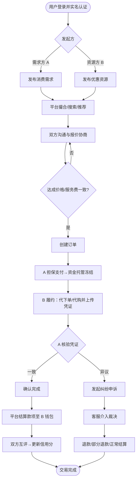
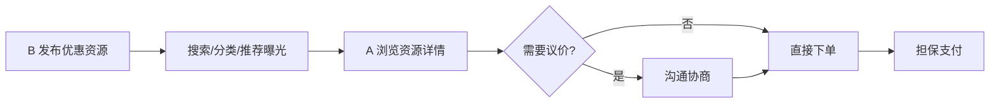
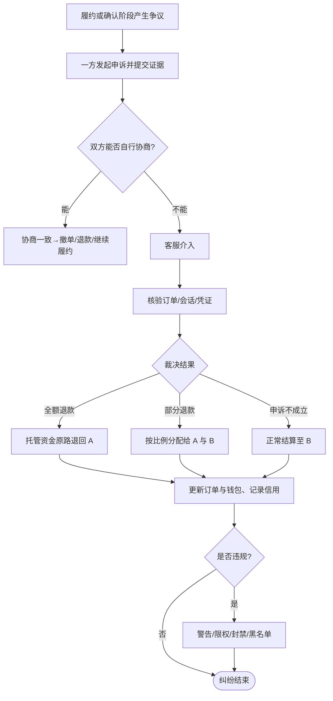
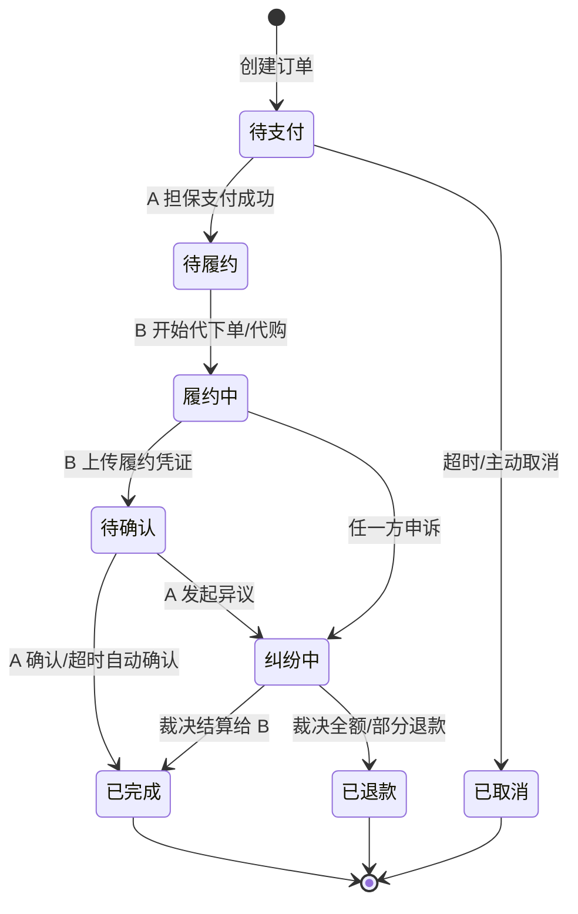

# 惠搭 HuiDa 消费优惠资源撮合平台 PRD

> 本文档依据需求规范 `tpl/prd_rules.md` 编写，基于产品简要说明 `sdp/IDEA201.md` 细化而成。

---

## 1. 项目概述

### 1.1 项目背景

日常生活中，不同用户之间存在消费优惠资源的不平衡：

- **资源闲置**：一部分用户拥有优惠券、会员权益、团购资格、促销资格等优惠资源，但因场景不匹配、时间限制或个人无需求，无法充分利用，造成资源浪费。
- **需求缺口**：另一部分用户有真实的消费需求，却缺少相应的优惠资源，只能以原价消费，成本偏高。
- **信息差**：供需双方彼此不认识、缺乏可信的对接渠道，优惠资源难以流动到需要它的人手中。

惠搭 HuiDa 希望通过互联网平台撮合供需双方：让拥有优惠资源的用户（B）在**符合相关平台规则**的前提下，为有消费需求的用户（A）提供代下单、代购等合规服务，从而帮助 A 降低消费成本、帮助 B 让闲置优惠资源产生收益，实现双赢。

**产品 Slogan**：让优惠找到需要它的人。

### 1.2 项目目标

| 层级 | 目标 | 衡量指标（示例） |
|---|---|---|
| 业务目标 | 建立消费优惠资源撮合交易市场 | 撮合成功率、GMV、月活跃交易用户数 |
| 用户目标（A） | 以更低成本完成消费 | 平均节省金额、需求满足率、复购率 |
| 用户目标（B） | 让闲置优惠资源合规变现 | 接单量、毛收益、履约完成率 |
| 平台目标 | 提供高效、可信、合规的撮合与交易环境 | 纠纷率、平均响应时长、信用体系覆盖率 |
| 阶段目标（MVP） | 跑通「发布—撮合—交易—履约—评价」核心闭环 | 核心流程完成率、首单转化时长 |

**长期愿景**：成为连接消费需求与优惠资源的综合性交易撮合平台。

### 1.3 项目范围

**本期（MVP）范围内：**

- 用户注册登录、实名认证与基础信用体系。
- 需求方（A）发布与管理消费需求。
- 资源方（B）发布与管理优惠资源。
- 供需撮合：搜索、浏览、推荐、匹配。
- 站内沟通与价格/服务费协商。
- 担保交易（资金托管）、下单、支付、履约、确认、结算。
- 交易评价与信用分累积。
- 纠纷申诉、客服介入与退款处理。
- 合规审核与基础风控。
- 消息通知（站内信 / 推送）。
- 平台运营管理后台。

**本期范围外（后续迭代）：**

- 自动化智能撮合算法的深度优化（MVP 以规则匹配 + 简单推荐为主）。
- 商家（B 端商户）入驻与多方合作分成体系。
- 多消费场景的深度垂直化定制（MVP 优先覆盖外卖、团购等高频场景）。
- 营销裂变、会员付费增值等商业化能力。

**关键约束：**

1. 所有优惠资源的使用必须符合**原始发放平台的规则与相关法律法规**，平台禁止违规倒卖、套现等行为。
2. B 提供的是「服务」（代下单/代购等），不一定涉及优惠券的所有权转让。
3. 资金采用平台担保托管，确认履约后再结算给 B，保障双方权益。

---

## 2. 用户角色定义

平台采用「同一账户、多重身份」设计，一个注册用户可同时具备需求方（A）与资源方（B）身份。

| 角色编号 | 角色名称 | 定位 | 核心诉求 | 主要权限 |
|---|---|---|---|---|
| R-A | 需求方 A | 有消费需求、缺少优惠的用户 | 低成本完成消费、交易安全 | 发布需求、筛选资源、下单支付、确认履约、评价、申诉 |
| R-B | 资源方 B | 拥有优惠资源、愿意提供合规服务的用户 | 闲置优惠合规变现 | 发布资源、接单、协商、履约服务、收款、评价、申诉 |
| R-U | 普通用户（未认证） | 已注册但未完成实名/资质认证 | 浏览与体验 | 浏览、收藏、受限的发布与交易（需认证后解锁） |
| R-OP | 平台运营 | 平台内容与交易秩序维护者 | 撮合效率、平台活跃 | 内容审核、推荐位管理、数据看板、活动配置 |
| R-CS | 客服 | 交易纠纷与用户咨询处理者 | 快速解决纠纷 | 查看订单、介入纠纷、发起退款、封禁建议 |
| R-RISK | 风控/审核 | 合规与风险控制 | 平台合规、资金安全 | 违规识别、账户处置、交易拦截、黑名单管理 |
| R-ADMIN | 系统管理员 | 平台配置与权限管理 | 系统稳定 | 角色权限配置、规则参数管理、日志审计 |

**角色关系说明：**

- R-A 与 R-B 是核心交易双方，二者可在同一账户上共存并可自由切换身份。
- R-OP / R-CS / R-RISK / R-ADMIN 为平台内部角色，服务于交易撮合、履约保障与合规风控。
- 未认证用户（R-U）在完成实名认证与（如作为 B）资质声明后，方可解锁完整的发布与交易权限。

---

## 3. 功能需求

> 优先级说明：**P0** = MVP 必须实现；**P1** = 重要，尽量实现；**P2** = 可延后迭代。

### 3.1 用户与账户模块（FR-USER）

| 需求编号 | 需求名称 | 需求描述 | 优先级 |
|---|---|---|---|
| FR-USER-01 | 注册与登录 | 支持手机号 + 验证码注册登录，支持第三方（微信等）授权登录；登录后统一进入个人账户。 | P0 |
| FR-USER-02 | 身份切换 | 同一账户支持「需求方 A / 资源方 B」双身份，可在个人中心自由切换，数据相互隔离展示。 | P0 |
| FR-USER-03 | 实名认证 | 交易与发布前需完成实名认证（姓名 + 身份证 + 人脸/活体校验），认证状态在资料页展示。 | P0 |
| FR-USER-04 | 个人资料 | 支持维护昵称、头像、常用消费场景、所在城市、简介等信息。 | P1 |
| FR-USER-05 | 资质声明（B） | 资源方需勾选并承诺「合规使用优惠资源」协议，声明所持优惠资源类型与适用平台。 | P0 |
| FR-USER-06 | 账户安全 | 支持修改手机号、登录密码、支付密码、登录设备管理与异常登录提醒。 | P1 |
| FR-USER-07 | 钱包账户 | 提供余额、可提现金额、冻结（托管中）金额、收支明细展示。 | P0 |
| FR-USER-08 | 注销账户 | 支持在满足无进行中订单、无未结算资金等条件下申请注销账户。 | P2 |

### 3.2 需求发布与管理模块（FR-DEM，面向 A）

| 需求编号 | 需求名称 | 需求描述 | 优先级 |
|---|---|---|---|
| FR-DEM-01 | 发布消费需求 | A 可发布需求，填写消费场景（外卖/团购/会员/其他）、商品或门店、期望优惠、心理价位/预算、时效要求、备注。 | P0 |
| FR-DEM-02 | 需求分类与标签 | 需求按消费场景归类并打标签，便于检索与撮合。 | P0 |
| FR-DEM-03 | 需求管理 | A 可查看、编辑、下架、删除自己发布的需求，并展示状态（待接单/已匹配/已完成/已关闭）。 | P0 |
| FR-DEM-04 | 需求有效期 | 需求可设置有效期，到期自动关闭；支持续期。 | P1 |
| FR-DEM-05 | 直接下单资源 | A 除发布需求外，也可直接浏览 B 发布的资源并发起下单（见 FR-RES / FR-TRADE）。 | P0 |
| FR-DEM-06 | 收藏与订阅 | A 可收藏感兴趣的资源，或订阅某类优惠的到达提醒。 | P2 |

### 3.3 优惠资源发布与管理模块（FR-RES，面向 B）

| 需求编号 | 需求名称 | 需求描述 | 优先级 |
|---|---|---|---|
| FR-RES-01 | 发布优惠资源 | B 可发布可提供的优惠资源，填写资源类型（优惠券/会员/团购/促销资格）、适用平台与门店、服务方式（代下单/代购/其他）、可服务时间、报价与服务费。 | P0 |
| FR-RES-02 | 合规声明与限制 | 发布时需声明资源来源合规、使用符合原平台规则；系统对明显违规内容（如套现、倒卖）进行拦截与提示。 | P0 |
| FR-RES-03 | 资源管理 | B 可查看、编辑、上下架、删除自己发布的资源，展示状态与浏览/接单数据。 | P0 |
| FR-RES-04 | 库存/可服务量 | B 可设置资源的可服务次数或库存，接单后自动扣减。 | P1 |
| FR-RES-05 | 接单大厅 | B 可浏览 A 发布的需求（接单大厅），主动应答/报价抢单。 | P0 |
| FR-RES-06 | 报价与议价 | B 针对具体需求提交报价（含服务费），可与 A 多轮议价。 | P0 |

### 3.4 撮合与匹配模块（FR-MATCH）

| 需求编号 | 需求名称 | 需求描述 | 优先级 |
|---|---|---|---|
| FR-MATCH-01 | 搜索 | 支持按关键词、消费场景、平台、门店、价格区间、城市等条件搜索需求与资源。 | P0 |
| FR-MATCH-02 | 分类浏览 | 提供按场景/平台的分类频道与列表页，支持排序（最新、价格、信用、距离）。 | P0 |
| FR-MATCH-03 | 规则匹配 | 基于场景、平台、门店、价格、时效等维度，对需求与资源做规则化匹配与推荐。 | P0 |
| FR-MATCH-04 | 智能推荐 | 根据用户历史行为与偏好推荐资源/需求（MVP 以简单推荐为主）。 | P1 |
| FR-MATCH-05 | 匹配通知 | 匹配成功或有新应答时，实时通知相关用户（见 FR-NOTIFY）。 | P0 |
| FR-MATCH-06 | 详情页 | 需求/资源详情页展示完整信息、发布者信用、评价与「沟通/下单/应答」入口。 | P0 |

### 3.5 沟通与协商模块（FR-CHAT）

| 需求编号 | 需求名称 | 需求描述 | 优先级 |
|---|---|---|---|
| FR-CHAT-01 | 站内即时通讯 | A 与 B 可就某条需求/资源发起一对一会话，支持文字、图片。 | P0 |
| FR-CHAT-02 | 协商留痕 | 价格、服务方式、时效等协商内容在会话与订单中留痕，作为履约与纠纷依据。 | P0 |
| FR-CHAT-03 | 敏感信息保护 | 对诱导脱离平台交易、违规联系方式等做识别与风险提示（风控联动）。 | P1 |
| FR-CHAT-04 | 快捷短语 | 提供常见协商话术模板，提升沟通效率。 | P2 |

### 3.6 交易与支付模块（FR-TRADE）

| 需求编号 | 需求名称 | 需求描述 | 优先级 |
|---|---|---|---|
| FR-TRADE-01 | 创建订单 | 双方就价格/服务费达成一致后生成订单，明确商品/服务、金额、时效、履约方式。 | P0 |
| FR-TRADE-02 | 担保支付 | A 支付款项进入平台托管账户（资金冻结），确认履约前不结算给 B。 | P0 |
| FR-TRADE-03 | 支付方式 | 支持微信支付、支付宝、余额等主流支付方式。 | P0 |
| FR-TRADE-04 | 金额构成 | 订单金额 = 商品/服务实付成本 + B 服务费（+ 平台服务费，如启用），明细透明展示。 | P0 |
| FR-TRADE-05 | 订单状态机 | 订单状态：待支付→已支付/待履约→履约中→待确认→已完成；含取消、退款、纠纷等分支。 | P0 |
| FR-TRADE-06 | 确认与结算 | A 确认收货/服务完成后，平台将款项结算至 B 钱包（可设自动确认时限）。 | P0 |
| FR-TRADE-07 | 超时处理 | 支付超时自动取消；履约/确认超时触发提醒与自动流转规则。 | P1 |
| FR-TRADE-08 | 平台服务费 | 支持按比例/固定值配置平台服务费与结算规则（可配置开关）。 | P1 |

### 3.7 服务履约模块（FR-FULFILL）

| 需求编号 | 需求名称 | 需求描述 | 优先级 |
|---|---|---|---|
| FR-FULFILL-01 | 履约凭证 | B 完成代下单/代购后上传凭证（订单截图、券码、配送信息等），提交 A 核验。 | P0 |
| FR-FULFILL-02 | A 核验 | A 核对凭证与实物/服务是否一致，可选择确认完成或发起异议。 | P0 |
| FR-FULFILL-03 | 履约时效 | 记录承诺时效与实际完成时效，超时可在评价与信用中体现。 | P1 |
| FR-FULFILL-04 | 履约沟通 | 履约过程中的补充沟通在订单会话内留痕。 | P1 |

### 3.8 信用与评价模块（FR-CREDIT）

| 需求编号 | 需求名称 | 需求描述 | 优先级 |
|---|---|---|---|
| FR-CREDIT-01 | 交易评价 | 订单完成后 A、B 可互评（星级 + 标签 + 文字），评价公开可查。 | P0 |
| FR-CREDIT-02 | 信用分 | 基于实名、履约率、评价、纠纷与违规记录计算信用分/等级。 | P0 |
| FR-CREDIT-03 | 信用展示 | 在用户主页、详情页、撮合排序中展示信用分与历史评价。 | P0 |
| FR-CREDIT-04 | 信用权益 | 高信用用户享有更高曝光/推荐权重与更高交易额度（可配置）。 | P2 |

### 3.9 纠纷与售后模块（FR-DISPUTE）

| 需求编号 | 需求名称 | 需求描述 | 优先级 |
|---|---|---|---|
| FR-DISPUTE-01 | 发起申诉 | 交易任一方可在履约/确认阶段发起申诉，说明原因并提交证据。 | P0 |
| FR-DISPUTE-02 | 客服介入 | 客服可查看订单、会话、凭证，组织协商并作出裁决（退款/部分退款/正常结算）。 | P0 |
| FR-DISPUTE-03 | 退款处理 | 依据裁决将托管资金原路退回或按比例分配，更新订单与钱包。 | P0 |
| FR-DISPUTE-04 | 违规处置 | 对确认违规的账户采取警告、限权、封禁、列入黑名单等处置。 | P0 |
| FR-DISPUTE-05 | 纠纷时效 | 设置申诉与举证的时限，超时按规则默认处理。 | P1 |

### 3.10 合规与风控模块（FR-RISK）

| 需求编号 | 需求名称 | 需求描述 | 优先级 |
|---|---|---|---|
| FR-RISK-01 | 内容审核 | 对发布的需求/资源、会话内容进行合规审核（机器 + 人工），拦截违规信息。 | P0 |
| FR-RISK-02 | 交易风控 | 识别异常交易（套现、刷单、诱导脱离平台、频繁纠纷）并拦截或标记。 | P0 |
| FR-RISK-03 | 黑名单 | 维护违规用户/内容黑名单，限制其发布与交易。 | P1 |
| FR-RISK-04 | 合规协议 | 提供用户协议、隐私政策、合规使用承诺等，关键操作需确认。 | P0 |
| FR-RISK-05 | 操作审计 | 记录关键操作与风控处置日志，支持追溯。 | P1 |

### 3.11 消息通知模块（FR-NOTIFY）

| 需求编号 | 需求名称 | 需求描述 | 优先级 |
|---|---|---|---|
| FR-NOTIFY-01 | 站内信/推送 | 对匹配成功、应答报价、订单状态变更、履约提醒、纠纷进展等发送通知。 | P0 |
| FR-NOTIFY-02 | 通知中心 | 统一的消息中心，分类展示交易、互动、系统通知，支持已读/未读。 | P0 |
| FR-NOTIFY-03 | 提醒策略 | 关键节点（支付、履约、确认、举证）超时提醒，减少流程中断。 | P1 |

### 3.12 平台运营后台模块（FR-ADMIN）

| 需求编号 | 需求名称 | 需求描述 | 优先级 |
|---|---|---|---|
| FR-ADMIN-01 | 内容审核台 | 审核需求/资源/评价，处理举报，管理推荐位与频道。 | P0 |
| FR-ADMIN-02 | 订单与资金 | 查询订单、托管资金与结算记录，处理退款与对账。 | P0 |
| FR-ADMIN-03 | 纠纷工作台 | 客服处理申诉、组织协商、作出裁决并执行处置。 | P0 |
| FR-ADMIN-04 | 用户与信用 | 管理用户资料、认证、信用分与账户处置。 | P0 |
| FR-ADMIN-05 | 规则配置 | 配置平台服务费率、结算规则、超时时限、匹配与推荐参数。 | P1 |
| FR-ADMIN-06 | 数据看板 | 展示核心经营指标（发布量、撮合成功率、GMV、纠纷率等）。 | P1 |
| FR-ADMIN-07 | 权限管理 | 管理内部角色（运营/客服/风控/管理员）的权限分配。 | P1 |

---

## 4. 业务流程

### 4.1 核心交易主流程

平台存在两条互为补充的撮合路径：**需求驱动**（A 先发需求，B 应答）与**资源驱动**（B 先发资源，A 直接下单）。两者在「创建订单」后汇入同一套交易与履约主流程。

**主流程步骤说明：**

| 步骤 | 角色 | 操作 | 关联需求 |
|---|---|---|---|
| 1 | A / B | 登录、实名认证、（B）完成资质声明 | FR-USER-01/03/05 |
| 2 | A | 发布消费需求（或浏览资源直接下单） | FR-DEM-01/05 |
| 2' | B | 发布优惠资源（或在接单大厅应答需求） | FR-RES-01/05 |
| 3 | 平台 | 撮合、搜索、推荐并通知匹配结果 | FR-MATCH-01~05 |
| 4 | A & B | 站内沟通，就价格与服务费协商一致 | FR-CHAT-01/02、FR-RES-06 |
| 5 | 平台 | 创建订单，明确金额构成与履约方式 | FR-TRADE-01/04 |
| 6 | A | 担保支付，款项进入平台托管账户冻结 | FR-TRADE-02/03 |
| 7 | B | 履约（代下单/代购）并上传凭证 | FR-FULFILL-01 |
| 8 | A | 核验凭证，确认完成或发起异议 | FR-FULFILL-02 |
| 9 | 平台 | 确认后将款项结算至 B 钱包 | FR-TRADE-06 |
| 10 | A & B | 互评并更新信用分 | FR-CREDIT-01/02 |

### 4.2 需求驱动流程（A 发需求 → B 应答）

- A 发布需求后，系统按场景/平台/门店/价格/时效进行规则匹配并推送给合适的 B。
- 多个 B 可分别报价，A 依据报价、信用分、历史评价择优选定。
- 选定后进入主流程的「创建订单」环节。

### 4.3 资源驱动流程（B 发资源 → A 直接下单）

- A 可直接从资源详情页发起下单，价格明确时可跳过议价直接进入支付。
- 若资源需按具体需求定制（如指定门店/商品），则先沟通协商再下单。

### 4.4 纠纷与退款流程

- 申诉与举证均有时限，超时按默认规则处理（FR-DISPUTE-05）。
- 客服裁决基于订单信息、协商留痕与履约凭证，确保客观公正。
- 退款资金流向同步更新订单状态与双方钱包，并计入信用记录。

### 4.5 订单状态流转

| 订单状态 | 含义 | 触发动作 |
|---|---|---|
| 待支付 | 订单已创建，等待 A 支付 | 创建订单 |
| 待履约 | 款项已托管，等待 B 服务 | A 支付成功 |
| 履约中 | B 正在代下单/代购 | B 开始履约 |
| 待确认 | B 已提交凭证，等待 A 核验 | B 上传凭证 |
| 已完成 | 交易成功，款项已结算给 B | A 确认 / 超时自动确认 |
| 纠纷中 | 存在争议，客服介入处理 | 一方发起申诉 |
| 已退款 | 依裁决完成退款 | 客服裁决退款 |
| 已取消 | 订单取消（未支付或协商取消） | 超时 / 主动取消 |

### 4.6 关键业务规则

1. **合规优先**：B 提供的是合规「服务」，优惠资源的使用必须符合原发放平台规则与法律法规，禁止套现、倒卖等违规行为（FR-RES-02、FR-RISK-01/02）。
2. **担保交易**：A 支付的款项由平台托管，确认履约后方结算给 B，避免「先款后货」风险（FR-TRADE-02/06）。
3. **协商留痕**：价格、服务方式、时效等关键协商内容须在平台内留痕，作为履约与纠纷裁决依据（FR-CHAT-02）。
4. **信用驱动**：信用分影响撮合排序、曝光权重与交易额度，形成正向激励（FR-CREDIT-02/03/04）。
5. **超时兜底**：支付、履约、确认、举证等关键节点均设时限与自动流转/提醒规则，防止流程悬挂（FR-TRADE-07、FR-NOTIFY-03）。

---

- **文档版本**：V1.0
- **创建日期**：2026-11-12
- **最后更新**：2026-11-12
- **维护人员**：产品团队（Product Team）
- **关联文档**：`sdp/IDEA101.md`（产品构想）、`sdp/IDEA201.md`（简要说明）、`tpl/prd_rules.md`（需求规范）
